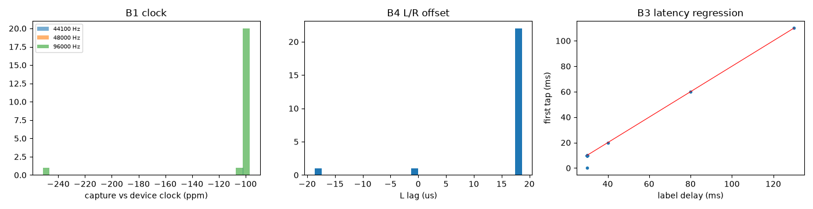
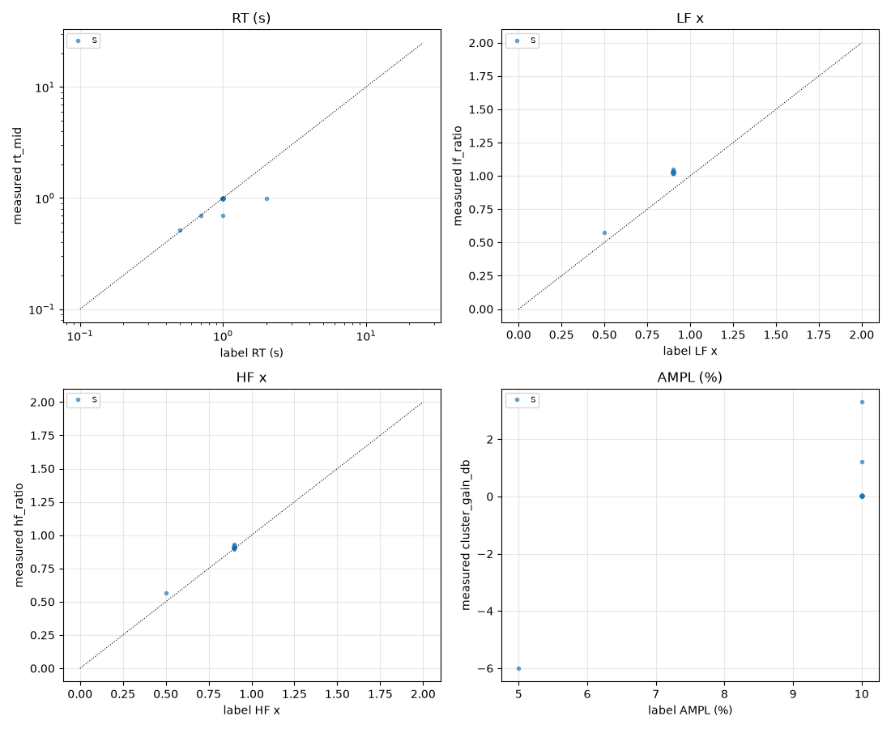

# Harness report: synthetic

25 files from `/private/tmp/claude-501/-Users-leighpierce--claude-spares-spare-4SGVQG/8646f49b-65c5-4bd3-b011-344e32af5b52/scratchpad/synthlib`. Per-file detail: `files.csv`. Pairs: `pairs.csv`. Label audit: `label_disagreements.csv`. Machine-readable summary: `library.json`.

## A. Ingest and QC

Sample rates: {44100: 1, 48000: 1, 96000: 23}. Errors: 0.

| flag | files | meaning |
|---|---|---|
| `pre_onset_energy` | 24 | energy before the onset > noise + 6 dB (sweep-deconvolution artefacts?) |
| `other_rate_version` | 8 | same setting exists at another sample rate (resampled copy or separate capture; not separable by residual) |
| `has_repeat_capture` | 6 | an independent capture of the same setting exists (useful for E1) |
| `label_group_inconsistent` | 5 | files with identical labels differ in content |
| `duplicate_with_different_label` | 3 | same content as a file with different labels |
| `duplicate_file` | 3 | same capture as a same-label file at the same rate |
| `fade_out` | 2 | tail falls faster than the reverb decay: a fade was applied (biases RT) |
| `zero_tail` | 2 | ends in digital silence (gated or trimmed tail) |
| `truncated_before_noise_floor` | 2 | file ends while the reverb is still decaying |
| `label_mismatch_amp` | 2 | label audit, see section C4 |
| `label_mismatch_rt` | 2 | label audit, see section C4 |
| `clipped` | 1 | samples at or above -0.01 dBFS |
| `mono` | 1 | single-channel file (analysed as dual mono) |
| `no_pre_roll` | 1 | less than 2 ms before the onset (pre-onset check impossible; possible trimmed start) |
| `label_mismatch_delay` | 1 | label audit, see section C4 |
| `unlabelled_duplicate_of_labelled_file` | 1 | no labels, but same content as a labelled file (labels can be inferred) |

**A4 cluster fingerprint:** {'ok': 21, 'no_cluster': 1, 'inverted_R': 1, 'novel_cluster': 1, 'swapped': 1}. `swapped`/`inverted_*` files must be fixed before any stereo analysis; `novel_cluster` files have a cluster pattern not in the templates (new program or firmware).

**A5/A7 pair comparison:** 157 pairs compared. Counts by (same label, class): {(False, 'copy'): 26, (False, 'different'): 20, (False, 'repeat'): 10, (False, 'repeat_or_resampled'): 10, (True, 'copy'): 6, (True, 'different'): 55, (True, 'near'): 8, (True, 'repeat'): 9, (True, 'repeat_or_resampled'): 13}. `copy` = same capture; `repeat` = separate capture of the same setting (residual at noise level); `repeat_or_resampled` = as `repeat` but across sample rates; `near` = same setting with extra differences (time variance? drift?); `different` = different settings.
Repeat/near pairs, median residual L -74.3 dB, R -74.4 dB. If L is consistently worse than R, that supports eugtone's L-only modulation report (spec E1).

**A6 normalisation:** 84% of files peak at -1.6 dBFS (peak-normalised likely: True). Cluster-gain spread within same-label groups: 3.31 dB. Amplitude will be measured as **cluster_to_reverb_db**.

## B. Calibration

- **B1 clock @ 44100 Hz:** median -101.9 ppm (IQR 0.0), n=1, off-grid files: 0.
- **B1 clock @ 48000 Hz:** median -101.7 ppm (IQR 0.0), n=1, off-grid files: 0.
- **B1 clock @ 96000 Hz:** median -99.2 ppm (IQR 0.0), n=22, off-grid files: 0.
- **B2 kernel @ 44100 Hz:** from 1 files; gain vs reference +0.00 dB, max magnitude deviation 0.01 dB (100 Hz–11 kHz), excess phase 0.001 rad, within-library spread 0.551 dB.
- **B2 kernel @ 48000 Hz:** from 1 files; gain vs reference +0.00 dB, max magnitude deviation 0.01 dB (100 Hz–11 kHz), excess phase 0.001 rad, within-library spread 0.552 dB.
- **B2 kernel @ 96000 Hz:** from 8 files; gain vs reference -0.00 dB, max magnitude deviation 0.00 dB (100 Hz–11 kHz), excess phase 0.000 rad, within-library spread 0.547 dB.
- **B3 latency:** first tap = 1.0000 x delay + -20.021 ms (rms residual 0.004 ms, n=23, outliers 1).
- **B4 L/R offset:** median 18.61 us (MAD 0.00), outliers 0.
- **B5 unit fingerprint:** loop sets {'S': 24, 'U:1321-1389-1461': 1}; L-R noise 6.65 dB (reference 6.6); L/R offset vs reference 0.00847 us.
  - 1 loop set(s) not in config.known_loopsets (expected for M/L until added; a set close to S would suggest different firmware)
  - some cluster patterns differ from the reference templates (other programs, or different firmware)

## C. Settings inference

Label coverage (fraction of files with each label): program 96%, rt 96%, lf 96%, hf 96%, delay 96%, amp 96%, lp 0%.
**1 files matched no naming pattern.** Run with `--templates` and add a pattern to config.json.

### C3 step tables

**Program S**
- rt (`rt_mid`): 3 measured clusters (expected 16); 4 labelled values, monotonic: False

| label | count | median | mad | min | max |
|---|---|---|---|---|---|
| 0.5 | 1 | 0.512 | 0 | 0.512 | 0.512 |
| 0.7 | 1 | 0.7 | 0 | 0.7 | 0.7 |
| 1 | 21 | 0.987 | 4.28e-07 | 0.7 | 0.996 |
| 2 | 1 | 0.987 | 0 | 0.987 | 0.987 |

- lf (`lf_ratio`): 2 measured clusters (expected 16); 2 labelled values, monotonic: True

| label | count | median | mad | min | max |
|---|---|---|---|---|---|
| 0.5 | 1 | 0.578 | 0 | 0.578 | 0.578 |
| 0.9 | 23 | 1.03 | 0.000414 | 1.02 | 1.05 |

- hf (`hf_ratio`): 2 measured clusters (expected 10); 2 labelled values, monotonic: True

| label | count | median | mad | min | max |
|---|---|---|---|---|---|
| 0.5 | 1 | 0.568 | 0 | 0.568 | 0.568 |
| 0.9 | 23 | 0.909 | 2.16e-05 | 0.893 | 0.93 |

- amp (`cluster_to_reverb_db`): 5 measured clusters (expected 11); 2 labelled values, monotonic: True

| label | count | median | mad | min | max |
|---|---|---|---|---|---|
| 5 | 1 | 23.1 | 0 | 23.1 | 23.1 |
| 10 | 22 | 29.1 | 0.000156 | 28.3 | 31.2 |

- delay (`tap0_ms`): 5 measured clusters (expected 1000); 4 labelled values, monotonic: True
- lp (`lp_corner_khz`): 1 measured clusters (expected 8)

### C4 label audit: 5 disagreements

| param | files |
|---|---|
| amp | 2 |
| delay | 1 |
| rt | 2 |

| relpath | param | label | measured | deviation |
|---|---|---|---|---|
| qc/EMT246_S_RT1.0_LF0.9_HF0.9_D30_A10_mislabelled.wav | rt | 1 | 0.7 | -0.287 |
| qc/EMT246_S_RT2.0_LF0.9_HF0.9_D30_A10_dup_other_label.wav | rt | 2 | 0.987 | -1.01 |
| qc/EMT246_S_RT1.0_LF0.9_HF0.9_D30_A10_clipped.wav | amp | 10 | 28.3 | -0.804 |
| qc/EMT246_S_RT1.0_LF0.9_HF0.9_D30_A10_mislabelled.wav | amp | 10 | 30 | 0.898 |
| qc/EMT246_S_RT1.0_LF0.9_HF0.9_D30_A10_trimmed.wav | delay | 30 | -3.58e-07 | -9.98 |

### C5 coverage

Files per program: {'S': 25}

Best available sweep for each planned set: the largest group of files where only the swept parameter changes.

| planned set | program | have | need | swept values | held fixed |
|---|---|---|---|---|---|
| core_rt | S | 4 ⚠ | 16 | 0.5, 0.7, 1, 2 | lf=0.9, hf=0.9, amp=10.0, delay=30.0, lp=? |
| core_rt | M | 0 ⚠ | 16 |  |  |
| core_rt | L | 0 ⚠ | 16 |  |  |
| lf_law | S | 2 ⚠ | 16 | 0.5, 0.9 | rt=1.0, hf=0.9, amp=10.0, delay=30.0, lp=? |
| lf_law | M | 0 ⚠ | 16 |  |  |
| lf_law | L | 0 ⚠ | 16 |  |  |
| hf_law | S | 2 ⚠ | 10 | 0.5, 0.9 | rt=1.0, lf=0.9, amp=10.0, delay=30.0, lp=? |
| hf_law | M | 0 ⚠ | 10 |  |  |
| hf_law | L | 0 ⚠ | 10 |  |  |
| cluster | S | 3 | 3 | 0, 5, 10 | rt=1.0, lf=0.9, hf=0.9, delay=30.0, lp=? |
| cluster | M | 0 ⚠ | 3 |  |  |
| cluster | L | 0 ⚠ | 3 |  |  |
| lowpass | S | 0 ⚠ | 8 |  |  |
| predelay | S | 4 | 3 | 30, 40, 80, 130 | rt=1.0, lf=0.9, hf=0.9, amp=10.0, lp=? |

RT × other-parameter count matrices: `coverage_<program>_rt_x_<param>.csv`.
