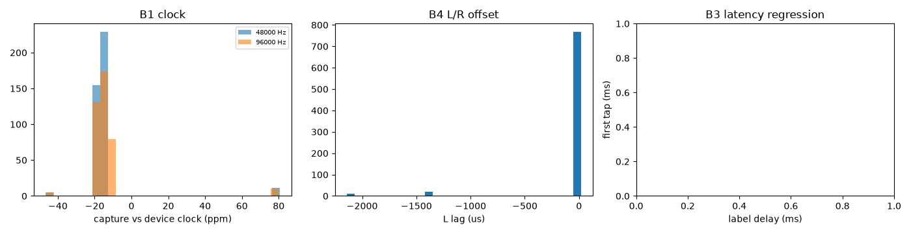
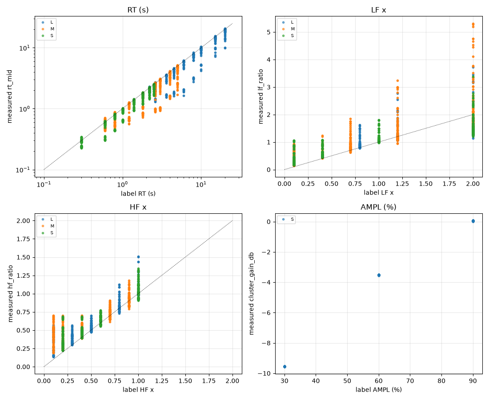

# Harness report: tomkin

4874 files from `/Users/leighpierce/Git/246/irs/EMT 246 captures`. Per-file detail: `files.csv`. Pairs: `pairs.csv`. Label audit: `label_disagreements.csv`. Machine-readable summary: `library.json`.

## A. Ingest and QC

Sample rates: {48000: 2437, 96000: 2437}. Errors: 0.

| flag | files | meaning |
|---|---|---|
| `zero_tail` | 3937 | ends in digital silence (gated or trimmed tail) |
| `short_file` | 3492 | shorter than onset + RT |
| `has_repeat_capture` | 3474 | an independent capture of the same setting exists (useful for E1) |
| `fade_out` | 3325 | tail falls faster than the reverb decay: a fade was applied (biases RT) |
| `no_pre_roll` | 2613 | less than 2 ms before the onset (pre-onset check impossible; possible trimmed start) |
| `label_mismatch_rt` | 2381 | label audit, see section C4 |
| `pre_onset_energy` | 2140 | energy before the onset > noise + 6 dB (sweep-deconvolution artefacts?) |
| `label_mismatch_lf` | 1814 | label audit, see section C4 |
| `label_mismatch_hf` | 1685 | label audit, see section C4 |
| `truncated_before_noise_floor` | 1212 | file ends while the reverb is still decaying |
| `duplicate_with_different_label` | 572 | same content as a file with different labels |
| `resampled_copy` | 395 | same capture as a same-label file at another sample rate |
| `label_mismatch_delay` | 391 | label audit, see section C4 |
| `label_group_inconsistent` | 336 | files with identical labels differ in content |
| `tail_too_short_for_loops` | 303 | not enough decay above the noise floor to identify loops |
| `clock_outlier` | 30 | capture clock differs from the library median by > 30 ppm (different interface/session, or resampled) |

**A4 cluster fingerprint:** {'no_cluster': 4075, 'ok': 768, 'novel_cluster': 31}. `swapped`/`inverted_*` files must be fixed before any stereo analysis; `novel_cluster` files have a cluster pattern not in the templates (new program or firmware).

**A5/A7 pair comparison:** 50749 pairs compared. Counts by (same label, class): {(False, 'different'): 40116, (False, 'near'): 5751, (False, 'repeat'): 1226, (False, 'repeat_or_resampled'): 1219, (True, 'copy'): 395, (True, 'different'): 168, (True, 'near'): 137, (True, 'repeat'): 1737}. `copy` = same capture; `repeat` = separate capture of the same setting (residual at noise level); `repeat_or_resampled` = as `repeat` but across sample rates; `near` = same setting with extra differences (time variance? drift?); `different` = different settings.
Repeat/near pairs, median residual L -33.1 dB, R -33.2 dB. If L is consistently worse than R, that supports eugtone's L-only modulation report (spec E1).

**A6 normalisation:** 7% of files peak at -26.4 dBFS (peak-normalised likely: False). Cluster-gain spread within same-label groups: 0.0511 dB. Amplitude will be measured as **cluster_gain_db**.

## B. Calibration

- **B1 clock @ 48000 Hz:** median -15.2 ppm (IQR 4.8), n=400, off-grid files: 0.
- **B1 clock @ 96000 Hz:** median -13.2 ppm (IQR 4.8), n=399, off-grid files: 0.
- **B2 kernel @ 48000 Hz:** from 8 files; gain vs reference -22.94 dB, max magnitude deviation 0.64 dB (100 Hz–11 kHz), excess phase 0.202 rad, within-library spread 0.0133 dB.
- **B2 kernel @ 96000 Hz:** from 8 files; gain vs reference -22.93 dB, max magnitude deviation 0.64 dB (100 Hz–11 kHz), excess phase 0.202 rad, within-library spread 0.00847 dB.
- **B3 latency:** not_enough_delay_values (n=799, distinct delays=1).
- **B4 L/R offset:** median 19.20 us (MAD 0.00), outliers 0.
- **B5 unit fingerprint:** loop sets {'?': 3122, 'U:1108-1254-1386': 512, 'S': 190, 'U:2641': 80, 'U:1108': 67, 'U:231-628-803-1108-1292-2032': 62, 'U:1321-1389-1461': 59, 'U:5279': 55, 'U:628': 44, 'U:628-1108-1386': 33, 'U:1108-1386': 32, 'U:1321-1389': 32, 'U:5279-10826-12176-16105-16663-17455-17957': 29, 'U:5279-10826-12176': 28, 'U:628-1108': 27, 'U:231-803-1108-1292-2032': 27, 'U:231-1108-1292-2032': 26, 'U:1108-1254': 23, 'U:924-1108-1254-1386': 21, 'U:1321': 20, 'U:5280': 18, 'U:231-1108-1292': 17, 'U:5279-10826-11620-12176-16105-16663-17455-17957': 15, 'U:231-248-628-803-1108': 15, 'U:1321-1389-2922': 14, 'U:5279-10826': 12, 'U:2641-5416': 11, 'U:2641-5416-6090': 10, 'U:248-628': 10, 'U:2641-5416-5814-6090-8057-8335-8731-8983-11508-11624-14677-17040-17318-17714': 9, 'U:231-628-803-1108-1292': 9, 'U:231-248-340-628-803-1108': 8, 'U:2641-5416-11512': 7, 'U:231-1108-1254-1292-2032': 7, 'U:924-1108-1254-1292-1386': 7, 'U:231-628-1108': 7, 'U:5279-10826-12176-16105-17455': 6, 'U:5279-10827': 6, 'U:1108-1292': 6, 'U:231-248-310-318-438-446-524-628': 6, 'U:231-628-803-1108': 6, 'U:231-248-310-480-628-803-1108': 6, 'U:1389': 6, 'U:5279-6341-10826-11620-12176-16105-16663-17455-17957': 5, 'U:231-248-480-628-803-1108': 5, 'U:5279-10827-12177': 4, 'U:920-2641': 4, 'U:1108-1254-1292-1386': 4, 'U:1321-1389-3174': 4, 'U:5279-10826-12176-16106-17455': 3, 'U:2642': 3, 'U:924-1108-1254-1292-1386-2032': 3, 'U:1108-1254-1292': 3, 'U:231-248-310-340-480-628-803': 3, 'U:460': 3, 'U:1321-2922': 3, 'U:5279-10826-12176-16105-16663-17455': 3, 'U:248-438-446-628': 3, 'U:5279-10826-12176-16106': 2, 'U:1836-5280': 2, 'U:5279-10826-11623-12176-16105-17455': 2, 'U:5279-10826-12176-16106-17456': 2, 'U:5279-10826-12176-17455': 2, 'U:2641-11512': 2, 'U:2641-5416-6090-8057-8335-8731-11510-11624-14677-17040-17318-17714': 2, 'U:2641-5416-6090-8057-8335-11510-17040-17318': 2, 'U:2641-5416-5814-6090-8057-8335-8731-11508-11624-14677-17040-17318-17714': 2, 'U:2641-5416-6090-8057-8335-11510-14677-17040-17318': 2, 'U:2641-5416-6090-8057-11510': 2, 'U:2641-5416-6090-8057-8335-11510-17318': 2, 'U:231-248-340-480-628-803-1108': 2, 'U:231-248-340-480-628-803': 2, 'U:231-340-628-803-1108': 2, 'U:231-1108': 2, 'U:1108-1254-1292-2032': 2, 'U:248-628-1108': 2, 'U:231-628-1108-1292-2032': 2, 'U:231-248-340-480-628': 2, 'U:534-603-1108-1386-1428': 2, 'U:534-1108-1137-1254-1386-1428': 2, 'U:534-1108-1254-1386': 2, 'U:231-248-310-316-318-438-446-524-628': 2, 'U:231-628-1108-1292': 2, 'U:5279-10826-11625-12176': 2, 'U:2641-5416-6090-11512': 2, 'U:2641-5416-5814-6090-8057-8335-8731-11508-11624-14677-17040-17318': 2, 'U:231-803-1108-1292': 2, 'U:5279-10826-11620-12176-16105-16663-17455': 1, 'U:5279-10826-11623-12176-16106-17455': 1, 'U:5279-10827-11625-12176': 1, 'U:2641-5416-6090-17040-17318': 1, 'U:2641-5416-6090-8057-8335-11508-11624': 1, 'U:2641-5416-6090-17318': 1, 'U:2641-5416-5814-6090-8057-8335-8731-11508-11624-14677': 1, 'U:2641-5416-6090-8335-11508-17318': 1, 'U:2641-5416-6090-8057-8335-8731-11508-11624-14677-17040-17318-17714': 1, 'U:2641-5416-5816-6090-8057-8335-8731-11510-11624-14677-17040-17318-17714': 1, 'U:231-248-256-310-316-318-438-446-524-628': 1, 'U:231-248-310-316-438-446-524-628': 1, 'U:231-583-803-1108-1292-1485-2032': 1, 'U:231-583-803-1108-1292': 1, 'U:231-248-628': 1, 'U:231-1108-1254': 1, 'U:248-628-1108-1386': 1, 'U:231-248-310-340-628-803-1108': 1, 'U:248-438-628': 1, 'U:231-248-480-628-1108': 1, 'U:231-248-446-628': 1, 'U:231-248-310-438-446-524-628': 1, 'U:231-803-1108-1254-1292-2032': 1, 'U:1321-1389-3174-7935': 1, 'U:5279-10826-12176-16106-16663-17455': 1, 'U:5279-10826-11623-12176': 1, 'U:920': 1, 'U:2641-5416-6090-8057-8335-11510': 1, 'U:2641-5416-6090-8057-8335-11510-11624': 1, 'U:2641-5416-5814-6090-8057-8335-8731-8983-11508-11624-14677-17040-17318': 1, 'U:2641-5416-6090-8057-8335-8731-8983-11510-11624-14677-17040-17318-17714': 1, 'U:2641-5416-6090-14677-17040-17318': 1, 'U:2641-5416-6090-8057-8335-11508-17040-17318': 1, 'U:2641-5416-6090-8057-8335-11510-11624-14677-17040-17318': 1, 'U:2641-5416-6090-11510': 1, 'U:2641-5416-6090-8057-8335-8731-8983-11508-11624-14677-17040-17318-17714': 1, 'U:231-248-256-310-318-438-446-524-628': 1, 'U:231-256-628': 1, 'U:231-583-1108-1292-2032': 1, 'U:231-1108-1254-1292': 1, 'U:1017-2103': 1, 'U:231-248-310-480-628': 1, 'U:1017-1108-1254-1386': 1, 'U:1108-1292-2032': 1, 'U:231-803-1108': 1, 'U:803-1108': 1, 'U:231-248-310-340-480-628-803-1108': 1, 'U:810-1108-1386': 1, 'U:810-1108': 1, 'U:810': 1, 'U:810-1108-1254-1386': 1, 'U:534-1137-1428': 1, 'U:534-1108': 1, 'U:248-438-446-524-628': 1, 'U:231-248-310-628': 1, 'U:1321-1389-1461-3174': 1}; L-R noise 0.327 dB (reference 6.6); L/R offset vs reference 0.596 us.
  - 141 loop set(s) not in config.known_loopsets (expected for M/L until added; a set close to S would suggest different firmware)
  - some cluster patterns differ from the reference templates (other programs, or different firmware)

## C. Settings inference

Label coverage (fraction of files with each label): program 100%, rt 57%, lf 57%, hf 57%, delay 100%, amp 57%, lp 100%, span 43%, early 43%, late 43%.

### C3 step tables

**Program L**
- rt (`rt_mid`): 21 measured clusters (expected 16); 9 labelled values, monotonic: True

| label | count | median | mad | min | max |
|---|---|---|---|---|---|
| 2.2 | 80 | 2.06 | 0.154 | 1.67 | 2.3 |
| 2.6 | 80 | 2.38 | 0.256 | 1.3 | 2.71 |
| 3.6 | 80 | 3.36 | 0.22 | 1.54 | 3.64 |
| 4.5 | 80 | 4.1 | 0.361 | 1.62 | 4.62 |
| 6 | 80 | 5.42 | 0.497 | 1.64 | 6.16 |
| 8 | 80 | 7.27 | 0.497 | 2.76 | 8.36 |
| 10 | 80 | 9.21 | 0.668 | 4.17 | 10.4 |
| 15 | 80 | 14 | 0.959 | 7.21 | 15.6 |
| 20 | 80 | 18.3 | 1.6 | 9.89 | 20.8 |

- lf (`lf_ratio`): 8 measured clusters (expected 16); 4 labelled values, monotonic: True

| label | count | median | mad | min | max |
|---|---|---|---|---|---|
| 0.1 | 180 | 0.253 | 0.0956 | 0.15 | 0.722 |
| 0.8 | 180 | 0.874 | 0.0558 | 0.781 | 1.62 |
| 1.2 | 180 | 1.17 | 0.0525 | 1.06 | 2.77 |
| 2 | 180 | 1.59 | 0.192 | 1.14 | 3.73 |

- hf (`hf_ratio`): 6 measured clusters (expected 10); 5 labelled values, monotonic: True

| label | count | median | mad | min | max |
|---|---|---|---|---|---|
| 0.1 | 144 | 0.366 | 0.131 | 0.135 | 0.563 |
| 0.3 | 144 | 0.385 | 0.0483 | 0.3 | 0.565 |
| 0.5 | 144 | 0.544 | 0.0406 | 0.475 | 0.699 |
| 0.8 | 144 | 0.813 | 0.0348 | 0.732 | 1.13 |
| 1 | 144 | 1 | 0.0441 | 0.916 | 1.51 |

- lp (`lp_corner_khz`): 1 measured clusters (expected 8); 1 labelled values, monotonic: True

| label | count | median | mad | min | max |
|---|---|---|---|---|---|
| 12 | 720 | 11 | 0 | 11 | 11 |

**Program M**
- rt (`rt_mid`): 7 measured clusters (expected 16); 8 labelled values, monotonic: True

| label | count | median | mad | min | max |
|---|---|---|---|---|---|
| 0.6 | 130 | 0.553 | 0.0665 | 0.435 | 0.709 |
| 0.8 | 130 | 0.676 | 0.129 | 0.47 | 0.879 |
| 1.2 | 130 | 1.05 | 0.183 | 0.561 | 1.27 |
| 1.8 | 130 | 1.56 | 0.229 | 0.724 | 1.86 |
| 2.6 | 130 | 2.25 | 0.317 | 0.875 | 2.68 |
| 3 | 130 | 2.6 | 0.354 | 0.929 | 3.09 |
| 4 | 128 | 3.55 | 0.368 | 1.45 | 4.13 |
| 5 | 130 | 4.28 | 0.605 | 1.7 | 5.16 |

- lf (`lf_ratio`): 5 measured clusters (expected 16); 5 labelled values, monotonic: True

| label | count | median | mad | min | max |
|---|---|---|---|---|---|
| 0.1 | 238 | 0.354 | 0.181 | 0.142 | 0.931 |
| 0.4 | 80 | 0.595 | 0.146 | 0.412 | 1.24 |
| 0.7 | 240 | 0.835 | 0.091 | 0.615 | 1.85 |
| 1.2 | 240 | 1.19 | 0.0816 | 0.947 | 3.24 |
| 2 | 240 | 1.84 | 0.258 | 1.35 | 5.31 |

- hf (`hf_ratio`): 1 measured clusters (expected 10); 5 labelled values, monotonic: False

| label | count | median | mad | min | max |
|---|---|---|---|---|---|
| 0.1 | 206 | 0.446 | 0.08 | 0.186 | 0.7 |
| 0.2 | 208 | 0.366 | 0.0991 | 0.226 | 0.702 |
| 0.4 | 208 | 0.494 | 0.0483 | 0.387 | 0.699 |
| 0.7 | 208 | 0.742 | 0.0494 | 0.616 | 0.906 |
| 0.9 | 208 | 0.918 | 0.0435 | 0.79 | 1.18 |

- lp (`lp_corner_khz`): 1 measured clusters (expected 8); 1 labelled values, monotonic: True

| label | count | median | mad | min | max |
|---|---|---|---|---|---|
| 12 | 1038 | 11 | 0 | 11 | 11 |

**Program N**
- rt (`rt_mid`): 14 measured clusters (expected 16)
- lf (`lf_ratio`): 16 measured clusters (expected 16)
- hf (`hf_ratio`): 3 measured clusters (expected 10)
- amp (`cluster_gain_db`): 2 measured clusters (expected 11)
- delay (`tap0_ms`): 10 measured clusters (expected 1000); 1 labelled values, monotonic: True
- lp (`lp_corner_khz`): 1 measured clusters (expected 8); 1 labelled values, monotonic: True

| label | count | median | mad | min | max |
|---|---|---|---|---|---|
| 12 | 2092 | 11 | 0 | 11 | 11 |

**Program S**
- rt (`rt_mid`): 8 measured clusters (expected 16); 8 labelled values, monotonic: True

| label | count | median | mad | min | max |
|---|---|---|---|---|---|
| 0.3 | 128 | 0.281 | 0.0351 | 0.227 | 0.346 |
| 0.6 | 128 | 0.563 | 0.0402 | 0.302 | 0.634 |
| 0.8 | 128 | 0.741 | 0.0487 | 0.431 | 0.822 |
| 1 | 128 | 0.924 | 0.0603 | 0.603 | 1.02 |
| 1.4 | 128 | 1.27 | 0.103 | 0.925 | 1.43 |
| 1.8 | 128 | 1.65 | 0.114 | 1.18 | 1.85 |
| 2.2 | 128 | 2 | 0.149 | 1.44 | 2.27 |
| 2.5 | 128 | 2.26 | 0.149 | 1.64 | 2.55 |

- lf (`lf_ratio`): 5 measured clusters (expected 16); 4 labelled values, monotonic: True

| label | count | median | mad | min | max |
|---|---|---|---|---|---|
| 0.1 | 256 | 0.282 | 0.0914 | 0.172 | 1.06 |
| 0.4 | 256 | 0.529 | 0.0608 | 0.441 | 1.08 |
| 1 | 256 | 1.04 | 0.0455 | 0.982 | 1.81 |
| 2 | 256 | 1.49 | 0.142 | 1.21 | 3.39 |

- hf (`hf_ratio`): 2 measured clusters (expected 10); 4 labelled values, monotonic: True

| label | count | median | mad | min | max |
|---|---|---|---|---|---|
| 0.2 | 256 | 0.325 | 0.0589 | 0.222 | 0.689 |
| 0.4 | 256 | 0.475 | 0.0302 | 0.39 | 0.69 |
| 0.6 | 256 | 0.643 | 0.0428 | 0.553 | 0.771 |
| 1 | 256 | 1.03 | 0.0829 | 0.91 | 1.34 |

- amp (`cluster_gain_db`): 3 measured clusters (expected 11); 3 labelled values, monotonic: True

| label | count | median | mad | min | max |
|---|---|---|---|---|---|
| 30 | 256 | -9.55 | 0.00688 | -9.57 | -9.54 |
| 60 | 256 | -3.51 | 0.00119 | -3.56 | -3.51 |
| 90 | 256 | 0.0536 | 0.00997 | 0.0149 | 0.0661 |

- delay (`tap0_ms`): 3 measured clusters (expected 1000); 1 labelled values, monotonic: True
- lp (`lp_corner_khz`): 1 measured clusters (expected 8); 1 labelled values, monotonic: True

| label | count | median | mad | min | max |
|---|---|---|---|---|---|
| 12 | 1024 | 11 | 0 | 11 | 11 |

### C4 label audit: 6271 disagreements

| param | files |
|---|---|
| delay | 391 |
| hf | 1685 |
| lf | 1814 |
| rt | 2381 |

| relpath | param | label | measured | deviation |
|---|---|---|---|---|
| 48kHz/Long RT/12_0_0_01_22_01_dc.wav | rt | 2.2 | 1.68 | -0.382 |
| 48kHz/Long RT/12_0_0_01_22_03_dc.wav | rt | 2.2 | 1.67 | -0.389 |
| 48kHz/Long RT/12_0_0_01_22_05_dc.wav | rt | 2.2 | 1.88 | -0.184 |
| 48kHz/Long RT/12_0_0_01_22_08_dc.wav | rt | 2.2 | 2.13 | 0.0723 |
| 48kHz/Long RT/12_0_0_01_22_10_dc.wav | rt | 2.2 | 2.26 | 0.202 |
| 48kHz/Long RT/12_0_0_08_22_01_dc.wav | rt | 2.2 | 1.8 | -0.26 |
| 48kHz/Long RT/12_0_0_08_22_03_dc.wav | rt | 2.2 | 1.75 | -0.309 |
| 48kHz/Long RT/12_0_0_08_22_05_dc.wav | rt | 2.2 | 1.89 | -0.167 |
| 48kHz/Long RT/12_0_0_08_22_08_dc.wav | rt | 2.2 | 2.17 | 0.114 |
| 48kHz/Long RT/12_0_0_08_22_10_dc.wav | rt | 2.2 | 2.17 | 0.114 |
| 48kHz/Long RT/12_0_0_12_22_01_dc.wav | rt | 2.2 | 1.83 | -0.235 |
| 48kHz/Long RT/12_0_0_12_22_03_dc.wav | rt | 2.2 | 1.9 | -0.157 |
| 48kHz/Long RT/12_0_0_12_22_08_dc.wav | rt | 2.2 | 2.17 | 0.109 |
| 48kHz/Long RT/12_0_0_12_22_10_dc.wav | rt | 2.2 | 2.2 | 0.137 |
| 48kHz/Long RT/12_0_0_20_22_05_dc.wav | rt | 2.2 | 2.18 | 0.117 |
| 48kHz/Long RT/12_0_0_20_22_08_dc.wav | rt | 2.2 | 2.29 | 0.229 |
| 48kHz/Long RT/12_0_0_20_22_10_dc.wav | rt | 2.2 | 2.3 | 0.24 |
| 48kHz/Long RT/12_0_80_01_22_01_dc.wav | rt | 2.2 | 1.9 | -0.164 |
| 48kHz/Long RT/12_0_80_01_22_03_dc.wav | rt | 2.2 | 1.93 | -0.131 |
| 48kHz/Long RT/12_0_80_01_22_05_dc.wav | rt | 2.2 | 2 | -0.0616 |
| 48kHz/Long RT/12_0_80_01_22_08_dc.wav | rt | 2.2 | 2.21 | 0.154 |
| 48kHz/Long RT/12_0_80_01_22_10_dc.wav | rt | 2.2 | 2.26 | 0.202 |
| 48kHz/Long RT/12_0_80_08_22_01_dc.wav | rt | 2.2 | 1.91 | -0.154 |
| 48kHz/Long RT/12_0_80_08_22_03_dc.wav | rt | 2.2 | 1.87 | -0.192 |
| 48kHz/Long RT/12_0_80_08_22_05_dc.wav | rt | 2.2 | 1.97 | -0.0925 |

### C5 coverage

Files per program: {'N': 2092, 'M': 1038, 'S': 1024, 'L': 720}

Best available sweep for each planned set: the largest group of files where only the swept parameter changes.

| planned set | program | have | need | swept values | held fixed |
|---|---|---|---|---|---|
| core_rt | S | 8 ⚠ | 16 | 0.3, 0.6, 0.8, 1, 1.4, 1.8, 2.2, 2.5 | lf=0.1, hf=0.2, amp=0.0, delay=0.0, lp=12.0 |
| core_rt | M | 8 ⚠ | 16 | 0.6, 0.8, 1.2, 1.8, 2.6, 3, 4, 5 | lf=0.1, hf=0.1, amp=60.0, delay=0.0, lp=12.0 |
| core_rt | L | 9 ⚠ | 16 | 2.2, 2.6, 3.6, 4.5, 6, 8, 10, 15, 20 | lf=0.1, hf=0.1, amp=0.0, delay=0.0, lp=12.0 |
| lf_law | S | 4 ⚠ | 16 | 0.1, 0.4, 1, 2 | rt=0.3, hf=0.2, amp=0.0, delay=0.0, lp=12.0 |
| lf_law | M | 5 ⚠ | 16 | 0.1, 0.4, 0.7, 1.2, 2 | rt=0.6, hf=0.1, amp=10.0, delay=0.0, lp=12.0 |
| lf_law | L | 4 ⚠ | 16 | 0.1, 0.8, 1.2, 2 | rt=10.0, hf=0.1, amp=0.0, delay=0.0, lp=12.0 |
| hf_law | S | 4 ⚠ | 10 | 0.2, 0.4, 0.6, 1 | rt=0.3, lf=0.1, amp=0.0, delay=0.0, lp=12.0 |
| hf_law | M | 5 ⚠ | 10 | 0.1, 0.2, 0.4, 0.7, 0.9 | rt=0.6, lf=0.1, amp=10.0, delay=0.0, lp=12.0 |
| hf_law | L | 5 ⚠ | 10 | 0.1, 0.3, 0.5, 0.8, 1 | rt=10.0, lf=0.1, amp=0.0, delay=0.0, lp=12.0 |
| cluster | S | 4 | 3 | 0, 30, 60, 90 | rt=0.3, lf=0.1, hf=0.2, delay=0.0, lp=12.0 |
| cluster | M | 3 | 3 | 10, 60, 99 | rt=0.6, lf=0.1, hf=0.1, delay=0.0, lp=12.0 |
| cluster | L | 2 ⚠ | 3 | 0, 80 | rt=10.0, lf=0.1, hf=0.1, delay=0.0, lp=12.0 |
| lowpass | S | 1 ⚠ | 8 | 12 | rt=0.3, lf=0.1, hf=0.2, amp=0.0, delay=0.0 |
| predelay | S | 1 ⚠ | 3 | 0 | rt=0.3, lf=0.1, hf=0.2, amp=0.0, lp=12.0 |

RT × other-parameter count matrices: `coverage_<program>_rt_x_<param>.csv`.
