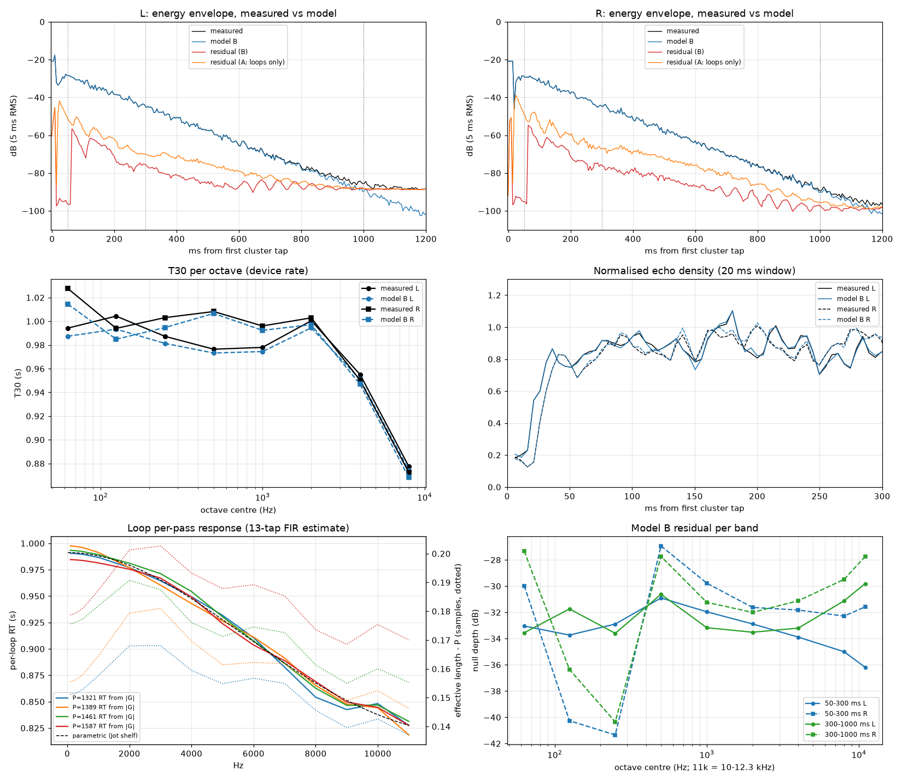

# Program S grey-box model (Path B): first results on the CLA IR

The fitted model is `tools/model_s.py`. Every number below comes from
`.venv/bin/python tools/model_s.py` (log: `analysis/model_s_run.log`; data:
`analysis/model_s/summary.json`; plot: `analysis/model_s/model_s.png`). The exceptions are numbers
marked *[exploratory]*, which come from one-off scratch runs while the model was being developed.
Labels: **[M]** measured here, **[A]** assumption, **[H]** hypothesis.



> **Current status (after round 14, Q1 on the library):** §14 tests Path B across the Tomkin library: the loops follow compact control laws, AP230 has a switched damping step, held-out settings null as well as training ones (and predict the CLA unit), but one shared injection reaches only −28…−33 dB (50–300 ms). §1–7 describe the first model (B); §8–13 the single-IR work on CLA:
> - best nulls: cluster −50/−52 dB; held-out 400–600 ms about −28 dB; R tail predicted within 4–6 dB of noise after 0.45 s (§10.1);
> - diffuser found (§11);
> - group-sparse and long-line taps are negative (§12);
> - time variance: R is LTI within about 3 %, L fits about 1 % read-out jitter, and the late input is withdrawn (§13).
>
> Open items are listed in `NEXT_STEPS.md`.

## 1. Summary

- **What fits.**
  - With 4 uncoupled loops, length-scaled gains and one shared first-order HF shelf, the decay matches: T30 is within 0.014 s in every octave from 63 Hz to 8 kHz, including the HF roll-off.
  - Echo-density curves overlap.
  - The sample-domain null is about −30 dB from 50 to 1000 ms in both channels (model B).
- **What doesn't fit.**
  - The late-tail null stops about 15 dB above R's noise floor, and the residual is still structured. Adding a 5th recursion at 460 samples (model C) gains 2–8 dB.
  - The cluster null is limited to −28/−32 dB by how the analysis chain's band-limit kernel is modelled.
  - The loops alone cannot produce the first pass (−19/−16 dB at 9–50 ms). That needs a non-recirculating first-pass FIR.
  - The output-distributor hypothesis fails in its strict form.
  - **Tightening (§8, §9):**
    - In the 20 Hz–11.3 kHz comparison band, the in-sample null reaches −48 to −50 dB at 50–300 ms. The capture-domain cluster reaches −50 to −52 dB.
    - The *held-out* null at 400–600 ms is only −27/−30 dB, about 21–24 dB above noise. The long-tail metrics (EDC, decay rates, fine structure) agree with measurement to within their noise.
    - Loop gains are resolved to about ±8 Q15 LSB, not to the LSB.
  - **Injection (§10):**
    - R's input ends at about 0.45 s. After that, 4 loops + the 460 stage predict R to within 4–6 dB of noise using only the IR's own past.
    - The generative models fail at 400–600 ms because nothing yet generates the dense, per-loop input arriving up to 0.45 s.
    - Not found: a long loop, extra 460-type stages, or one input shared across loops.
  - **Diffuser (§11):**
    - A common all-pass chain AP20 · AP72 · AP230 with g ≈ −0.70, plus the 460 comb (g 0.445), was found on R and confirmed on L. The delays are sharp to ±1 sample.
    - It improves sparse-tap models by 10–13 dB at every tap budget.
    - It does not generate the late input, so the held-out null with a generative model is still about −29 dB in band.
  - **Group-sparse taps (§12):**
    - No small tap set is shared across loops; within a loop, sharing between L and R costs about 4 dB.
    - Long-delay-line (EMT 250-style) taps and loop feedback don't generate the late input.
    - L's excess is in the recirculating read-out, not the injection.
  - **Time-variance through the sweep (§13):**
    - An LTI simulation of the fitted structure reproduces the "late input". It is the diffuser tail plus deconvolution band edges, not an extra generator.
    - R is time-invariant to within about 3 % injection jitter.
    - L's excess fits an L-only read-out gain variation of about 1 % every 0.2 s (unit or capture chain).
    - The non-sparse injection is structural mismatch, not stochastic.
  - What is left over in R sits at loop-mode frequencies; what is left over in L is mostly broadband noise. L's *model* error is not worse than R's (§6.5).
- **HF.**
  - The HF *decay* is right: T30 at 8 kHz is 0.874/0.868 s against 0.878/0.872 s measured. The loop filter's 7 kHz loss is 0.37–0.40 dB per pass. The panel's numeric displays read HF ×0.9, and the measured RT(7 kHz)/RT(1 kHz) ≈ 0.90 is exactly that setting, with the HF factor applied at 7 kHz as the data sheet says. A pure one-pole lowpass with p ≈ 0.037–0.044 fits it as well as a general first-order section. Whether any damping remains at HF ×1.0 is unknown.
  - The HF *fine structure* in the late tail is 1–4 dB worse than mid band (§6.3).
- **The "+0.2 sample" loop offset is a clock offset, not a filter.**
  - It grows with Pᵢ at about 100 ppm, and the cluster taps drift by the same ratio.
  - Once the clock is accounted for, the loop filters' own delay is ≤ ±0.02 samples.
- **Caveat [A].** The excitations and first-pass FIR (about 16.7 k free samples in model B) are fitted *in-sample* to this one IR. Only 5 numbers (RT₀, RT_π, pole, τ₀, ε) set the loop recursion, and those were identified separately (§3). The null depths show the structure *can* represent the IR; they are not a held-out prediction. The real Path-B test is to keep the excitations, change only the loop gains, and predict another RT setting. That needs the library.

## 2. Set-up and assumptions

| Item | Value |
|---|---|
| Data | `analysis/shortRT/h_dev.npy`, regenerated with `tools/analyze_ir.py` on `irs/eugtone_EMT246_CLA_shortRT.wav`; fs_dev = 19.2 MHz/728 = 26,373.6 Hz; L's ½-sample offset already removed by `deconv_grid.recover` |
| Time origin **[A]** | first cluster tap (index 263); all windows are in ms after it |
| Fit range | 0–1.0 s. Weight: decay-flattening 10^(3t/0.98), capped at t = 0.3 s **[A, a trade-off, §6.4]** |
| Band limit **[A]** | the IR only holds information up to 12.3 kHz (the deconvolution window rolls off from 11 kHz). The cluster taps are rendered through that window's analytic device-rate kernel. Everything else is fitted inside the band |
| Settings **[A]** | from a screenshot of CLA's unit showing the numeric displays: SHORT RT, LP 12 kHz, DELAY 10 ms, AMPL 80 % (the display has dead segments, so 60 % is possible; the bar favours 80), **LF ×1.0, RT 1.0 s, HF ×0.9**. This supersedes an earlier reading from the LED bars alone. DELAY 10 ms puts the first cluster tap at the pre-delay itself (index 263 ≈ 9.97 ms from file start; 10 ms = 263.7 device samples), so eugtone appears to have kept absolute timing and the reverb's onset times are meaningful |
| Noise floor **[A]** | from 1.6–1.9 s, assumed stationary. The "noise-limited null" is noise energy over signal energy per window: L is about 9 dB noisier than R |

## 3. Loops: lengths, clock and damping filters

**Method.** Each loop's per-pass response Gᵢ(ω) is identified *without* the excitations. The annihilator e = ∏ᵢ (1 − Gᵢ(z) z^−Pᵢ) · h is zero, up to noise, once every loop's excitation has ended. The fit window is 0.25–0.75 s.

Two estimators are used:
- a non-parametric 13-tap FIR per loop, by alternating least squares;
- a parametric fit by nonlinear least squares.

### 3.1 The +0.2 offset: a clock ratio [M]

| Estimate | Value |
|---|---|
| Cluster taps: sub-sample drift with lag (fit of the band-limit kernel; e.g. the R tap at 353 sits at 353.035) | **104.5 ppm** |
| Loop LF offset τᵢ (100–500 Hz, FIR) for P = 1321/1389/1461/1587 | 0.152 / 0.157 / 0.176 / 0.180 → slope **113 ± 33 ppm**, intercept 0.003 |
| Parametric, clock only (τ₀ = 0) | ε = **98.5 ppm**, cost 0.5448 |
| Parametric, clock + constant offset | ε = 103.3 ppm, τ₀ = −0.007, cost 0.5447 |
| Parametric, constant offset only (ε = 0) | τ₀ = 0.140, cost **0.6192 (+14 %)** |

- **Reading:**
  - The offset scales with Pᵢ, and the cluster shows the same ratio on its own. The IR-library harness independently measured −99 ppm for this capture relative to 19.2 MHz/728, from cluster-tap spacing; the same ratio expressed with the opposite sign. So the capture and the unit's clock differ by about 100 ppm. The analyser's 0.05-sample grid had rounded this to "+0.2".
  - Two explanations fit equally well. Either the interface clock ran fast, or the unit's 19.2 MHz crystal runs about 100 ppm slow, which would put the device rate at about 26,371 Hz **[H; these two cannot be told apart from audio]**.
  - The constant-delay explanation proposed earlier (algorithm_research §4) is rejected.
  - **For the plugin:** use integer Pᵢ, with no fractional delay in the loops.
- **How the model handles it:** to null against this capture, the model renders the loops at Pᵢ(1+ε) and the cluster taps at t(1+ε).

### 3.2 Gains and HF damping [M]

Per-loop RT computed from |Gᵢ| (FIR estimate):

| Hz | 100 | 1k | 2k | 4k | 6k | 7k | 8k | 10k | 11k |
|---|---|---|---|---|---|---|---|---|---|
| 1321 | 0.991 | 0.987 | 0.977 | 0.949 | 0.911 | 0.883 | 0.854 | 0.848 | 0.827 |
| 1389 | 0.998 | 0.991 | 0.977 | 0.943 | 0.911 | 0.891 | 0.865 | 0.844 | 0.818 |
| 1461 | 0.993 | 0.989 | 0.981 | 0.954 | 0.907 | 0.886 | 0.863 | 0.847 | 0.831 |
| 1587 | 0.985 | 0.981 | 0.975 | 0.949 | 0.904 | 0.889 | 0.869 | 0.845 | 0.828 |

- **Length-scaled gains:** the DC loss per pass is 3.034 / 3.168 / 3.346 / 3.667 dB, i.e. 2.30 / 2.28 / 2.29 / 2.31 mdB per sample. That is gᵢ = 10^(−3Pᵢ/(fs·RT)) within ±0.6 %, at RT₀ = 0.991 s.
  - *[exploratory]* Freeing a gain trim per loop changed the cost by < 0.1 % (trims ≤ 0.08 %).
- **HF:** the extra loss at 7 kHz is 0.37 / 0.38 / 0.40 / 0.40 dB per pass, close to the ≈ 0.35 dB in the updated algorithm_research §4. That is the HF ×0.9 setting **[A: from the panel]**: RT(7 kHz)/RT(1 kHz) ≈ 0.90 in every loop. With LF ×1.0 the filter is flat at LF, which matches the 100 Hz values. So at this setting the loop filter needs HF shaping only.
  - Removing the HF damping doubles the cost (1.187 against 0.545).
- **Parametric model (used in B):**
  - One first-order section per loop, (b₀ + b₁z⁻¹)/(1 − p z⁻¹). Its DC and Nyquist gains follow the length-scaling rule from RT₀ = 0.991 s and RT_π = 0.818 s; the pole p = 0.030 is shared.
  - RT_π is an extrapolation, because the data stop at 12.3 kHz.
  - The pole is poorly determined: a zero-pole section (p = 0) gives cost 0.545 as well. First order is enough on this IR.
- **Pure one-pole lowpass** H = R₀(1−p)/(1−p z⁻¹) (fitted with τ₀ = 0, so ε absorbs everything):
  - **Length-scaled one-pole** (pole per loop set by its DC and Nyquist gains): cost **0.5449**, the same as the general section's 0.5447. RT₀ = 0.992 s, RT_π = 0.820 s, ε = 98.6 ppm. The implied poles are p = 0.0365 / 0.0384 / 0.0403 / 0.0438, with extra loss at 7 kHz of 0.36 / 0.38 / 0.40 / 0.43 dB per pass and DC group delay of 0.038–0.046 samples.
  - **One fixed one-pole in every loop:** p = 0.0393, cost **0.5491**, i.e. +0.8 %.
  - **Reading:** a mild one-pole (p ≈ 0.04) is enough for HF ×0.9. The data slightly favour scaling the pole with loop length over one shared coefficient, but 0.8 % is not decisive on one IR.
- **Shared coefficients vs length-scaled: not decided.**
  - Cost is 0.5467 against 0.5447 with free ε, and 0.5702 against 0.5673 with ε fixed at the cluster value. That is a 0.4–0.5 % difference.
  - At HF ×0.9 the two hypotheses differ by ≤ 0.015 s in RT. An HF ×0.1 setting will separate them, and HF ×1.0 will show whether any fixed damping remains.
- **Filter phase:** after removing εPᵢ, the per-loop delay varies by about +0.015 samples (2–3 kHz) and −0.01 (9–11 kHz). That is consistent with a mild first-order section **[H]**.

### 3.3 A fifth recursion at 460 samples [M, interpretation H]

- The annihilator residual of the 4-loop model is not white. *[exploratory]* A scan over single lags 150–3500 found that one extra recursion at lag **460** removes 60 % (L) and 65 % (R) of the residual. The lag-scan peaks also include 230, 920 and 690.
- Fitting 1 − G₅ z^−460 together with the loops:
  - cost 0.5447 → **0.1945**;
  - g₅ = 0.439 per pass (−7.15 dB, i.e. RT ≈ 0.146 s), HF ratio 0.89;
  - the loops refit to RT₀ = 1.000 s.
- **Where it sits:**
  - In the full model, a parallel 460 loop (C) and a 460 recursion in series after the loop sum and the first-pass FIR (Cs) give the same null within 0.5 dB. Its position can't be determined from this IR.
  - A plausible reading is a 17.4 ms all-pass or comb stage with |g| ≈ 0.44 in the diffusion path **[H]**. It is not in the §3.4 topology of the discovery doc.
- **Test on the library:**
  - Is the 460 stage present in M and L?
  - Does g₅ stay fixed when RT changes? Fixed would mean a diffuser.

## 4. Injection

- **Model B** (per channel):
  - 4 excitations xᵢ of Pᵢ + 300 samples, starting 230 samples after the first tap;
  - a first-pass FIR of 1,400 samples (230–1,630, i.e. until just after the shortest loop's first recirculation at 1,551);
  - 8 cluster gains.
  - All of these are solved jointly by LSQR with the loop filters fixed.
- **Reverb onset:** about 240 samples after the first tap in L, and about 570 in R (330 later; compare the 332 L/R lag).
- **The loops cannot carry the first pass by themselves.**
  - Model A has no first-pass FIR. Its null is −19.4/−15.6 dB at 9–50 ms, and fitting that early part costs the tail 8–11 dB.
  - In B, the first-pass FIR carries −10.7 dB (L) and −7.1 dB (R) of the first 1,400 samples' energy. That is content that does not recirculate the way the loop excitations do.
  - This fits injection or read-out at several points along each delay line, where some taps see an input before it wraps **[H]**. It is evidence against a single write and single read per loop.
- **The spec's literal method fails.**
  - Model P takes one period per loop from periodic decomposition of the flattened tail, scales it per loop and channel, and uses the measured first pass as the FIR. It nulls only −7.4/−7.7 dB (50–300 ms) and −9.3/−9.6 dB (300–1000 ms).
  - *[exploratory]* The mapping is correct: on an undamped synthetic it recovers the excitations with correlation ≥ 0.999.
  - On a noise-free synthetic with the fitted damping it again gives only −7 to −10 dB. Periodic decomposition averages over passes, while the HF loss and phase change from pass to pass.
  - **The excitations must be fitted in the time domain with the loop filters**, which is what `Linear` does.

## 5. Output: common loop sum + distributor vs per-channel components

| Test | Result |
|---|---|
| D: common excitations, L = d_L ∗ s, R = d_R ∗ s, with 701-tap d_c (alternating LS, 5 rounds) | null **−10.8/−10.7 dB** (50–300), −8.9/−7.9 (300–1000), against −31/−30 and −29/−29 for B. The ALS cost was still falling (0.73× the start), but D would need about 100× less cost to compete. d_R stayed near its start values (lags 332: 0.55 and 26: 0.53) |
| L/R harmonic-ratio test on B's excitations. A common distributor implies X_iL/X_iR(f) is the same function for every loop | harmonics of *different* loops within 1 Hz: phase score 0.60 (0 = equal, random pairs 1.01); the magnitude ratio differs by a median 4.85 dB (random 4.82 dB) |
| Per-loop sparse L→R relation | lags 26 and 332 explain 47 / 49 / 53 / 54 % of R's periodic component in loops 1321 / 1389 / 1461 / 1587, with **loop-specific** gains (0.45/0.59, 0.55/0.49, 0.34/0.73, 0.67/0.33). *[exploratory]* Greedy OMP over all lags picked 26 and 332 first in every loop. Four more taps add only 7–9 % |

- **Reading:**
  - The strict "loop sum → one fixed distributor" is **rejected**. L/R phases are partly shared across loops, but magnitudes are not.
  - The same two lags (26 and 332) appear in every loop, with different weights per loop. So the output side shares its *delays* across loops but not its *weights*. Examples: two output buses that mix the loops differently, or read taps at fixed offsets from each loop's write point **[H]**.
- **For now:** keep independent per-channel components (B).

## 6. Null test (model − measured) [M]

### 6.1 Null depth, dB (L / R)

| Model | 0–50 ms | 50–300 ms | 300–1000 ms | 0–9 ms (cluster only) | 9–50 ms | 300–600 | 600–1000 |
|---|---|---|---|---|---|---|---|
| A: loops only | −22.6 / −19.8 | −23.6 / −21.3 | −21.3 / −18.7 | −28.3 / −32.5 | −19.4 / −15.6 | −21.7 / −18.9 | −12.3 / −11.6 |
| **B: loops + first-pass FIR (main)** | **−30.5 / −34.5** | **−31.3 / −30.1** | **−29.1 / −29.3** | −28.3 / −32.5 | −68.0 / −66.4 ¹ | −30.6 / −29.7 | −15.1 / −20.2 |
| C: B + parallel 460 loop | −30.5 / −34.5 | −35.8 / −37.7 | −30.9 / −34.4 | −28.3 / −32.5 | −62.2 / −60.0 ¹ | −33.1 / −34.9 | −15.7 / −24.3 |
| Cs: B + 460 in series | −30.4 / −34.4 | −35.7 / −37.2 | −30.8 / −34.2 | −28.3 / −32.5 | −55.3 / −51.0 ¹ | −33.0 / −34.8 | −15.6 / −23.7 |
| D: common sum + distributor | −30.5 / −34.5 | −10.8 / −10.7 | −8.9 / −7.9 | −28.3 / −32.5 | −56.9 / −58.1 ¹ | −9.0 / −8.0 | −7.8 / −6.9 |
| P: periodic decomposition | −30.5 / −34.5 | −7.4 / −7.7 | −9.3 / −9.6 | −28.3 / −32.5 | (copied) ¹ | −9.4 / −9.6 | −9.1 / −9.8 |
| *noise-limited floor* | −66.6 / −74.7 | −56.2 / −64.8 | −35.6 / −44.3 | −71.8 / −80.1 | −63.4 / −71.2 | −39.2 / −48.0 | −18.9 / −27.6 |

¹ The first-pass FIR is free over 9–62 ms, so this column is a fit **by construction**, not a prediction. P copies the measured first pass exactly.

- **0–50 ms** is dominated by the cluster, which limits it to −28/−32 dB. That residual sits *between* the taps, in the ±0.12 band-limit ripple: within ±3 samples of the taps it is −39/−42 dB.
  - *[exploratory]* An empirically fitted kernel did not improve it.
  - This is a limit of modelling the analysis chain, not of the cluster model **[A]**: on the hardware the taps are single samples.
- **Cluster gains** (kernel units): L 1.128, 1.128, 1.119, −1.140; R 1.120, 1.116, −1.125, 1.104. All are equal within ±1.6 %, with signs + + + − / + + − + as expected.
- **300–1000 ms:**
  - L's 600–1000 ms is noise-limited (−15.1 against a floor of −18.9).
  - R's is about 7 dB above its floor (−20.2 against −27.6); its 300–600 ms is 18 dB above (−29.7 against −48.0). So R shows the model error remaining in the tail.
  - *[exploratory]* The residual's autocorrelation still peaks at the loop lengths and their doubles (0.2–0.3), and at 460/920. Part of the loops' periodic content is still not captured.

### 6.2 T30 per octave (s), measured → model B (L | R)

| Octave | 63 | 125 | 250 | 500 | 1k | 2k | 4k | 8k |
|---|---|---|---|---|---|---|---|---|
| L meas | 0.994 | 1.004 | 0.987 | 0.976 | 0.978 | 1.000 | 0.955 | 0.878 |
| L model B | 0.987 | 0.993 | 0.981 | 0.973 | 0.974 | 0.994 | 0.951 | 0.874 |
| R meas | 1.028 | 0.994 | 1.003 | 1.008 | 0.996 | 1.003 | 0.950 | 0.872 |
| R model B | 1.014 | 0.985 | 0.995 | 1.007 | 0.992 | 0.997 | 0.947 | 0.868 |

- Every model B octave is within −0.014 to −0.001 s, slightly short.
- Model C is within ±0.002 s in every octave of both channels: e.g. L 0.993, 1.002, 0.988, 0.977, 0.977, 1.000, 0.954, 0.876.
- The L/R differences in the measured T30 (e.g. 500 Hz: 0.976 against 1.008) come from modal beating, because the loops are common to both channels. The model reproduces them because the excitations are fitted.
- Method: T30 is computed at the device rate with `analyze_ir.edc`; the 8 kHz band is capped at 12.3 kHz.

### 6.3 Residual per band, model B (null dB, L / R)

| Band | 63 | 125 | 250 | 500 | 1k | 2k | 4k | 8k | 10–12.3k |
|---|---|---|---|---|---|---|---|---|---|
| 50–300 ms | −33.0/−30.0 | −33.7/−40.3 | −32.9/−41.3 | −30.9/−26.9 | −32.0/−29.8 | −32.9/−31.6 | −33.9/−31.8 | −35.0/−32.3 | −36.2/−31.6 |
| 300–1000 ms | −33.6/−27.3 | −31.7/−36.4 | −33.6/−40.3 | −30.6/−27.7 | −33.2/−31.2 | −33.5/−32.0 | −33.2/−31.1 | −31.1/−29.5 | −29.8/−27.7 |

- **HF:** in 50–300 ms, HF nulls as well as mid band or better. In 300–1000 ms, 8 kHz and 10–12.3 kHz are 1–4 dB worse than 1–4 kHz. That matches small HF loss or phase errors that accumulate over passes, from the first-order shelf.
  - Closing that gap needs an HF/LF sweep; one IR doesn't constrain the filter shape further. *[exploratory]* A 33-tap free FIR per loop lowered the annihilator cost by only about 1 % against the parametric model (0.538 against 0.545).
- **R at 500 Hz and R at 63 Hz** are the worst bands (about −27 dB). The reason is unknown.

### 6.4 Weighting trade-off *[exploratory]*

- With excitations starting at 0 rather than 230: capping the flattening at 0.1 s gives 50–300 ms −35.0/−34.7 and 300–600 ms −24.9/−23.9.
- Capping at 0.3 s (as used) gives −31.3/−30.2 and −30.6/−29.7.
- With the B configuration, extending the first-pass FIR to 2,500 samples improved the null to −36.8/−38.9 (50–300) and −32.8/−34.5 (300–600). It then covers part of the second pass, so it was not used.

### 6.5 Is the residual at loop modes or broadband? L vs R [M]

This bears on the 1986 "stochastic control" claim (algorithm_research §7.2b). Tests: `residual_mode_test`, on the decay-flattened window.

- **on/off:** spectral density within 0.3 Hz of any loop harmonic, over density more than 1.2 Hz from every harmonic. These cover 12 % and 57 % of the 100 Hz–11 kHz bins. 0 dB means broadband; the measured IR itself gives the fully modal value.
- **Mode-shaped share:** in each 250 Hz band, fit S_res = a·S_meas + b (a, b ≥ 0). The share is the fraction of residual energy that follows the IR's modal fine structure.
- **Control:** the measurement's own noise tail (1.4–1.9 s).

| Signal | Window | on/off L / R (dB) | mode-shaped share L / R |
|---|---|---|---|
| measured IR | 0.1–0.6 s | 11.7 / 11.5 | (reference) |
| residual, B | 0.1–0.6 s | 3.9 / 4.8 | 0.37 / 0.42 |
| residual, B | 0.3–0.8 s | 8.1 / 11.4 | 0.61 / 0.79 |
| residual, C (+460) | 0.1–0.6 s | 0.7 / 4.3 | 0.08 / 0.33 |
| residual, C (+460) | 0.3–0.8 s | 2.6 / 9.5 | 0.17 / 0.66 |
| noise tail (control) | 1.4–1.9 s | 0.4 / 1.6 | 0.06 / 0.13 (the test's false-positive level) |

- **R:** the unexplained residual is **concentrated at loop-mode frequencies**, more so later in the tail. With C, 66 % of R's 0.3–0.8 s residual follows the modal structure, with on/off 9.5 dB against 11.7 for the IR itself. So the leftover error is mainly in the modes' amplitudes and decays, not broadband.
  - This fits the "randomised read-out gains" reading (§7.2b, reading 1).
  - It equally fits an ordinary static mis-fit: a slightly wrong loop-filter shape, which also leaves error at mode frequencies that grows with time.
  - **One IR cannot tell these apart.** §8.6 tests one consequence within this IR: the line widths match an LTI model. Library IRs at other settings can test another: whether the mode-level error moves with RT, which a randomised read-out would not.
- **L:** the residual is **mostly broadband**: 8–17 % mode-shaped with C, close to the control. L carries more measurement noise:
  - L's noise-limited floor is 9 dB above R's.
  - L's late floor is broadband (control row) but **not stationary**. It falls from −88.1 dB at 1.1 s to −90.9 dB at 1.8 s (about 4 dB/s), while R's is flat at −98.4 to −98.9 dB from 1.4 s.
  - A slowly decaying broadband floor is what time-variance smear in a sweep measurement can leave. It could equally come from the capture chain **[H]**.
- **Is L's model error worse than R's? No.** Subtracting the noise floor's energy from the null (arithmetic on the §6.1 numbers):
  - Model B at 300–600 ms: model error is −31.2 dB in L and −29.8 dB in R.
  - Model C: −34.3 dB in L and −35.1 dB in R.
  - So the *model* error is about the same in both channels. **L's extra residual is broadband noise**, not extra mode-level error.

### 6.6 Echo density

The NED curves of models B and C overlap the measured ones over 0–300 ms (plot, middle right). The first crossing of 0.9 falls at:

| | measured | model B | model C |
|---|---|---|---|
| L | 75.9 ms | 75.9 ms | 75.9 ms |
| R | 80.9 ms | 90.8 ms | 80.9 ms |

The crossing time is a noisy statistic, so compare the curves. NED is computed at the device rate (20 ms window) and is not comparable with the 96 kHz figure in the discovery doc.

## 7. What this means for Path B and the library work

1. **Use as-is:**
   - integer loops with length-scaled gains, from RT₀;
   - one first-order HF section per loop;
   - per-channel excitation FIRs (Pᵢ + 300 taps) and a first-pass FIR (1,400 taps per channel);
   - 8 fixed cluster taps.

   Parameters are in `analysis/model_s/model_B_params.npz`.
2. **Held-out test (decisive):** render B with RT changed, keeping the excitations, and null it against the library's RT steps. If the null stays near −30 dB, Path B is viable. If not, the excitations depend on RT, which would mean exponential tap weighting (T5).
3. **HF/LF sweeps:** decide length-scaled against shared coefficients (§3.2), and the filter order and shape (§6.3).
4. **The 460 recursion:** is it in M and L, and does g₅ change with RT? Model C or Cs is the better candidate structure if it holds.
5. **Output stage:** model per-loop L/R weights on shared lags 26 and 332, which would cut the per-channel parameters roughly in half if it holds (§5). A strict common distributor is ruled out.
6. **Clock:** re-grid captures with fs_dev/(1+ε). Expect about 100 ppm on this interface; check whether ε differs between libraries. If it does, the drift is in the capture chain.

## 8. Tightening against one IR: hold-out, sparsity, structure, capture domain

Code: `.venv/bin/python tools/model_s.py --tighten` → `analysis/model_s/tighten.json` (log: `analysis/model_s_tighten.log`). Everything below is from that run unless marked otherwise.

- **Settings [A]:** this section uses the confirmed panel settings (§2): LF ×1.0, RT 1.0 s, HF ×0.9, DELAY 10 ms.
- **Absolute timing:** with DELAY 10 ms, cluster tap 0 at index 263 (9.97 ms from file start) is the pre-delay output. So the reverb onsets are absolute: about 240 device samples (9.1 ms) after tap 0 in L and about 570 (21.6 ms) in R.

### 8.1 Ground rules

- **Hold-out:** excitations, first-pass FIR and cluster gains are fitted on **0–400 ms only**. The loop and 460 parameters are also identified from data before 400 ms (annihilator window 0.25–0.40 s). Windows after 400 ms are predictions.
- **Comparison band 20 Hz–11.3 kHz** (`band_limit`).
  - Below 20 Hz the IR holds a large non-reverb component (sub-20 Hz energy is −22 dB of the signal at 50–300 ms), which is presumably sweep/deconvolution leakage **[A]**. In broadband nulls it dominates the residual: 0–20 Hz carries −36/−38 dB of residual against −44.5/−42.1 dB at 44 Hz–11.3 kHz (§9.3).
  - Above 11.3 kHz the deconvolution window rolls off.
  - Both the broadband and the in-band figures are kept.
- **Excess over noise** = null − noise-limited floor of the same window and band. 0 dB is the target.
  - The in-band floors are much lower than the broadband ones. The broadband "noise floor" is itself mostly below 20 Hz: R's in-band floor is −110 dB against −98 dB broadband.

### 8.2 Hold-out table, device domain, 20 Hz–11.3 kHz (null dB, L / R; excess over noise in brackets)

| Model | Params | 0–50 ms (fit) | 50–300 (fit) | 300–400 (fit) | **400–600 (predicted)** | **600–1000 (predicted)** |
|---|---|---|---|---|---|---|
| B: 4 loops + first-pass FIR | 16,729 | −31.2/−35.2 (+48.8/+50.7) | −35.1/−33.0 (+34.5/+43.2) | −32.6/−30.7 (+23.8/+32.3) | −20.6/−19.7 (+27.3/+34.7) | −12.8/−12.9 (+19.5/+26.1) |
| C: + parallel 460 | 18,252 | −31.2/−35.2 (+48.8/+50.7) | **−48.1/−50.1** (+21.4/+26.0) | −43.5/−46.1 (+12.9/+16.9) | −26.7/−30.1 (+21.2/+24.3) | −17.2/−21.3 (+15.1/+17.6) |
| Cs: + series 460 | 16,732 | −31.2/−35.2 | −47.4/−46.8 (+22.2/+29.3) | −42.6/−43.4 | **−28.4/−27.5** (+19.5/+27.0) | −19.5/−18.5 (+12.8/+20.4) |
| Cs without first-pass FIR | 13,932 | −27.6/−22.3 | −28.9/−22.7 | −26.8/−20.6 | −17.8/−12.1 | −10.4/−6.7 |
| Cs, loops + 460 taken from the **L-only** fit | 16,732 | −31.2/−35.2 | −47.0/−46.1 | −42.5/−42.9 | −28.5/−27.3 | −19.6/−18.5 |
| *noise floor (in band)* | | −80.0/−85.9 | −69.6/−76.1 | −56.4/−63.0 | −47.9/−54.4 | −32.3/−38.9 |

The broadband equivalents are in `tighten.json` (`null`, `excess`). For example, C at 50–300 ms is −36.3/−38.5 broadband.

- **Reading:**
  - The 460 recursion is the one structural addition that clearly helps: +13/+17 dB in-band at 50–300 ms, and +6/+10 dB on the held-out 400–600 ms.
  - At the fit/hold-out boundary the null drops by about 17 dB, from −43/−46 dB (300–400 ms) to −27/−30 dB (400–600 ms). The 16–18 k free excitation samples fit the 0–400 ms window much better than they generalise. **The hold-out numbers are the honest ones.**
- **Cross-channel:** the 9 shared parameters (loops + 460) fitted on L alone predict R as well as R's own parameters.
  - Annihilator cost on R: 0.1048 against 0.1042 (+0.5 %). On L with R's parameters: +0.4 %.
  - R's in-band nulls with L-derived loops differ from the R-derived ones by ≤ 0.7 dB.
  - The early-window loop parameters (RT₀ 0.998 s, ε 98.4 ppm, g₄₆₀ 0.445) match the full-window ones. Without the 460 stage they drift (RT₀ 0.970, ε 113.7).

### 8.3 Sparse integer-tap excitations

Greedy batch OMP picks integer-position excitation and first-pass taps (Cs basis, fit 0–400 ms):

| Taps per channel (+8 cluster) | 103 | 414 | 1,719 |
|---|---|---|---|
| L null 50–300 / 400–600 (broadband) | −1.7 / −1.3 | −4.8 / −3.9 | −12.8 / −8.6 |
| R null 50–300 / 400–600 | −1.8 / −1.5 | −4.9 / −4.0 | −12.4 / −8.9 |

- **The excitations are not a modest set of integer taps.**
  - They are heavy-tailed (kurtosis 11–20; top 1 % of samples hold 25–34 % of the energy), and some positions repeat across loop pairs at offsets of 20, 52 and 72 samples. *[exploratory]*
  - Yet 1,719 taps per channel recover less than the dense model does with 8,400.
  - Something dense, a diffuser we have not identified, sits between a sparse tap set and the loops.
- **The 460 stage as an all-pass:** *[exploratory]* the excitations keep a −0.31 lag-460 regression coefficient after the 460 recursion is modelled. That fits an all-pass numerator (−g + z⁻⁴⁶⁰). But removing that numerator does not make them sparser.
- **Other short recursions:** lags 72, 20, 52, 230 each explain ≤ 0.2 % of the excitation variance *[exploratory]*. So no second short all-pass is visible this way.

### 8.4 What else lowers the annihilator cost (loops + 460, window 0.25–0.75 s, cost L+R = 0.195)

| Added freedom | Cost |
|---|---|
| none (4 loops + 460) | 0.0902 + 0.1043 = 0.1945 |
| + recursions at 230, 690, 920 (gain + HF each) | 0.1825 (−6 %); singly 0.190 / 0.194 / 0.194 |
| per-loop free 81-tap FIR instead of the shelf | 0.0905 + 0.1008 (−2 %) |
| per-loop free shelves (12 parameters) | 0.1944 |
| LF shelf in every loop | 0.1923 (corner 9 Hz, i.e. a DC effect) |
| cross-coupling between loops (12 off-diagonal gains) | 0.1944 (couplings ≤ 0.08, with no gain) |
| *noise-only level of this objective* | 0.0123 + 0.0025 |

- Annihilator residual over its noise-only level, in 50 ms blocks:
  - **R:** +47 dB at 0.25 s, +7 dB at 0.40 s, +1.4 dB at 0.50 s, and ≤ 0 dB from 0.55 s on. **In R, 4 loops + 460 explain the recursion to the noise floor from about 0.5 s.**
  - **L:** +15 dB at 0.40 s, falling to +4 dB at 0.85 s. It never reaches noise, and no LTI change above removes it.
- So two things limit the null, and neither is the loop filters:
  1. **Unmodelled input arriving at 0.25–0.4 s**, in both channels: annihilator residual +47 → +7 dB (R). This is content that neither the loops, the 460 stage, nor the excitation and first-pass supports can carry. A longer free excitation support did not help: *[exploratory]* +1,000 samples moved Cs at 400–600 ms (broadband) from −27.9/−26.8 to −27.8/−26.5 dB. It is probably the unidentified diffuser of §8.3 having a longer tail than the model allows **[H]**.
  2. **An L-only excess in the tail.** Its periodicities are the loop-length *differences* (68, 126, 140, 198, 266 samples) *[exploratory]*, which is what a slow modulation of the loop or read-out gains in L would leave **[H]**.

### 8.5 Capture domain (raw 96 kHz WAV)

- **Method:** the device model uses *integer* Pᵢ, delta cluster taps and the clock ratio ε only in the resampling. It is resampled onto the 96 kHz grid with a Kaiser-sinc interpolator, then passed through the analogue chain. That chain is one shared 1,193-tap FIR at 96 kHz × a 2nd-order high-pass (15 + 15 Hz), with L allowed a fractional offset. The comparison is against the raw WAV low-passed at 11.5 kHz.
- **Cluster-only test** (reverb-free regions, L < 9 ms, R < 21 ms; kernel fitted on R, then **held out on L**):

| Analogue high-pass | R in-sample | L held out | L offset |
|---|---|---|---|
| none | −37.0 | −35.4 | 0.492 device samples |
| 10 Hz | −38.3 | −40.5 | 0.492 |
| 10 + 10 Hz | −46.5 | −41.2 | 0.492 |
| 15 + 15 Hz | −47.5 | −40.6 | 0.492 |
| *noise floor* | −81.5 | −75.6 | |

- **What the cluster shows:**
  - The L offset is **0.492 device samples**: the ½-sample DAC multiplex, fitted freely.
  - The R tap gains are **0.9999 / 1.0010 / −0.9992 / 0.9999** (cluster-only, 15 + 15 Hz), i.e. the taps are unity gain. L's three in-region taps are 1.0065–1.0075, an L/R level offset of about 0.06 dB. L's tap at 288 lies outside the L region and is not determined there.
  - The analogue chain needs a 2nd-order sub-20 Hz high-pass (coupling capacitors **[H]**). A plain FIR cannot represent its long, low-level tail. That tail was the main reason the device-domain cluster stopped at −28/−32 dB.
- **Full model Cs in the capture domain** (kernel fixed from the cluster fit, device parameters solved on 0–400 ms):

| Window | 0–9 ms | 0–50 | 50–300 | 300–400 | 400–600 (pred.) | 600–1000 (pred.) |
|---|---|---|---|---|---|---|
| null, 20 Hz–11.3 kHz | **−49.5/−51.9** | **−51.0/−52.9** | −47.8/−47.7 | −42.7/−44.4 | −27.1/−29.2 | −17.0/−19.4 |
| excess over noise | +36.0/+39.7 | +29.2/+33.2 | +22.0/+28.5 | +13.9/+18.7 | +21.0/+25.3 | +15.6/+19.6 |
| null, broadband (to 11.5 kHz) | −47.7/−50.1 | −49.4/−51.2 | −42.4/−43.2 | −35.6/−38.4 | −26.3/−28.5 | −15.2/−18.7 |

- Refitting the kernel jointly with the reverb changes these by ≤ 1.1 dB (`kernel_joint`).
- Moving to the capture domain gains about 20 dB on 0–50 ms (cluster) and about 6 dB broadband on 50–300 ms, the latter from modelling the sub-20 Hz analogue high-pass. In band, the reverb windows are the same as the device domain.

### 8.6 Line width (the "stochastic control" question within one IR)

Spectral concentration at loop modes, on/off in dB (§6.5 measure), for the measured IR against the LTI model C plus measured noise:
- 0.1–0.4 s: 6.61 / 6.50 measured against 6.61 / 6.50 model.
- 0.4–0.7 s (the model's held-out range): 6.65 / 6.55 against 6.64 / 6.54.

**No line broadening beyond the LTI decay** is visible at this resolution (0.3 s windows, about 3 Hz). Modulation slower than about 1 Hz, or affecting only the L excess of §8.4, is not excluded **[limit]**.

### 8.7 What limits the null now

1. **Unmodelled late input (0.25–0.4 s), both channels.** This is the main limit on the held-out windows (+21 to +25 dB over noise at 400–600 ms). It needs a structural idea, most likely the diffuser of §8.3. It does not need more free taps: those overfit (§8.2).
2. **L-only tail excess**, about +4 to +15 dB over noise in the annihilator, which no time-invariant change removes. Either L-side time variance (the 1986 "stochastic control", if confined to L) or a capture artefact **[H]**.
3. **Analogue-chain model**, for the cluster: −50/−52 dB against a −86/−92 dB floor. The first-order kernel + high-pass is the limit; it is not the digital model.
4. **Sub-20 Hz content** of the capture: broadband nulls only, excluded from the comparison band.
5. **Fixed-point effects** are not reached. They only matter once the model error nears −60 dB, which it does nowhere yet.

So −50 dB is reached only for the cluster and the first 50 ms in the capture domain, and in-sample at 50–300 ms. Nowhere is the null at the noise floor, and **this IR does not yet prove that the true algorithm has been found**.

## 9. Long tail: noise-robust metrics, noise model, loop-parameter precision

Code: `.venv/bin/python tools/model_s.py --tail` → `analysis/model_s/tail.json`.
- **Loop fit:** loops + 460 come from the whole decay (annihilator over 0.25–1.8 s). The residual of a correct model there is filtered noise, so it is fitted unweighted, then iteratively reweighted by the inverse local residual RMS (50 ms blocks, 3 passes). That is the SNR weighting.
- **Model:** model C uses those loops, with the excitations fitted on 0–400 ms. **Everything after 400 ms is a prediction.**

### 9.1 Loop parameters and their precision

| Parameter | Value | 1σ (Jacobian × √τ_int, τ_int = 54) | in Q15 LSB | L-only / R-only | 0.25–0.7 s / 0.7–1.8 s |
|---|---|---|---|---|---|
| g₁₃₂₁ (per-pass DC gain) | 0.707439 | 0.000246 | 8.1 | 0.707138 / 0.707452 | 0.707443 / 0.707425 |
| g₁₃₈₉ | 0.695463 | 0.000231 | 7.6 | 0.695132 / 0.695470 | 0.695486 / 0.695272 |
| g₁₄₆₁ | 0.682337 | 0.000229 | 7.5 | 0.682280 / 0.682338 | 0.682345 / 0.682162 |
| g₁₅₈₇ | 0.660021 | 0.000235 | 7.7 | 0.659779 / 0.660036 | 0.660034 / 0.659852 |
| κ, HF excess at Nyquist (length-scaled) | 12.84 dB/s | 0.10 | | 13.40 / 12.82 | 12.82 / 13.86 |
| shelf pole p | 0.0392 | 0.0049 | 159 | 0.028 / 0.040 | 0.040 / 0.016 |
| clock ε | 98.39 ppm | 0.14 | | 97.86 / 98.41 | 98.41 / 97.12 |
| g₄₆₀ | 0.458 | 0.020 | 656 | 0.397 / 0.501 | 0.531 / 0.016 |

- **Per-loop RT₀ from the gains:** 0.9997 / 1.0017 / 1.0011 / 1.0004 s. That is length-scaled gains exactly at the RT 1.0 s setting, within ±0.2 %.
- **Q15 resolution, the bit-exactness question:**
  - The loop gains are resolved to about **±8 LSB (1σ)**.
  - Early and late halves agree to 0.6–7 LSB, but L-only and R-only differ by 2–11 LSB, systematically lower in L (the L excess again).
  - So this IR is roughly 3–4 bits short of pinning Q15 loop coefficients. The filter pole (±160 LSB) and the 460 gain (±650 LSB; it is unconstrained after 0.7 s, where it has decayed) are far from it.
  - **[A]** The per-pass DC gain equals a hardware coefficient only if the loop filter has unity DC gain. That is not known.
- **What would tighten it:** several library IRs at different RT settings sharing the same loop structure. Each adds an independent decay, and the gain law across RT steps constrains the coefficient table.

### 9.2 Tail metrics, model against measured (both over the predicted range)

- **Noise-compensated EDC per octave**, max |difference| down to −50 dB (L / R):

| Octave | 63 Hz | 125 | 250 | 500 | 1 k | 2 k | 4 k | 8 k |
|---|---|---|---|---|---|---|---|---|
| L / R | 0.19 / 0.68 | 0.59 / 0.17 | 0.15 / 0.15 | 0.08 / 0.13 | 0.07 / 0.07 | 0.05 / 0.05 | 0.03 / 0.03 | 0.06 / 0.05 |

- **Per-band decay rate and frequency** (free 81-tap FIR per loop over the whole decay, against the parametric loops):
  - 125 Hz–8 kHz: decay deviation within −0.51…+0.31 dB/s (on 60 dB/s, i.e. < 1 %); frequency deviation within ±7.4 mHz.
  - 10 kHz: −0.6 to −2.1 dB/s and up to 19.5 mHz. Near the band edge the first-order shelf is slightly off.
- **Spectral fine-structure correlation**, model against measured (ceiling = model against model + a measured-noise realisation):

| Window | 0.3–0.6 s | 0.6–0.9 | 0.9–1.2 | 1.2–1.5 |
|---|---|---|---|---|
| L: model vs measured (ceiling) | 0.998 (1.000) | 0.986 (0.997) | 0.886 (0.942) | 0.51 (0.53) |
| R | 0.998 (1.000) | 0.992 (0.999) | 0.964 (0.972) | 0.66 (0.65) |

- **Reading:** in the tail the *algorithm* matches measurement to within the noise: EDCs within 0.2 dB in most bands to −50 dB; decays within 1 %; mode frequencies within a few mHz; fine structure at the noise ceiling in R. The waveform null degrades because the excitation is not exactly right (§8.7, item 1), not because the loops are wrong. L sits below its ceiling at 0.9–1.2 s, the L excess again.

### 9.3 Noise model and "model error = residual − noise"

- **Noise model** (`noise_model`): an octave-band spectrum from 1.4–1.9 s, and a level that is linear in dB against time (fitted from 1.3/1.4 s).
  - **Broadband:** L −89.0 dB at 1.4 s, falling 4.2 dB/s; R −98.4 dB, falling 1.0 dB/s.
  - **In band (20 Hz–11.3 kHz):** L −103.3 dB falling 1.8 dB/s; R −110.3 dB and flat (+0.4 dB/s).
  - **So L's "decaying floor" is mostly below 20 Hz.** In band, L's floor is 7 dB above R's and drifts only slightly.
  - The noise spectrum rises with frequency in both channels: the 8 kHz octave is −18/−16 dB of the total, the 63 Hz octave −44/−35 dB.
  - **[A]** The model extrapolates the 1.3–1.9 s level back to earlier windows. For L both a drifting and a flat extrapolation are reported.
- **Model error per window, in band, with model C** (dB re signal in the window; "res/noise" = residual over noise model):

| Window | L null | L noise (drift / flat) | **L model error** | R null | R noise | **R model error** | res/noise L (drift) / R |
|---|---|---|---|---|---|---|---|
| 50–300 ms | −43.8 | −66.8 / −69.4 | −43.8 | −42.0 | −76.1 | −42.0 | +23.0 / +34.1 |
| 300–400 | −40.1 | −53.9 / −56.2 | −40.2 | −38.9 | −63.0 | −38.9 | +13.9 / +24.1 |
| 400–600 (pred.) | −25.7 | −45.8 / −47.8 | −25.7 | −26.7 | −54.4 | −26.7 | +20.1 / +27.8 |
| 600–1000 (pred.) | −16.7 | −30.7 / −32.2 | −16.8 | −19.6 | −38.9 | −19.7 | +14.0 / +19.3 |
| 1000–1500 (pred.) | −6.3 | −6.6 / −7.3 | (≈ 0) | −13.2 | −13.1 | (at noise) | +0.3 / −0.1 |

- **Model error, broadband, per octave** (dB re that band's signal, L / R):

| Window | 63 Hz | 125 | 250 | 500 | 1 k | 2 k | 4 k | 8 k |
|---|---|---|---|---|---|---|---|---|
| 50–300 ms | −37.4/−41.2 | −41.7/−46.0 | −45.2/−50.2 | −48.7/−48.6 | −52.7/−50.7 | −52.0/−50.9 | −48.2/−47.0 | −42.3/−39.7 |
| 300–600 | −34.8/−44.4 | −37.7/−41.2 | −37.7/−41.5 | −40.3/−41.2 | −42.1/−40.8 | −41.2/−38.9 | −38.7/−37.2 | −31.8/−30.4 |
| 600–1000 | −40.9/−41.9 | −32.7/−34.4 | −23.1/−26.8 | −28.0/−26.6 | −28.7/−29.2 | −30.4/−27.1 | −26.9/−25.8 | −18.7/−18.4 |

- **Where the residual sits** (50–300 ms, share of total signal energy, L / R):
  - 0–20 Hz: −35.9/−38.0 dB (signal there: −22.2/−23.0);
  - 20–44 Hz: −55.7/−63.1;
  - 44 Hz–11.3 kHz: −44.5/−42.1;
  - 11.3–13.2 kHz: −56.6/−54.4.
- **Reading:**
  - Up to 1 s the residual is model error, not noise, in every window and band (+14 to +34 dB over noise).
  - Mid bands (500 Hz–2 kHz) fit best: −49 to −53 dB at 50–300 ms. The extremes are worse: 63 Hz and 8 kHz.
  - From 1 s on, the residual equals the noise model (res/noise ≈ 0 dB).

## 10. Injection / diffuser structure

Code: `.venv/bin/python tools/model_s.py --diffuser` (needs `tighten.json` and `tail.json`) → `analysis/model_s/diffuser.json` (log: `analysis/model_s_diffuser.log`). All nulls are in the 20 Hz–11.3 kHz band. **Excess** is over the in-band noise floor of the same window.

### 10.1 The key test: where does the input end?

If the input has stopped by time T, D(z)·h = 0 after T, where D is the product of the four loop factors and the 460 factor. So h after T follows from h before T alone:

h_after = −(1/D) · [(D · h_before) restricted to n ≥ T]

This prediction has **no excitation parameters**: just the 9 loop + 460 numbers, with the measured IR up to T as the state.

| Loop + 460 parameters from | T | Predicted window | L null (excess) | R null (excess) |
|---|---|---|---|---|
| 0.25–0.40 s only (fully honest) | 0.30 | 400–600 | −19.5 (+28.4) | −23.9 (+30.5) |
| 〃 | 0.35 | 400–600 | −22.6 (+25.3) | −29.5 (+24.9) |
| 〃 | **0.40** | **400–600** | **−26.0 (+21.9)** | **−38.8 (+15.6)** |
| 〃 | 0.40 | 600–1000 | −15.6 (+16.7) | −28.5 (+10.5) |
| whole decay (§9; uses data after 0.4 s for these 9 numbers) | 0.40 | 400–600 | −26.3 (+21.6) | −41.7 (+12.7) |
| 〃 | 0.45 | 450–650 | −25.3 (+19.5) | **−45.5 (+5.9)** |
| 〃 | 0.50 | 500–700 | −24.4 (+17.1) | −41.8 (+6.2) |
| 〃 | 0.60 | 600–800 | −20.2 (+14.9) | −38.0 (+3.7) |

- **R:** the prediction improves steadily as T moves from 0.30 to 0.45 s, then stays 4–6 dB above noise.
  - **So R's input ends at about 0.45 s, and from there the 4 loops + 460 stage explain R to within a few dB of the noise floor.**
  - With early-window parameters, the R hold-out at 400–600 ms is −38.8 dB, against −27.5 dB for the generative model Cs (§8.2). Cs fails there because its excitations end by about 80 ms (plus the 460 tail) and so cannot carry input that arrives up to 0.45 s.
- **L:** the prediction stays 15–22 dB above noise whatever T is. **L has something that R does not, all the way down the tail.** That is the L excess of §8.4. It is not input timing.

### 10.2 What the late input looks like

The de-recirculated IR D·h is the input as the loops see it, in dB over its noise-only level (10 ms blocks):
- It is high up to 0.24 s (≥ 52/62 dB for L/R). That is the excitations' own support, ending about 230 + P + 300 + ΣP + 460 samples after tap 0.
- Then it **drops by 20–30 dB and decays smoothly, with no spikes**:
  - R: +52 dB at 0.25 s to 0 dB at 0.43 s, about 290 dB/s;
  - L: +35 to +10 dB over 0.25–0.45 s, about 130 dB/s, and L never reaches noise.
- So the late input is a dense, decaying component with its own decay rate: RT ≈ 0.2 s in R. It is neither isolated taps nor a delayed copy of earlier input.

### 10.3 Hypotheses for the late input

| Hypothesis | Free params | In-sample 50–300 ms | Held-out 400–600 ms L / R (excess) | Held-out 600–1000 ms L / R (excess) |
|---|---|---|---|---|
| Cs reference (§8.2): free excitations + first-pass FIR, 4 loops + series 460 | 16,732 | −47.4 / −46.8 | −28.4 / −27.5 (+19.5 / +27.0) | −19.5 / −18.5 (+12.8 / +20.4) |
| Input ended by 0.40 s; loops + 460 only (whole-decay parameters) | 9 + measured state | n/a | −26.3 / −41.7 (+21.6 / +12.7) | −16.0 / −29.8 (+16.3 / +9.1) |
| + a second 460 stage | 11 + state | n/a | −26.1 / −41.3 | −15.7 / −29.2 |
| + a 920 stage | 11 + state | n/a | −26.1 / −41.2 | −15.7 / −29.2 |
| + a 230 stage | 11 + state | n/a | −26.1 / −40.4 | −15.8 / −28.4 |
| 460 stage as a free 49-tap FIR (frequency-shaped gain) | 49 + state | n/a | −26.2 / −41.6 | −16.1 / −29.7 |
| + AR(1200) on the input (fitted 0.25–0.40 s) | 1,209 + state | n/a | −26.2 / −43.2 | −16.2 / −31.3 |
| Long loop, lags 3,500–16,000 (scan of the input, 0.22–0.40 s and 0.30–0.50 s) | n/a | best single lag removes ≤ 9 %, at sums of loop lengths (4,297, 4,437, 5,759), i.e. artefacts | | |
| Shared mono input d (0–0.4 s) × 8 tap sets of 300 (bilinear ALS) | 12,957 | −7.3 / −7.5 | +1.3 / +1.3 (+49 / +56) | +1.6 / +1.7 |

Reading of each hypothesis:
1. **A long, low-gain loop (EMT 250 style)** is **not present**: nothing at lags 3,500–16,000.
2. **A second 460 stage, 920 or 230 stages**: not present. The 460 stage's per-pass gain is **flat across frequency**: 0.45 / 0.42 / 0.51 / 0.44 / 0.52 / 0.45 at 0.1 / 0.5 / 1 / 2 / 4 / 8 kHz (49-tap FIR). The two-parameter stage is enough.
3. **A shared long input** feeding all loops is **rejected**, on two counts:
   - The fine structure of the Cs excitation spectra (detrended at 20 Hz) is uncorrelated across *different* loops: mean |r| 0.03, against 0.02 for random sequences.
   - It is correlated between L and R *of the same loop*: 0.17 / 0.17 / 0.16 / 0.38. **Each loop has its own long injection**, and its two read-outs are related (the 26/332-lag relation of §5).
   - The bilinear model also fails outright. From a naive start the alternating fit converges to −7 dB in-sample, and its prediction is worse than nothing. Better initialisation was not tried.
4. **The 460 stage as a true all-pass:**
   - Its numerator (−g + z⁻⁴⁶⁰) cannot be tested while excitations are free, because they absorb it.
   - *[exploratory, §8.3]* The excitations keep a −0.31 lag-460 regression coefficient, close to the −g/(1+g²) = −0.37 that an all-pass numerator with g = 0.44 would leave.
   - g₄₆₀ = 0.439–0.458 (σ ≈ 0.02). Simple values such as 7/16 = 0.4375 or 15/32 = 0.469 cannot be told apart.
   - Whether it sits before the loops (common) or per loop: the annihilator cannot tell, because a pole is a pole. The parallel (C) and series (Cs) placements null within 0.5–2 dB of each other.
5. **AR model of the late input:** it explains 89–96 % of it in-window, mostly as spectral colouring (alternating lags 1–9, an HF tilt), plus weak lags 230, 72, 30 and 20. As a predictor it adds only about 1.5 dB in R.

### 10.4 Timing and plausibility

- **Timing:** relative to the pre-delay output (cluster tap 0, the 10 ms pre-delay), the reverb starts about 240 samples later in L and about 570 in R. They differ by 330, the 332 L/R lag of §5. No integer injection taps could be isolated (§8.3), so no tap set can be given relative to the pre-delay.
- **Memory budget:** model C uses 5,758 + 460 = 6.2 k words of loop memory. That's comfortably inside the 39 k free words.
- **Tap budget:** model C needs 2 × 8.4 k taps of dense excitation FIR per channel, against about 50–70 gain-weighted taps per sample for the whole machine. **That is implausible as hardware.** The real injection must come from a compact structure.
- **What that structure would have to do:**
  - feed each loop its own dense sequence;
  - keep arriving, decaying at 130–290 dB/s (RT about 0.2–0.5 s), until about 0.45 s;
  - share fine structure between the L and R read-outs of one loop, but not across loops.

  Per-loop diffusers (a short all-pass chain or nested all-pass in front of each loop, each with its own delays) would fit that description **[H]**. The 230 / 72 / 30 / 20 lags that keep appearing are the obvious first candidates for their delays.

### 10.5 What limits the held-out null now

1. *(Withdrawn in §13.2: the apparent late input is the diffuser tail plus deconvolution band edges.)* **No generator for the per-loop input over 0–0.45 s.** In R, everything else is within 4–6 dB of noise once the input has ended (§10.1). Until the injection structure is found, the best *generative* hold-out stays at about −28 dB (Cs). The structural information is there: a predictor that uses the IR's own past reaches −42 to −46 dB in R.
2. **L-only excess**, 15–22 dB over noise at every T. Neither input timing nor any time-invariant recursion explains it (§8.4, §10.1). It is the main obstacle in L.
3. Free excitations overfit (§8.2), and sparse integer taps fail (§8.3). **The next step is a structural search for per-loop diffusers.** For example, fit a small all-pass chain per loop (delays from {20, 30, 72, 230, 460, …} and gains) to each loop's excitation, judged by this held-out predictor and not by in-sample nulls.

## 11. All-pass diffuser search

Code: `.venv/bin/python tools/model_s.py --allpass` (needs `tighten.json`) → `analysis/model_s/allpass.json` (log: `analysis/model_s_allpass.log`). Rows marked *[exploratory]* come from scratch runs of the same functions.

**Scoring.**
- A candidate diffuser is a fixed filter placed in series with the loops (and with the first-pass path).
- Integer taps in front of it, per loop and channel, are chosen greedily by batch OMP on 0–400 ms only.
- The score is the broadband null at a fixed tap budget (215 taps per channel): in-sample at 50–300 ms, **held out at 400–600 ms**.
- Loop and 460 parameters are the early-window ones (data before 0.4 s).
- The search runs on R; L is used afterwards as an independent check.
- If a filter is the real diffuser, the same few taps should explain far more of the IR.

### 11.1 What was found

| Step (R, 215 taps) | in-sample 50–300 | **held-out 400–600** |
|---|---|---|
| 460 stage only (comb or all-pass) | −3.2 | −2.6 |
| + all-pass 20, g = −0.6 / +0.6 | −5.9 / −2.6 | −5.9 / −1.8 |
| + all-pass 72, g = −0.6 / +0.6 | −5.8 / −2.7 | −5.9 / −2.0 |
| other single stages (30, 52, 100, 144, 230, 690, 920; ±0.6) | −1.8 … −3.9 | −1.2 … −3.7 |
| 460 · AP20 · AP72, gains (−0.5 / −0.6 / −0.7 / −0.75 / −0.8 / −0.9) | −6.6 / −9.1 / **−12.1** / −11.3 / −9.1 / −5.3 | −6.5 / −9.2 / **−13.4** / −12.0 / −9.0 / −4.7 |
| delays 18, 19, 21, 22 instead of 20 | −3.2 … −3.7 | −2.6 … −3.3 |
| delays 70, 71, 73, 74 instead of 72 | −3.3 … −3.7 | −2.7 … −3.2 |
| delays 458, 459, 461, 462 instead of 460 | −7.2 … −8.1 | −7.3 … −8.2 |
| 460 as a comb (pole only) instead of an all-pass | −13.3 | −14.4 |
| AP20 · AP72 with no 460 stage | −10.9 | −11.6 |
| + third stage, full scan of every delay 2–460 at g = −0.6 *[exploratory]*: best 230 (−14.3 / −14.9); next 115 (−9.7), 229 (−9.0), 3 (−8.9) | | |
| **comb460 · AP20 · AP72 · AP230, all at g = −0.7** | **−15.7** | **−17.2** |
| AP230 gain −0.45 / −0.6 / −0.8 / +0.6 | −13.6 / −14.3 / −13.2 / −10.9 | −14.6 / −14.9 / −14.7 / −12.1 |
| + a fourth stage (3, 7, 30, 52, 115, 144, 153; ±0.6) | all worse (−9.7 … −11.1) | |
| common gain −0.65 / −0.6875 / −0.7 / −0.72 / −0.75 | −12.8 / −15.3 / −15.7 / −15.3 / −13.2 | −12.9 / −16.3 / −17.2 / −17.0 / −14.1 |
| **L check** (chain chosen on R): 460 only → + AP20 · AP72 → + AP230 | −3.0 → −13.6 → **−15.9** | −2.4 → −14.5 → **−17.6** |

**Structure found [M]:** a common series diffuser of three all-pass sections with integer delays and equal gain:

AP(20, g) · AP(72, g) · AP(230, g), with g ≈ −0.70; each AP(M, g) = (−g + z⁻ᴹ) / (1 − g·z⁻ᴹ),

combined with the 460 recursion (pole gain 0.445, better modelled as a plain comb than as a fourth all-pass).

- **The delays are sharp:** ±1 sample loses 8–10 dB (20, 72), 4–7 dB (230 at −0.6) and 4–6 dB (460).
- **L agrees:** the chain was chosen on R alone, and it gives L the same improvement at the same gain.
- **Gain:** −0.70 to −0.72 is best. −0.6875 (−11/16) is 0.4–0.9 dB worse, so it is not resolved to a Q15 value **[limit]**.
- **Delay set:** 20, 72, 230 and 460 explain the 20/52/72 tap offsets (§8.3) and the 230/460/690/920 lags (§8.4, §10). AP20 · AP72 alone has echoes at 20, 52 (= 72 − 20), 72, 92, … .
- **Cost:** 3 all-pass sections + 1 comb ≈ 8 multiplies and 4.1 k words of delay at most. That's well inside the budget.
- **Input or read-out side?** Because the chain is common to all loops and both channels and is linear, one IR cannot tell input side from read-out side. The usual design, and the per-loop L/R fine-structure sharing of §10.3, favour an **input diffuser in front of the loops [H]**.
- **What it implies for timing:** with the diffuser in front of the loops, the "late input" decay of §10.2 (R about 380 dB/s in band) is close to AP230's own rate at g = −0.7 (356 dB/s) **[H]**.

### 11.2 Effect on the models (broadband null dB, L / R; excess over the broadband noise floor in brackets)

| Model | Free params | in-sample 50–300 | **held-out 400–600** | **held-out 600–1000** |
|---|---|---|---|---|
| sparse taps, 460 only, 3,345 taps/ch | 6.7 k + 16 | −20.6 / −20.3 | −12.7 / −12.4 (+21.8 / +30.7) | −9.5 / −10.2 |
| **sparse taps + diffuser**, 414 taps/ch | 0.8 k + 19 | −19.8 / −20.5 | −21.1 / −20.6 (+13.4 / +22.5) | −14.5 / −19.6 |
| **sparse taps + diffuser**, 1,719 taps/ch | 3.4 k + 19 | −26.7 / −27.2 | −23.2 / −23.6 (+11.3 / +19.5) | −15.2 / −20.9 |
| **sparse taps + diffuser**, 3,345 taps/ch | 6.7 k + 19 | −31.6 / −32.3 | −25.4 / −26.3 (+9.1 / +16.8) | −15.3 / −21.0 |
| Cs: dense excitations + first-pass FIR, no diffuser (§8.2, broadband) | 16,732 | −36.1 / −37.9 | −27.9 / −26.8 (+6.6 / +16.3) | −14.2 / −17.3 |
| dense + diffuser *[exploratory]*, in band (20 Hz–11.3 kHz) | 16,732 | −43.3 / −49.0 | −29.2 / −29.1 (in-band excess +18.7 / +25.3) | −20.3 / −20.0 |
| (same model without diffuser, in band, §8.2) | 16,732 | −47.4 / −46.8 | −28.4 / −27.4 (+19.5 / +27.0) | −19.5 / −18.5 |

- **For a parsimonious model, the diffuser is worth 10–13 dB at every tap budget.** With 414 taps per channel, the held-out null (−21 dB) is 17 dB better than without it. With 3.3 k taps it comes within 1–2.5 dB of the 16.7 k-parameter dense model.
- **With dense free excitations it adds only 0.8–1.7 dB held out.** Dense excitations can already absorb a short diffuser; what they cannot carry is the late input.
- So **the diffuser is real structure, but it is not the missing late input generator.** Even with it, thousands of taps per channel are needed. The taps in front of the diffuser are still far from a "handful": the injection has more structure we have not found.

### 11.3 What still limits

1. **The injection taps are still dense** (thousands per channel). There must be further structure in front of or around the diffuser: per-loop multi-tap writes, a second diffuser branch, or taps read from a long delay line carrying the diffused signal. One test that fits the 50–70 tap budget: look for a small set of tap delays that is **shared across loops and channels** with loop-specific gains, i.e. group-sparse OMP.
2. **The late input** (§10) is still not generated. In R, the input-ended predictor (§10.1) remains the best held-out evidence (−38.8 dB from early-window parameters, −41.7 dB with whole-decay parameters, at 400–600 ms). No generative model reaches it.
3. **L-only excess** (§8.4, §10.1): unchanged by any of this.
4. **Gains** are resolved to about ±0.02 (diffuser) and ±8 Q15 LSB (loops). That is not bit-exact.

## 12. Group-sparse injection taps, and the late-input generator

Code: `.venv/bin/python tools/model_s.py --groups` (needs `tighten.json`) → `analysis/model_s/groups.json` (log: `analysis/model_s_groups.log`).

**Set-up.**
- Fixed parts: the §11 diffuser (comb460 · AP20 · AP72 · AP230, g = −0.7), the early-window loops, and the cluster with free gains.
- Taps sit at integer device-sample delays after cluster tap 0 (the 10 ms pre-delay output), placed with the (1 + ε) clock stretch.
- Each tap feeds a "slot": loop i (4 slots) or the direct, non-recirculating path through the diffuser (1 slot), in each channel.
- Fit: 0–400 ms. Held-out windows: 400–600 and 600–1000 ms. Excess is over the noise floor of the same band.

### 12.1 Tap delays shared across loops and channels (group OMP)

Each group is one delay feeding all 10 slots (5 per channel) with its own gains.

| Shared delays | Params | 50–300 ms (fit) | **400–600 held out**, broadband (excess) | 400–600 held out, 20 Hz–11.3 kHz (excess) | 600–1000 held out, broadband |
|---|---|---|---|---|---|
| 4 | 48 | −1.0 / −0.9 | −0.9 / −0.8 (+33.6 / +42.3) | −0.9 / −0.9 (+47.0 / +53.5) | −0.9 / −0.9 |
| 8 | 88 | −1.5 / −1.4 | −1.4 / −1.3 | −1.5 / −1.4 | −1.4 / −1.5 |
| 16 | 168 | −2.3 / −2.9 | −2.1 / −2.7 | −2.2 / −2.9 | −2.1 / −2.8 |
| 32 | 328 | −4.4 / −5.3 | −4.6 / −5.1 | −5.1 / −5.6 | −4.3 / −5.3 |
| 64 | 648 | −8.9 / −9.8 | −9.8 / −10.6 (+24.7 / +32.5) | −12.0 / −13.1 (+35.9 / +41.3) | −9.3 / −11.5 |

**Negative result.** A small delay set shared by all loops and both channels does not exist: 4–16 shared delays explain almost nothing. The 64 selected groups show no structure either:
- RMS gain against delay: L −201 dB/s (r = −0.27), R +5 dB/s (r = 0.01);
- sign agreement across loops: 0.45 / 0.30, against about 0.375 for random signs;
- their delays bunch just after the reverb onsets (L at 240; R at 570–1,250).

This agrees with §10.3: different loops share no spectral fine structure.

### 12.2 Sharing within a loop only (L and R read the same delay)

Each group is (loop or direct path, delay), feeding both channels with its own gains.

| Groups | Params | 50–300 ms (fit) | **400–600 held out**, broadband | 400–600 held out, in band | 600–1000 held out, broadband |
|---|---|---|---|---|---|
| 50 | 108 | −6.5 / −6.3 | −7.0 / −6.4 | −7.9 / −7.2 | −6.5 / −6.7 |
| 100 | 208 | −10.5 / −10.9 | −12.5 / −12.7 | −17.4 / −18.0 | −11.5 / −13.8 |
| 200 | 408 | −12.4 / −12.7 | −14.0 / −14.0 | −17.5 / −18.3 | −12.3 / −15.1 |
| 400 | 808 | −15.6 / −15.6 | −16.9 / −16.7 (+17.6 / +26.4) | −19.4 / −19.7 (+28.5 / +34.7) | −13.4 / −17.1 |
| *for comparison:* independent taps per slot and channel (§11), 414/ch | about 830 | −19.8 / −20.5 | −21.1 / −20.6 (+13.4 / +22.5) | n/a | −14.5 / −19.6 |

At the same parameter count, sharing a loop's delays between L and R costs about 4 dB. The L and R read-outs of a loop are related (§5, §10.3), but not by identical tap positions.

### 12.3 Late-input generator: long-delay-line taps (EMT 250 style)

Independent per-slot taps allowed out to 8,500 samples beyond each loop's normal support, i.e. up to about 10,300 samples (0.39 s) after tap 0. These are the "taps read from a long delay line".

| Taps per channel | normal support (ext 300), 400–600 held out | long support (ext 8,500), 400–600 held out |
|---|---|---|
| 414 | −21.1 / −20.6 | −20.4 / −20.1 |
| 1,719 | −23.2 / −23.6 | −22.1 / **+88.1 (R unstable)** |

- **Negative result.** Late taps do not improve the held-out null.
- At 1,719 taps, R's prediction blows up: taps near the end of the fit window are almost unconstrained, and greedy selection fits them to it.
- The exponential gain law could not be tested as a parametric model, because the selected taps show no decay with delay at all (§12.1). Fitting a·exp(−σt) to them would describe noise.
- A long multi-tap line would also inject *bursts* (one diffuser response per tap). The late input of §10.2 is smooth and only mildly heavy-tailed: kurtosis 4–10 over 0.27–0.45 s *[exploratory]*.

### 12.4 The two alternatives

- **(a) Feedback from the loop sum or comb460 output into the diffuser input.**
  - That couples the loops, which moves the modes off the harmonic series. §8.4 found that 12 free cross-coupling gains lower the annihilator cost by nothing (0.1944 against 0.1945). The modes fit Pᵢ(1+ε) per loop to a few mHz (§9.2).
  - So any such feedback must be too small to matter. It is not the late-input generator. **[M, indirect: frequency-dependent coupling through the diffuser was not fitted explicitly]**
- **(b) L-only time-varying injection.**
  - The input-ended predictor (§10.1) keeps L 15–22 dB above noise even when started at T = 0.45–0.6 s, after the input has ended. R falls to +4–6 dB.
  - So **L's excess lives in the recirculating part, not in the injection**: L's read-out of the loops differs from what a fixed set of read-out filters predicts, all the way down the tail **[M]**. The same predictor also rules out time-variance in the injection as the cause.
  - A time-varying L read-out (the 1986 "stochastic control" confined to L) remains consistent with this **[H]**. The line-width test (§8.6) bounds it to modulation slower than about 1 Hz, or to small depths.

### 12.5 What still limits

1. The injection is **per loop, dense, and not sparse in any basis tried**: integer taps, loop-shared taps, L/R-shared taps, the §11 diffuser, or long-delay taps. Each loop's excitation behaves like a long, loop-specific diffused sequence. The best generative held-out results remain:
   - dense model + diffuser: −29.2 / −29.1 dB in band at 400–600 ms (§11.2);
   - sparse + diffuser at 0.8 k params: −21 dB.
2. *(Withdrawn in §13.2.)* **The late input (0.25–0.45 s) is still unexplained.** Every candidate generator tried here fails: a long loop, a 460 cascade, a common all-pass chain, long-line taps, and loop feedback. The only description that works is the R predictor from the IR's own past (§10.1).
3. **L's read-out excess** in the tail (12.4b).
4. With only one setting, structural candidates can't be cross-checked against changes in RT, HF, LF, DELAY or AMPL. Several remaining questions are best settled on the library:
   - does the late input scale with RT (recirculating) or not (feed-forward)?
   - does the diffuser gain change with any control?
   - does L's excess change between captures of other settings?

## 13. Is it "stochastic control"? Time-variance seen through a sine sweep

Code: `.venv/bin/python tools/model_s.py --stochastic` (needs `tighten.json` and `tail.json`) → `analysis/model_s/stochastic.json` (log: `analysis/model_s_stochastic.log`).

**Hypothesis under test:** S/M/L randomly switch or drift their tap gains or positions, in the injection and, on L, in the read-out. Measured through a slow ESS, that would make a sparse system look dense and spoil the L predictor.

### 13.1 Sweep parameters from the IR itself

- No distortion images. Searching the WAV for scaled copies of the cluster pattern (15 ms template, normalised matched filter) finds:
  - in the 10 ms before the first tap: best match 0.35 (L) / 0.34 (R);
  - in the last second: 0.16 / 0.22;
  - typical (median) values: 0.009 / 0.005.

  No discrete images sit at consistent negative offsets. With a slow sweep, the k = 2, 3 images would lie hundreds of ms before t = 0, and the file starts only 10.1 ms before the first tap. **So the sweep parameters cannot be recovered from this file.**
- **The pre-onset energy is diffuse.** L: −52.6 dB re its first tap. R: −78.6 dB. That is **26 dB higher in L**. L is also 18 dB above its own last 0.3 s (−70.3 dB). R is 8 dB above its own (−86.2 dB).
- Another L-only anomaly. It is consistent with L-side time-variance smear, which an ESS spreads into negative time too, but this file can't separate that from a capture-chain artefact **[H]**.

### 13.2 Simulator

- **Synthetic program S** (`Synth246`), built from the fitted structure:
  - integer loops with the fitted filters;
  - comb460 · AP20 · AP72 · AP230 (g = −0.7);
  - sparse injection: 8 random taps per loop, common to L and R;
  - sparse read-out: 3 taps per loop and channel, at lags 0 / 26 / 332;
  - the 8-tap cluster.

  That is about 96 effective taps per channel.
- **Measurement:** an exact ESS (20 Hz–12 kHz, 10 s and 30 s) through the system, deconvolved by regularised spectral division (`deconvolve`). Noise is added at −105 dB re tap.
- **Variants** (taps change every *period*):
  - injection gain jitter (relative rms 3–30 %);
  - injection position jitter (±1 sample);
  - full injection re-draws;
  - L-only read-out gain jitter (1–10 %);
  - combinations.
- **Diagnostics (identical for CLA and the simulations):**
  - batch OMP held out at 400–600 ms, after 103/414 taps. The atoms include the measurement's band-limit (`post·B`); see below for why;
  - the state predictor (§10.1) on a *gently* band-limited IR (30–80 Hz and 9–11 kHz raised-cosine edges, `gentle_band`), given as excess over noise;
  - cross-band envelope correlation of the de-recirculated input (`cross_band`).

**Two corrections to earlier sections, both found with the LTI control:**

1. **The "late input" up to about 0.4–0.45 s (§10) is reproduced by the LTI control,** whose taps all lie within the first 82 ms.
   - Its state predictor behaves exactly like CLA's R: excess +21.0 dB at T = 0.35 s, falling to +9.0 / +8.3 dB at 0.40 / 0.45 s.
   - The apparent late input is the **diffuser's own recursive tail** (AP230 at g = −0.7 decays at about 356 dB/s) **plus band-edge ringing of the deconvolution**: a sharp 10–20 Hz edge rings for hundreds of ms.
   - **No extra late-input generator is needed.** §10.5 item 1 and §12.5 item 2 are withdrawn.
2. **OMP atoms must include the measurement band-limit.**
   - Without it, the LTI control (truth about 96 taps per channel) needs more than 400 OMP taps to reach −18 / −20 dB held out.
   - With it, 103 taps reach **−45.5 / −46.0 dB**.
   - So the poor sparse fits in §8.3 and §11–12 were partly a basis artefact. For CLA, adding the deconv_grid band-limit (11–12.3 kHz) to the atoms raises the 103-tap held-out null from −14.5 / −14.6 to −21.8 / −21.0 dB. **But CLA then plateaus at about −23 dB** (−23.8 / −23.1 at 414 taps), where the LTI control reaches −46 to −49 dB.

### 13.3 Results (held-out 400–600 ms; predictor excess over noise at T = 0.35 / 0.40 / 0.45 s)

| System | OMP 103 taps L / R | OMP 414 taps L / R | predictor excess L | predictor excess R |
|---|---|---|---|---|
| **CLA (measured)** | −21.8 / −21.0 | −23.8 / −23.1 | **+23.6 / +21.1 / +19.3** | **+16.5 / +8.1 / +6.2** |
| LTI control (10 s and 30 s sweeps identical) | −45.5 / −46.0 | −46.5 / −48.6 | +18.5 / +7.8 / +7.7 | +21.0 / +9.0 / +8.3 |
| injection gain 3 % / 0.2 s | −30.1 / −30.0 | −32.5 / −33.2 | +19.3 / +13.7 / +11.7 | +21.5 / +15.4 / +13.6 |
| injection gain 10 % / 0.2 s | −20.0 / −20.0 | −23.1 / −23.9 | +22.5 / +19.9 / +17.3 | +22.8 / +20.0 / +18.3 |
| injection gain 30 % / 0.2 s | −11.1 / −11.6 | −14.0 / −14.7 | +24.0 / +21.7 / +19.1 | +23.2 / +21.0 / +19.4 |
| injection gain 10 % / 0.05 s | −19.1 / −19.2 | −21.0 / −21.2 | +22.6 / +21.2 / +19.0 | +23.6 / +22.4 / +20.5 |
| injection gain 10 % / 1 s | −21.7 / −22.2 | −26.9 / −28.4 | +19.5 / +13.8 / +12.6 | +22.4 / +16.2 / +14.5 |
| injection positions ±1 / 0.2 s | −3.9 / −4.8 | −7.4 / −8.2 | +22.8 / +20.5 / +19.3 | +23.1 / +20.9 / +19.3 |
| injection full re-draw / 0.2 s | −1.0 / −1.0 | −2.4 / −2.8 | +24.7 / +22.7 / +21.0 | +23.1 / +21.4 / +21.3 |
| injection full re-draw / 1 s | −2.3 / −2.6 | −5.1 / −5.6 | +27.4 / +23.0 / +17.7 | +26.9 / +25.2 / +22.1 |
| **L read-out 1 % / 0.2 s** | −38.9 / −46.0 | −38.5 / −48.6 | **+26.3 / +22.1 / +18.9** | +21.0 / +9.0 / +8.3 |
| L read-out 2 % / 0.2 s (10 s sweep; 30 s sweep in brackets) | −33.5 / −46.0 | −32.5 / −48.6 | +31.5 / +27.9 / +24.6 (+30.3 / +28.3 / +24.3) | +21.0 / +9.0 / +8.3 |
| **L read-out 2 % / 1 s** | −34.5 / −46.0 | −35.4 / −48.6 | **+27.1 / +21.4 / +17.5** | +21.0 / +9.0 / +8.3 |
| L read-out 3 % / 0.2 s | −30.1 / −46.0 | −29.0 / −48.6 | +34.8 / +31.3 / +27.9 | +21.0 / +9.0 / +8.3 |
| L read-out 10 % / 0.2 s | −19.5 / −46.0 | −18.4 / −48.6 | +42.9 / +39.5 / +36.1 | +21.0 / +9.0 / +8.3 |
| injection 3 % + L read-out 2 % / 0.2 s | −28.5 / −30.0 | −29.4 / −33.2 | +31.1 / +27.5 / +24.3 | +21.5 / +15.4 / +13.6 |

- **Cross-band envelope correlation** of the de-recirculated input is 0.91–0.98 in every variant, and 0.94–0.99 in CLA. It is dominated by the shared decay envelope, so it **does not discriminate**.

### 13.4 Reading

- **R is time-invariant within this test's resolution.**
  - CLA R's predictor excess after the input ends (+8.1 / +6.2 dB) matches the LTI control (+9.0 / +8.3).
  - Injection jitter of 3 % / 0.2 s already gives +15.4 / +13.6, and 10 % / 1 s gives +16.2 / +14.5. So any randomisation of the injection, which R shares with L, is **below about 3 % rms per 0.2 s**. Larger re-draws are ruled out by a wide margin.
- **L's excess fits an L-only read-out variation of about 1 % rms gain every 0.2 s, or about 2 % every 1 s** (+22 / +21 dB at T = 0.40 against CLA's +21.1). 2–3 % at 0.2 s already overshoots.
  - This is the model's best explanation of the L excess. It also fits the 26 dB higher L pre-onset energy (13.1) and eugtone's "L-only null error".
  - L-only gain modulation of about 1 % is far too small to hear as FM or AM, which fits "ohne wahrnehmbare Frequenzmodulation".
  - **[H]** The same signature would come from any slow L-only variation in the capture chain (e.g. an unstable L converter or cable). One IR cannot tell unit from capture chain.
- **The dense, non-sparse injection is not explained by time variance.**
  - The variants that fit the predictors (R LTI, L read-out about 1 %) leave the simulated OMP at −38 to −49 dB.
  - CLA's OMP plateau at −23 dB in **both** channels must therefore be **structural mismatch**: our loops, diffuser or read-out form differs from the real one in a way that sparse taps cannot absorb.
  - Injection jitter of 10 % or more would produce the plateau, but it contradicts R's predictor.
- **Not supported:** "stochastic control" as switched or re-drawn injection taps. Re-draws at 0.2–1 s destroy both the sparse fit (−1 to −6 dB) and the predictor (+18 to +27 dB). CLA shows neither.

### 13.5 What it means for the model, and what the library can confirm

- **For the plugin:**
  - R path: time-invariant.
  - L path: optionally a slow random gain modulation of the L read-out (about 1 % rms, re-drawn every 0.2–1 s). That costs nothing in hardware terms. Whether it belongs to the unit or to eugtone's capture is open.
  - The injection still needs a structural model, which remains unidentified (§11–12). It is not a stochastic one.
- **The library can test this:**
  1. If L's excess is in the unit, it appears in every capture, with the same rough depth, and in L only. If it is the capture chain, it varies between libraries.
  2. Captures that differ only in RT or HF reuse the same injection. If the injection were randomised, the excitations fitted on different captures would disagree beyond noise; in an LTI unit they agree. That is a direct test of injection randomness without repeat captures of the same setting.
  3. Programs M and L ("Grad der Stochastik" differs per program, 1986 review): run the same predictor test. A larger L or R excess in M/L than in S would point to the unit.

## 14. Q1: does Path B generalise across the library? (Tomkin 96 kHz, program S)

Code: `.venv/bin/python tools/q1_generalise.py` (stages `data`, `loops`, `laws`, `ap230`, `joint`, `ceiling`, `cla`, `report`) → `analysis/q1/` (`data.json`, `loops.json`, `laws.json`, `ap230.json`, `fade.json`, `split_*.json`, `repeat_ceiling.json`, `cla.json`, `summary.json`, `report.md`; logs `*.log`). The device-rate cache is not committed; the fitted injections `v_*.npy` are (240 KB each), so `--stage check --sample 8` can re-derive 8 random held-out captures per split from them and compare with the stored nulls in about 35 s (it checks rendering, clock fits and windows, not the training; a full re-run takes about 45 min). First check: 24 captures, all windows identical to 0.00 dB. Labels as in `EMT246_unit_facts.md`: **C** confirmed, **S** strong, **H** hypothesis; *[exploratory]* = scratch runs of the same functions on a subset.

> **Answer (October 2026).**
> - **The loops generalise exactly; the fixed injection only partly.** Gain, LF and HF filters follow compact control laws (13 numbers) to ±0.8 % in RT at every frequency (§14.2). Across RT steps at HF ×1.0 the shared injection predicts held-out settings as well as it fits the training ones (§14.4).
> - **Path B's fixed structure is incomplete:** the diffuser's AP230 carries a **switched two-tap damping, set by a 4-step table on (RT, HF)** (§14.3). Without it the first 60 ms of short-RT/low-HF settings are wrong by −7 to −15 dB; with it the first pass of every setting fits to −37…−62 dB.
> - **Held-out nulls stay far from −50 dB:** 0–50 ms −38 / −37 dB; 50–300 ms −29…−32 / −27…−28; 300–1000 ms −21…−28 / −21…−26 (three splits, 100 Hz–10 kHz, L / R), 17–30 dB above the repeat-capture null. Held out = in-sample to 0.4 dB on the same captures, so this is the structure's own error (§14.5).
> - **Where it fails:** at large damping per loop pass (RT 0.3 s, HF 0.2, LF 0.1), from the first recirculation on. Not the laws (refitting them gains ≤ 1.5 dB) and not the loop-filter form: the injection/read-out geometry, i.e. Q2 (§14.6).
> - **The same injection predicts the CLA unit** (−32 / −30 dB at 50–300 ms, nothing digital fitted on CLA; §14.7).

> **Correction (§15.1):** these windows end inside Tomkin's fade for files shorter than about 1.5 s (RT ≤ 1.0; 335 of 512 windows). With corrected windows the held-out nulls change by ≤ 1.5 dB and the conclusions stand; §15 adds fade compensation.

### 14.1 Set-up

- **Data:** the 512 library S files (8 RT × 4 LF × 4 HF × 4 AMPL), from the device-rate cache of `ml_structure.py`.
- **Alignment (per channel):** cluster tap 0 on an integer index (AMPL > 0: the tap itself, ±0.01 sample; AMPL 0, which has no cluster: cross-correlation with the setting's AMPL-90 capture, plus a free shift in the clock fit). L and R tap 0 then agree to 0.0003 sample, so the cache's 19.19 µs L shift is right.
- **Structure kept (model Cs + diffuser, §8, §11):** loops 1321/1389/1461/1587; comb460 (0.445) · AP20 · AP72 · AP230 (−0.7) in series; the 8-tap cluster with gain × AMPL/90; per channel, excitations of Pᵢ + 300 samples from 230 samples after tap 0 and a 1,400-tap first-pass FIR.
- **Variant x0 + G·x1:** each loop has a second excitation that passes the loop gain and filter once (§14.4). Injection parameters: 30,640 (16,724 without the second branch).
- **What changes with the controls:** the loop responses Gᵢ, from laws fitted on the training settings only (§14.2), and the AP230 step (§14.3).
- **Per capture (counted, not digital):** clock ratio (fitted against the model on 50 ms to the window end), per-channel sub-sample alignment (from the cluster tap, or a free shift for AMPL 0), and in the "+gain" columns one gain.
- **Windows** end at each file's natural decay: Tomkin's fades start a near-constant **0.65 s before the last non-zero sample** (median over 291 captures where an AMPL partner runs longer; level there median −32 dB re 50–300 ms). A window ends at the earliest of the fade seen against the partners, the last sample − 0.7 s (45 % of the file for short files), and the level 60 dB below 50–300 ms (RT 0.3 files reach the format floor at about −65 dB).
- **Bands:** 100 Hz–10 kHz (the band of the repeat-capture ceiling, `ml_structure.md` §4.1) and 20 Hz–11 kHz. The device-domain IRs keep the unit's sub-20 Hz high-pass (6.25 Hz for the Tomkin unit, `EMT246_unit_facts.md` §2b): the 5 ms deconvolution kernel can't remove it, so captures with a large cluster carry slow tails below about 22 Hz (−38 against −51 dB annihilator residual for AMPL 90 against AMPL 0 of one setting). Fitting in either band gives the same nulls *[exploratory]*. **No analogue high-pass is modelled here** (model and data share the band filter; the 15 + 15 Hz form of §8.5 is not used). For the 20 Hz–11 kHz and 0–50 ms figures the next step is the measured Tomkin form, corners **3.351 / 0.227 / 0.720 / 0.159 Hz plus the capture chain's 1.8 Hz** (`analog_results.md` §3), applied to model and cluster atoms alike (1 parameter, the 1.8 Hz, shared by all Tomkin captures; for the CLA check the chain is the unit's corners + 6.65 + 6.65 Hz). On the cluster region that form nulls to −44 dB where 15 + 15 Hz gives −20 dB, and 15 + 15 is −8.6 dB wrong in the 63 Hz octave; the 100 Hz–10 kHz tables here should barely move.
- **Ceiling:** each held-out capture is also nulled against its AMPL partner (another capture of the same reverb), with the same clock and gain fits: the measured repeat-capture null in the same windows and band.

### 14.2 Control laws for the loops (Q4–Q7)

**Method.** Per capture, an annihilator fit of the four loops with the diffuser's poles in the characteristic polynomial (comb460 · AP20 · AP72 · AP230): with them, the input has ended by **0.30 s** (the 50 ms residual drops from −22 to −58 dB at that point; without them only by about 0.4 s). Window 0.30 s to where the block residual rises 10 dB (fade or floor). Free per capture: loop RT, the LF shelf's DC gain and pole, the HF lowpass, the clock ratio (6 numbers, 3 at LF 1.0). Laws from the captures with RT ≥ 1.4 s and residual below −35 dB (223 files). Short RTs (0.3, 0.6 s) leave no usable window after 0.3 s; their loops come from the laws.

| Finding | Value | Conf. |
|---|---|---|
| **Gain law = Jot, exactly:** gᵢ = 10^(−3Pᵢ/(fs·RT_label)) | loop RT / label at LF 1.0: 0.9965 / 1.0003 / 1.0005 / 1.0000 / 0.9995 / 0.9994 at RT 0.8 / 1.0 / 1.4 / 1.8 / 2.2 / 2.5 (IQR within ±0.1 %) | S |
| **Filters are length-scaled:** loss per second of delay is the same in all four loops | free 81-tap loop filters at HF 0.2: −125.5 / −125.5 / −125.0 / −124.3 dB/s at 7 kHz; DC delay ∝ Pᵢ | S |
| **HF = one-pole lowpass per loop, pole length-scaled** | a shared pole fits 15 dB worse (HF 0.2/0.4/0.6, identical windows); two-tap FIR, cascaded one-poles or a mix all worse; free per-loop gains and poles change nothing (poles within ±0.002 of the law) | S |
| **HF reference ≈ 6.4–6.6 kHz, not 7 kHz:** RT(f_ref) = HF × RT with one factor k | at LF 1.0, RT(6.6 kHz)/RT = 0.202 / 0.397 / 0.599 for HF 0.2 / 0.4 / 0.6; at 7 kHz 0.194 / 0.380 / 0.580. Fitted f_ref = 6.4 kHz, k = 0.92 / 0.93 / 0.97 / 0.99 for LF 0.1 / 0.4 / 1.0 / 2.0 (the LF shelf shifts the HF end) | S |
| **HF ×1.0 has no residual damping (Q6)** | RT(7 kHz)/RT = 1.000 (IQR 1.000–1.002); loops flat to 11 kHz within 0.3 % | S |
| **LF = first-order shelf with one fixed pole, a = 0.9167 (corner ≈ 365 Hz), length-scaled gains** | pole 0.9166–0.9169 at every LF step (12 captures each); a length-scaled pole fits 14 / 10 / 4 dB worse at LF 0.1 / 0.4 / 2.0 (identical windows). 0.9167 = 11/12 (**H**) | S |
| **LF steps are not exactly "RT × LF at 50 Hz" (Q5)** | RT(50 Hz)/RT = 0.139 / 0.415 / 1 / 1.916 for LF 0.1 / 0.4 / 1.0 / 2.0 (DC: 0.132 / 0.412 / 1 / 1.948). The shelf also tilts the top: RT at Nyquist = 1.28 / 1.09 / 1 / 0.958 × RT, and RT(1 kHz) = 0.93 / 0.95 / 1 / 1.03 × RT. So the 50 Hz definition holds to ±4 % at LF 0.4 and 2.0 but not at 0.1 | S |
| **Laws as used:** per LF step (Nyquist-end RT ratio, DC RT ratio, k), one shelf pole, f_ref | 13 numbers | |

RT(f)/RT_label from the fitted loops (median, RT ≥ 1.4 s):

| LF, HF | 50 Hz | 200 | 1 k | 2 k | 6.6 k | 13 k |
|---|---|---|---|---|---|---|
| 0.1, 1.0 | 0.139 | 0.249 | 0.932 | 1.158 | 1.259 | 1.266 |
| 0.4, 1.0 | 0.415 | 0.499 | 0.951 | 1.054 | 1.093 | 1.095 |
| 1.0, 1.0 | 1.000 | 1.000 | 1.000 | 1.000 | 1.000 | 1.000 |
| 2.0, 1.0 | 1.916 | 1.596 | 1.025 | 0.976 | 0.959 | 0.958 |
| 1.0, 0.6 | 1.000 | 0.999 | 0.979 | 0.923 | 0.599 | 0.454 |
| 1.0, 0.4 | 0.999 | 0.997 | 0.946 | 0.823 | 0.397 | 0.285 |
| 1.0, 0.2 | 0.998 | 0.989 | 0.813 | 0.552 | 0.202 | 0.152 |

- **Clock ratio per capture** from the annihilator: 12.2 ppm median (10–90 %: 10.5–13.6), the harness's −13.2 ppm with the opposite sign convention.
- **Are the laws the limit?** No *[exploratory]*: in a joint fit, each setting's own fitted loops instead of the laws change the nulls by ≤ 1 dB (LF 1.0, HF 0.2/0.6/1.0, RT 1.0–2.5).

### 14.3 New structure: a switched damping step in AP230

The first pass (240–1,550 samples after tap 0, before any loop recirculates) should be the same for every setting if only the loops change. It is, to −45…−62 dB, **except** for settings with short RT and low HF, which differ by quantised amounts (−7.2, −10.3 or −15.4 dB) that do not depend on LF.

- **Where:** the difference starts abruptly 230 samples after the reverb onset (L: 450–475 samples after tap 0), i.e. only signal that has passed AP230's delay changes. Fitting a change to AP20, AP72 or comb460 instead gives nothing.
- **What:** AP230's loop filter becomes a two-tap average, AP(230) = (0.7 + z⁻²³⁰F)/(1 + 0.7 z⁻²³⁰F) with **F = (1 − b) + b z⁻¹**. A free 19-tap loop filter converges to exactly two taps summing to 1 (0.831/0.171, 0.674/0.328, 0.505/0.493); the gain stays at −0.70. The first pass then fits to −37…−43 dB, against −6…−14 dB with b = 0. Equivalently, a delay of 230 + b samples with linear interpolation (**H**, same response).
- **The steps:** b = **0.0007 / 0.1715 / 0.3314 / 0.5006** (four values over all 128 settings; the same value to ±0.001 in all four LF columns):

| RT \ HF | 0.2 | 0.4 | 0.6 | 1.0 |
|---|---|---|---|---|
| 0.3 | 0.50 | 0.50 | 0.33 | 0 |
| 0.6 | 0.50 | 0.33 | 0.17 | 0 |
| 0.8 | 0.33 | 0.17 | 0 | 0 |
| 1.0 | 0.17 | 0 | 0 | 0 |
| 1.4–2.5 | 0 | 0 | 0 | 0 |

- **Reading (H):** extra HF damping in the input diffuser when the requested HF decay is very short, from a coarse table in the control CPU. The rule is not a simple function of RT·HF (RT 1.0/HF 0.2 = 0.2 gives 0.17, RT 0.6/HF 0.4 = 0.24 gives 0.33). If the 16 RT steps are 0.2, 0.3, …, 1.0, 1.2, …, 2.2, 2.5 and the 10 HF steps 0.1…1.0, b = min(⌈(10 − s)/2⌉, 3)/6 with s = RT index + HF index fits every cell, but those step tables are assumed (**H**).
- **AP230 is on the input side (S):** putting the step into the annihilator's AP230 denominator changes the loop fits after 0.3 s by < 0.1 dB in all six step > 0 settings tried. If AP230 sat after the loops, its poles would act all the way down the tail. This settles §11's open placement for AP230.
- **For the model:** b is a per-setting step table (2 bits per setting), measured from each setting's first pass (`ap230` stage); held-out settings use their measured step (a rule is H).

### 14.4 Across RT: the injection carries over, but needs a branch through the loop gain

*[exploratory]* runs on LF 1.0 / HF 1.0 only (no LF/HF filters, AP230 step 0), 20 Hz–11 kHz, clock from the annihilator, no gain; null L / R, median over captures:

First rows: AMPL-0 captures only, ranges over the held-out (or training) RT steps; last three rows: medians over all captures.

| Training RT steps | Injection | Held out | 50–300 ms | 300–600 ms | 600–1000 ms |
|---|---|---|---|---|---|
| 1.0, 1.8, 2.5 | x (Path B as in §8) | 1.4, 2.2 | −38.1…−40.6 / −34.4…−39.6 | −37.3…−38.9 / −35.1…−35.5 | −34.3…−37.3 / −32.2…−34.6 |
| 〃 (in-sample) | x | 1.8, 2.5 | −36.7…−40.6 / −32.6…−38.4 | −37.0…−41.4 / −33.2…−39.9 | −36.0…−37.9 / −32.8…−36.3 |
| 〃 | x | 0.6 (extrapolated) | −26.3 / −21.6 | −20.7 / −17.7 | – |
| 0.6, 1.0, 1.8, 2.5 | x | 0.8, 1.4, 2.2 | −34.5 / −30.0 | −34.0 / −29.8 | −30.6 / −27.8 |
| 0.6, 1.0, 1.8, 2.5 | **x0 + G·x1** | 0.8, 1.4, 2.2 | **−41.6 / −39.4** | **−37.8 / −36.5** | **−34.9 / −33.1** |
| 〃 | all excitations through G only | 0.8, 1.4, 2.2 | −18.7 / −18.7 | −22.8 / −22.1 | −20.5 / −19.9 |

- **Within the trained RT range, held out = in-sample:** the injection does not depend on RT (S, for HF 1.0 / LF 1.0).
- **One injection can't serve short and long RT** if every excitation enters the loop after the gain: adding RT 0.6 drops every window by 4–9 dB. Scaling RT 0.6's loop gain law by 0.96–1.04 only makes it worse (best at 1.00), so the law is right and the form is wrong.
- **x0 + G·x1 fixes it:** each loop gets a second excitation that passes the loop gain and filter once. Every excitation through G fails. So part of each loop's injection (or read-out) sits on each side of the gain/filter. **Reading (H):** the loop filter sits partway along each delay line, with taps on both segments. That is Q2's question; here it costs a second set of excitations (30,640 parameters in all).
- Other branch forms with HF settings included (gain only, filter only, gain + filter, all four) agree within 1–3 dB, so the data don't pin where the gain and filter sit relative to the taps.

### 14.5 Held-out nulls across the library

Three splits, each holding out every capture of 32 settings (4 AMPL captures each = 128): **RT** steps 0.8 and 1.8 s (interpolation of the gain law and the AP230 table), **HF** step 0.4 (HF law), **LF** step 0.4 (shelf tables interpolated in log LF). Laws refitted on the 96 training settings of each split; injection trained on their AMPL-30 and AMPL-90 captures; one clock-refit round. Null in dB, median over held-out captures, **100 Hz–10 kHz, one clock ratio and one gain per capture**, L / R (`analysis/q1/report.md`, `summary.json`):

| Window (ms) | RT 0.8 / 1.8 held out | HF 0.4 held out | LF 0.4 held out | Repeat-capture null (RT split) | Excess over repeat, R (RT / HF / LF split) |
|---|---|---|---|---|---|
| 0–50 | −38.2 / −37.4 | −37.7 / −37.4 | −37.5 / −36.8 | – | – |
| 50–300 | −30.7 / −27.4 | −31.5 / −28.1 | −29.2 / −27.0 | −57.2 / −56.4 | +30.0 / +27.9 / +30.4 |
| 300–600 | −24.9 / −22.9 | −26.8 / −24.8 | −21.3 / −20.6 | −46.2 / −46.4 | +23.9 / +22.0 / +25.1 |
| 600–1000 | −27.1 / −24.9 | −27.7 / −25.7 | −21.5 / −20.8 | −40.2 / −40.2 | +17.0 / +17.8 / +19.9 |
| 1000–1500 | −28.0 / −25.7 | −27.0 / −24.8 | −22.6 / −21.6 | −34.0 / −33.9 | +10.5 / +17.3 / +17.2 |

- **Captures per window:** 128 up to 300 ms, 123–128 at 300–600, 64–79 at 600–1000, 20–21 at 1–1.5 s (windows stop at each capture's fade).
- **Parameters:** injection 30,640 (shared by all settings); laws 13 (10 in the LF split, which has three LF steps); the AP230 table (2 bits per RT/HF cell); per capture a clock ratio, the per-channel alignment (a cluster-tap fit, or one free shift for AMPL 0) and one gain.
- **Without the gain** the nulls change by ≤ 0.3 dB after 50 ms; 0–50 ms is 2–3 dB better without it (−40 dB), because the gain is fitted from 50 ms on. **In 20 Hz–11 kHz:** within 0.5 dB after 50 ms; 0–50 ms 1–2 dB worse (the sub-20 Hz tails of the cluster, §14.1).
- **Repeat-capture null** = AMPL partners against each other with the same clock and gain fits, in the same windows. It depends on RT, because short files reach their floor early: RT 0.3–0.8 s −59 / −34 / −29 dB at 50–300 / 300–600 / 600–1000 ms; RT 1.0–1.4 s −58 / −46 / −39; RT 1.8–2.5 s −53 / −50 / −42 (−38 at 1–1.5 s). Over all 128 settings: −56 / −46 / −41 / −38 dB. These are below `ml_structure.md` §4.1's −57…−58 dB after 0.3 s, which used a gain per window, the capture domain and the 40 longest settings. The format floor (24-bit, −88 dB below the 50–300 ms reverb) is far below either.

**Held out against in-sample, same captures.** 48 captures are held out in one split and in the training set of another:

| Window (ms) | n | Held out | In-sample | Held out − in-sample (median of pairs) |
|---|---|---|---|---|
| 0–50 | 48 | −37.9 / −37.0 | −37.8 / −37.1 | +0.0 / +0.1 |
| 50–300 | 48 | −29.5 / −26.3 | −29.8 / −26.9 | +0.1 / +0.4 |
| 300–600 | 46 | −22.2 / −20.7 | −24.8 / −22.8 | +0.0 / +0.1 |
| 600–1000 | 23 | −23.4 / −22.4 | −24.9 / −23.6 | +0.2 / +0.4 |

So **the structure generalises completely**: a held-out setting is predicted as well as when it is trained on. The gap to the ceiling is the structure's own error, not overfitting (the 30 k injection parameters are constrained by 192 training captures).

**Loops from each setting's own tail instead of the laws** ("own loops", annihilator fits of §14.2 on held-out captures with RT ≥ 1.0 s; nothing else refitted): RT split −31.7 / −28.3, −28.1 / −26.1, −27.2 / −25.0 dB (50–300 / 300–600 / 600–1000 ms); HF split −31.3 / −28.2, −27.7 / −25.8, −28.1 / −25.8; LF split −31.2 / −28.1, −27.8 / −25.6, −25.8 / −24.8. The RT and HF laws cost ≤ 1–3 dB; the interpolated LF 0.4 shelf costs 4–7 dB after 300 ms.

**By control** (50–300 ms; 300–600 ms in brackets; L / R):

| | | | | |
|---|---|---|---|---|
| RT (HF split) | 0.3: −18.2 / −14.3 (−4.0 / −3.0) | 0.6: −28.0 / −24.3 (−15.9 / −15.5) | 1.0: −31.5 / −28.3 (−24.1 / −22.6) | 2.5: −33.4 / −29.3 (−30.6 / −27.4) |
| HF (RT split) | 0.2: −25.4 / −21.8 (−19.4 / −18.6) | 0.4: −31.1 / −27.8 (−26.4 / −24.3) | 0.6: −31.5 / −28.3 (−26.8 / −24.5) | 1.0: −31.2 / −27.8 (−26.8 / −23.6) |
| LF (RT split) | 0.1: −26.5 / −23.8 (−18.5 / −17.5) | 0.4: −30.9 / −27.6 (−24.9 / −22.7) | 1.0: −30.9 / −27.5 (−24.0 / −22.3) | 2.0: −31.2 / −27.7 (−25.2 / −23.4) |
| AMPL (RT split) | 0: −30.8 / −27.4 (−25.6 / −23.7) | 30: −30.7 / −27.3 (−24.7 / −22.7) | 60: −30.6 / −27.4 (−24.6 / −22.7) | 90: −30.7 / −27.4 (−24.8 / −22.8) |

R is 3–4 dB worse than L throughout (R's reverb starts 332 samples later, so more of each window is recirculation).

### 14.6 Where it fails, and why it isn't the loops

- **The extremes fit worst, in-sample as well as held out:** RT 0.3 s (50–300 ms about −14…−18 dB; 300–600 ms 0 to −4 dB), HF 0.2 (−22…−25 dB at 50–300 ms), LF 0.1 (−24…−27 dB). Long RT with HF ≥ 0.4 and LF ≥ 0.4 reach −31…−33 dB (L) and −28…−29 dB (R) at 50–300 ms. These are the settings with the largest loss per loop pass.
- **The first 50 ms fit everywhere** (−37…−38 dB held out, about −40 dB without a gain), so the misfit starts at the first recirculation. (R's first arrivals are L's delayed by exactly 332 samples, with the same values to ±0.01, the 332 read-out lag of §5.) At HF 0.2 the residual jumps at 60–90 ms (the first loop passes, 1,551 samples in L and 1,883 in R) and rises with frequency, from −39 dB at 125 Hz to −17 dB at 8 kHz (RT 1.0 s, R, relative to each octave's energy) *[exploratory]*.
- **Not the laws:** with the injection held fixed, refitting each setting's loop RT, HF factor and LF shelf (3 numbers) gains ≤ 1.5 dB at RT 0.3, 0.6 and 1.0 and HF 0.2 *[exploratory]*. Using each setting's own annihilator loops instead of the laws changes the held-out nulls by ≤ 1 dB in the RT and HF splits (columns "own loops"); only the interpolated LF 0.4 shelf costs 4–7 dB after 300 ms.
- **Not the loop filter's form:** per-loop free gains and poles, free 81-tap loop filters, two-tap or cascaded filters, and branch forms of the injection through the gain only, the filter only or both, all leave the same picture *[exploratory]*.
- **Not the band:** fitting in 100 Hz–10 kHz instead of 20 Hz–11 kHz changes nothing *[exploratory]*.
- **Reading (H):** the excitations themselves depend on how much each loop pass damps. With a fixed injection and the loop filter applied at one point per pass, the first recirculations carry the wrong spectral balance when the damping per pass is large. That points at the injection/read-out geometry: where the taps sit relative to the gain and filter along each delay line (§14.4), which is Q2.
- **The heavy-damping annihilator is weaker too:** at HF 0.2 the per-capture loop fit reaches −38…−40 dB against −45…−51 dB at HF 1.0, and its residual sits at high frequencies (−36 dB at 8 kHz re that octave, against −58 dB flat at HF 1.0), even with free per-loop filters. A small high-frequency component that no fixed per-loop LTI filter predicts is consistent with the same geometry question (**H**).
- **AMPL changes the reverb level slightly:** the fitted gain per capture rises with AMPL (median +0.02 / +0.03 / +0.03 / +0.07 dB at AMPL 0 / 30 / 60 / 90, the same in all three splits). So "AMPL changes only the cluster" holds to about 0.05 dB (S).

### 14.7 Cross-unit check: the CLA IR predicted from the library

The CLA IR (another unit; LF 1.0, RT 1.0, **HF 0.9, a step the library doesn't have**, AMPL 80, DELAY 10 ms) rendered from the RT split's library-trained injection and laws, AP230 step 0. Fitted on CLA: clock ratio (97.5 ppm, against 98.4 ppm from its own annihilator in §9.1), a common shift (−0.005 sample) and one gain (+1.0 dB). **No digital parameter is fitted on CLA.**

| Window (ms) | 100 Hz–10 kHz | 20 Hz–11 kHz | CLA's own model Cs (§8.5, 20 Hz–11.3 kHz) | CLA noise-limited null (§8.2, §9.3) |
|---|---|---|---|---|
| 0–50 | −35.0 / −35.6 | −28.4 / −31.6 | −51.0 / −52.9 (fitted) | −80 / −86 |
| 50–300 | −32.1 / −29.7 | −28.9 / −27.8 | −47.8 / −47.7 (fitted) | −67 / −76 |
| 400–600 | −24.3 / −22.1 | −23.4 / −21.3 | −27.1 / −29.2 (held out) | −46 / −54 |
| 600–1000 | −21.6 / −20.4 | −20.9 / −19.8 | −17.0 / −19.4 (held out) | −31 / −39 |
| 1000–1500 | −8.6 / −13.7 | −7.3 / −13.2 | – | −7 / −13 (noise) |

- After 400 ms the library-trained prediction is within 4–8 dB of CLA's own best generative model (model Cs, fitted on CLA's first 400 ms) at 400–600 ms and 1–4 dB better at 600–1000 ms. So **an injection learnt on one unit predicts another unit's IR about as well as that unit's own fitted injection (S)**: the firmware, injection included, is the same, and an unseen HF step works through the law. Excess over CLA's noise: +21 / +32 dB at 400–600 ms.
- The cluster window (−35 dB) is limited by the two units' different analogue chains (CLA's own capture-domain fit reaches −50/−52 dB, §8.5); this check runs in the device domain with each library's kernel.

### 14.8 What this answers

- **Q1: partly.** The structure generalises: the loops follow 13-number control laws to < 1 % in RT; the first pass is identical across settings once the AP230 step is in; held-out settings null as well as training ones (in every split, held-out and in-sample agree within 1–3 dB); and the library-trained injection predicts a second unit. But the shared injection only reaches −28…−33 dB at 50–300 ms and −21…−28 dB later, 17–30 dB above the repeat-capture ceiling, and it fails at the extremes (RT 0.3, HF 0.2, LF 0.1). **Path B as structured can't reach −50 dB; what's missing is the injection/read-out structure (Q2), now with a sharper test: it must fit every setting with one set of taps, and its error grows with the per-pass damping.**
- **Q4–Q7 answered for S** (§14.2, §14.3): gain law exact; HF one-pole per loop, length-scaled, referenced at 6.4–6.6 kHz; no residual damping at HF ×1.0; LF a first-order shelf with one fixed pole (0.9167) and length-scaled gains, not exactly "×LF at 50 Hz"; plus the AP230 step table.
- **Q8 partly:** the 460 stage needs no control dependence in the first pass (AP230 is the only stage that changes, §14.3).
- **§11's open placement:** AP230 is on the input side (§14.3).
- **Parameter count:** 30,640 shared injection parameters (the Q2 target: replace them with a structure), 13 law numbers, a 4-step table (2 bits per RT/HF cell), and per capture a clock ratio, a per-channel sub-sample alignment and optionally a gain.

## 15. Q2 groundwork: fade-free windows, fade compensation, and what a per-setting injection reaches (Tomkin 96 kHz, program S)

Code: `.venv/bin/python tools/q2_injection.py --stage windows|ramp|free|joint|nulls|report` → `analysis/q2/` (`fade2.json`, `ramp.json`, `free.json`, `split_*.json`, `v_*.npy`, `nulls_*.json`, logs `*.log`). It reuses `tools/q1_generalise.py` and its `analysis/q1` cache, laws, AP230 table and clock fits. The per-setting free injections (`analysis/q2/v/`, 8.5 MB) are not committed; `--stage free` regenerates them in about 60 min (5 workers). Every long stage was smoke-tested on 2–7 settings first (`--only`).

> **Status (October 2026): the injection is found to be one fixed, setting-independent excitation per loop that Q1's window cut short (§15.7–15.9); its compact structure and the loop filters at strong settings are open.**
>
> **Earlier status (groundwork):**
> - **Q1's windows ran into Tomkin's fade** on 335 of 512 files (§15.1). Corrected; Q1's conclusions stand (the shared injection is still 21–28 dB above the repeat-capture null).
> - **The fade is a fixed 0.700 s linear ramp** ending 0.65 ms before each raw file's end, and is now compensated in every null without a free parameter (§15.2). The model is never faded.
> - **A free injection per setting** (loops from the laws) reaches **−53 / −46 / −41 dB** (50–150 / 150–300 / 300–600 ms, R, other captures), **+3…+10 dB over the repeat-capture null**; the shared injection reaches −28 / −25 / −24 dB (§15.3). So **15–20 dB of the gap is how the injection depends on the setting**: that is Q2.
> - The rest is the **loop filters at their extremes**: LF 0.1 (+10…+18 dB), HF 0.2 (+5…+11), LF 0.4 / HF 0.4 (+4…+8); HF 1.0 / LF 1.0 are at the ceiling (§15.3–15.4).

### 15.1 Q1's windows included the fade

- q1's `fade_times` ends each window at min(fade seen against the AMPL partners, last non-zero sample − min(0.70 s, **45 % of the file**), the level 60 dB down). For files shorter than about 1.5 s the 45 % branch puts the end inside Tomkin's fade, which starts 0.70 s before the last sample in every file (§15.2).
- Median window end against fade start: RT 0.3 0.41 / 0.23 s, RT 0.6 0.49 / 0.34, RT 0.8 0.59 / 0.46, RT 1.0 0.65 / 0.56; RT ≥ 1.4 unaffected. The fit weight 10^(1.5t/RT) gives those faded samples the largest weights.
- **Check (loops only, per-file annihilator fits of §14.2, 100 Hz–10 kHz):** in 50 ms blocks from 0.40 s, the residual leaves the repeat-capture difference (AMPL 0 − AMPL 30 through the same annihilator) at a median +0.005 s from the fade start (IQR −0.055…+0.096 s, 105 of 128 settings). In 52 of 128 settings q1's window ended after that point.
- **Fix:** `fade2.json` = min(q1's end, last non-zero − 0.70 s): 335 of 512 windows shortened, median 0.175 s (max 0.33 s). Three AMPL-0 files (RT 0.3–0.6) have nothing before the fade.
- **Q1's result stands** with corrected windows (`joint` stage = q1's `run_split`, same settings; held out, 100 Hz–10 kHz, cut at the fade, L / R): RT split −31.9 / −27.9, −27.4 / −25.1, −26.6 / −24.4, −28.9 / −26.1 dB at 50–150 / 150–300 / 300–600 / 600–1000 ms; HF split −32.7 / −28.6, −29.9 / −27.5, −29.5 / −26.2, −28.4 / −26.1; LF split −30.7 / −27.8, −26.3 / −25.2, −23.8 / −22.9, −22.3 / −21.4. Against §14.5 (−30.7 / −27.4 at 50–300 ms in the RT split) the change is ≤ 1.5 dB. The §14.6 reading "fails as the per-pass damping grows" is partly the fade for RT ≤ 1.0 (late windows); §15.3 separates it.

### 15.2 The fade, and its compensation

- **Shape (S):** the gain of each file against an AMPL partner that is still unfaded (20 ms LS gains, both re-gridded by their clock) is a **linear amplitude ramp to zero**: 127 file/partner pairs agree within ±0.1 dB (10th–90th percentile); raised-cosine, dB-linear and quarter-sine shapes fit 0.7–5.9 dB rms worse than linear (0.58 dB rms, in 10 ms blocks).
- **Length and end (S):** per-file fits give L = 0.699 s (IQR 0.693–0.703); L and the end time trade exactly on the partial ramps a partner shows (correlation +1.00). With **L = 0.700 s** fixed, the ramp ends **0.65 ms before the raw 96 kHz file's end** (IQR −0.90…−0.36 ms, 5–95 % −1.2…+0.4 ms; L and R agree within ±0.6 ms). The raw files carry a median 129 (max 272) zero samples after the last non-zero one, so the last non-zero sample is not a usable anchor (a shared ramp anchored there fits only to 0.4–0.5 % rms per file).
- **Compensation (`ramp`, `nulls` stages):** each raw file's end is mapped onto q1's device grid per channel (ml_structure's `to_device_grid` anchor, then q1's `shift_LR`, then each capture's clock and shift). The model is rendered unfaded; nulls compare the data with model × ramp. Clock and gain are still fitted before the fade (for the three fully faded files: against model × ramp). Windows run on to where the ramp falls below 0.1 or the compensated level is 60 dB below 50–300 ms. The repeat-capture null is compensated the same way, by cross-multiplying (y_a·g_b against y_b·g_a). **No free parameter:** the ramp scatter (±0.3 ms) is worth about 0.04 % in gain (−68 dB).
- **Rejected:** fitting the ramp end per capture against the model. Where the model nulls only to −25 dB, the least-squares gain shrinks and drags the end to its bound (−30 ms in half the smoke-test captures).
- **Check:** before the fade the compensated repeat-capture null equals the cut one (−55.1 / −54.1 against −55.5 / −54.1 dB at 150–300 ms, smoke test; identical at 50–150 ms in every run).

### 15.3 Per-setting free injection against the shared one

**Set-up (`free` stage).** Per setting, a free injection of its own (variant x: excitations Pᵢ + 300, the 1,400-tap first-pass FIR, the cluster gains; 14.3 k parameters per setting), loops and AP230 step from the laws and table (all files), one clock-refit round. Three tests: in-sample (all four captures, fitted up to the fade); **other captures** (fitted on AMPL 30 + 90, nulled on AMPL 0 and 60: same reverb, independent capture noise); **time held out** (fitted on 0–250 ms, predicted to the fade). The repeat-capture null per setting uses the same clock and gain fits.

Held-out medians, 100 Hz–10 kHz, L / R; compensated = fade compensated (§15.2), cut = windows end at the fade:

| Window (ms) | Shared injection, compensated: RT / HF / LF split (R) | Free per setting, other captures (cut) | Free per setting, time held out (cut) | Free per setting, compensated (in-sample before the fade, held out in time after it) | Repeat-capture null, compensated (R; range over the four runs) |
|---|---|---|---|---|---|
| 0–50 | −37.9 / −37.7 / −37.0 | −40.3 / −42.1 | −41.7 / −44.4 | −41.7 / −44.0 | – |
| 50–150 | −27.9 / −28.6 / −27.8 | −52.0 / −53.2 | −53.5 / −54.9 | −52.0 / −53.0 | −49.2…−56.1 |
| 150–300 | −25.1 / −25.3 / −24.5 | −48.9 / −48.2 | −46.6 / −46.1 | −46.6 / −45.5 | −51.3…−54.6 |
| 300–600 | −23.5 / −25.5 / −21.0 | −45.7 / −45.4 | −38.4 / −39.3 | −41.7 / −41.4 | −42.7…−47.7 |
| 600–1000 | −21.8 / −24.1 / −18.6 | −42.0 / −42.2 | −37.9 / −39.3 | −37.4 / −37.3 | −34.0…−40.2 |
| 1000–1500 | −22.6 / −23.5 / −17.1 | −40.3 / −40.3 | −37.1 / −38.8 | −33.9 / −33.9 | −31.7…−35.1 |
| 1500–2500 | −22.7 / −22.5 / −16.1 | – | – | −31.2 / −31.2 | −26.6…−30.6 |

- **Excess over the repeat-capture null (R):** shared injection, compensated: +21…+28 dB up to 600 ms, +14 dB at 600–1000 ms, +10…+13 dB at 1–1.5 s. Free per setting, other captures (cut): +2.7 / +6.8 / +5.6 / +1.5 dB at 50–150 / 150–300 / 300–600 / 600–1000 ms; compensated +3.4 / +9.6 / +9.4 / +3.3 dB. Fade compensation extends the windows by a median 0.63 s (to 417 against 245 captures at 600–1000 ms for the free models).
- **Parameters:** shared injection 30,640 + 13 law numbers + the AP230 table; free per setting 14.3 k per setting (a diagnostic, not a model); per capture a clock ratio, a sub-sample alignment and a gain; the fade ramp has none.
- **Excess of the free injection by control** (R, other captures, cut; 50–150 / 150–300 / 300–600 ms):

  | | | | | |
  |---|---|---|---|---|
  | LF | 0.1: +10.1 / +18.4 / +12.8 | 0.4: +3.9 / +7.2 / +6.5 | 1.0: −0.2 / +2.3 / +0.7 | 2.0: −0.2 / +3.9 / +2.8 |
  | HF | 0.2: +4.6 / +11.1 / +9.7 | 0.4: +3.3 / +7.9 / +6.3 | 0.6: +1.6 / +3.0 / +2.1 | 1.0: −1.2 / +0.2 / −0.2 |
  | RT | 0.3: +1.2 / +12.2 / – | 1.0: +3.8 / +7.1 / +6.5 | 1.8: +2.6 / +6.0 / +5.6 | 2.5: −0.1 / +4.2 / +2.2 |

  By octave (150–300 ms) LF 0.1 is worst at low frequencies (+35 dB at 125 Hz, +27 at 250, +20 at 1 kHz, +12 at 8 kHz) and HF 0.2 at 8 kHz (+16 dB).
- **Reading:**
  - With flat filters (HF 1.0, LF 1.0) a free injection per setting is **at the repeat-capture null**: the loops and diffuser are right there, and so is the injection *per setting*.
  - **The shared injection is 15–20 dB worse than a per-setting one at every RT, HF and LF.** *(Superseded by §15.7–15.9: the gap was Q1's too-short excitation window and the loop laws spoiling the shared fit, not a setting-dependent injection.)*
  - The remaining per-setting excess follows the **strength of the LF and HF filters**, not RT: the laws (or the filter forms) are off at LF 0.1 / 0.4 and HF 0.2 / 0.4. RT 0.3 has almost no data outside the fade (+12 dB at 150–300 ms, few windows).

### 15.4 Loop-only checks in the tail (diagnostics, scratch scripts, not in the tool)

On the AMPL-0 captures, with the §14.2 per-file loop fits, 100 Hz–10 kHz, after 0.40 s and before the fade:
- **The four loops reach the repeat-capture difference** (median excess −3…+3 dB) at every RT and HF and at LF 0.4 / 1.0 / 2.0. Exceptions that depart before the fade: **LF 0.1** at RT ≥ 0.8 (+8…+20 dB), **HF 0.2 at RT 2.2–2.5** (+9 dB), and LF 2.0 at RT 0.8–1.0 with HF 0.2–0.4 (+10…+30 dB). These are filter-form or law questions (Q5, Q7), not the injection.
- **The tail residuals are deterministic:** residuals of different captures of one setting correlate at +0.89…+0.93 (RT 2.5 / HF 1.0, 0.35–1.0 s) and +0.996 (RT 1.0 / HF 0.2).
- **Not loop coupling:** second-order coupling terms z^−(Pᵢ+Pⱼ) (six coefficients, also with a 5-tap spread, plus triples) and own-loop terms remove ≤ 0.8 dB, the same as random lags, at HF 0.2, LF 0.1 and HF 1.0. Free per-loop gain and delay in 100–1000 Hz don't help at HF 0.2 either (−21.7 against −20.8 dB at RT 1.0).
- **AP230 stays on the input side:** a recursion at lag 230 (g −0.70) or 460 (+0.50) explains 14–17 dB of the loops-only residual over 0.32 s to the fade at HF 1.0, but per 100 ms block only in 0.3–0.4 s (−31 → −60 dB): the input diffuser's own ringing. From 0.4 s on, the loops alone are at the repeat-capture difference.
- A residual that looks like a late input lasting to 0.25 s, sharply ended at 6,475 (L) / 6,807 (R) samples, is the product annihilator's own length (excitation support + ΣPⱼ), not new structure.

### 15.5 The per-setting injections, mode by mode (`residues`, `regress` stages): noise-limited

- **Idea:** with fixed taps, a loop's pole residue can depend on the setting only through ℓ = ln Gᵢ(ωₖ) at that mode, as an analytic function (a sum of e^(−Dℓ/P), one term per effective tap delay D). Regressing the 128 per-setting residues per mode on candidate bases (polynomials in ℓ; in the gain and filters separately; plus other loops' ℓⱼ; plus conj(ℓ)) would say what the dependence is. Residues are referenced to the end of the excitation support, ρ = R·e^(Tℓ/P), T = S0 + Pᵢ + 300, and weighted by mode energy 1/(1 − |z|²). With the origin at tap 0, heavily damped modes are extrapolated back by up to e³, and their estimation noise (one residue reached 2,740 against a typical 0.3) swamps the fit.
- **Validation:** residues of the shared fixed-tap model (Q1's x0 + G·x1) are fitted by a degree-5 polynomial in ℓ to −46…−47 dB held out.
- **Real data:** every basis stops at about −15 dB, in-sample as well as held out (degree-5 polynomial in ℓ: −14.4 / −16.0 / −19.1 dB held out in the RT / HF / LF splits; gain, LF and HF separately: −17.7 / −14.5 / −9.9; with the other loops: −15.9 / −16.3 / −19.9). That plateau is **estimation noise in single residues**, not structure. The free and shared fits null the same data to better than −45 dB yet differ by −15…−19 dB in residues: with four interleaved loops and finite windows, many residue combinations barely change the IR. **Mode-by-mode comparison can't resolve this question; it has to be judged on the IR.**

### 15.6 What doesn't close the shared-vs-per-setting gap (diagnostics on 7 held-out RT-split settings, scratch scripts)

Fitted per capture on 50–150 / 150–300 ms against the shared x0 + G·x1 model, judged later: a fractional delay and gain of the whole reverb (0 dB; fitted delays 0.000 samples), a 41-tap EQ (0.2 dB), one gain per loop branch (≤ 0.4 dB), a 5-tap filter per loop branch (≤ 2 dB), against 17–19 dB for a free per-setting injection. So the per-setting differences are not an overall shift, level or EQ, nor a per-loop level.

### 15.7 The excitation window was too short (`branches` stage) **[S]**

Shared injection with one branch per exponent α (each loop's branch through Gᵢ^α; Q1's x0 + G·x1 is α = 0, 1), excitation window Pᵢ + `ext` samples from 230 after tap 0, fitted on the flat settings (LF 1.0, HF 1.0), RT 0.8 / 1.8 held out (8 captures), one clock round, fade-compensated. Excess over the repeat-capture null, R, 50–150 / 150–300 / 300–600 / 600–1000 ms:

| Branches | Window | Parameters | Excess (dB) | Training captures, 150–300 ms null |
|---|---|---|---|---|
| {0} | Pᵢ + 300 | 16.7 k | +20.4 / +25.3 / +22.5 / +12.6 | −26.1 |
| {0, 1} (Q1) | Pᵢ + 300 | 30.6 k | +19.6 / +20.0 / +12.5 / +7.8 | −32.8 |
| {0, ½, 1}; {0, ¼, ½, ¾, 1} | Pᵢ + 300 | 44.6 k; 72.4 k | +18.3…+18.6 / +18.8…+18.9 / +11.9…+12.0 / +7.6 | −33.9 |
| {0, 1, 2} | Pᵢ + 300 | 44.6 k | +12.9 / +15.2 / +10.2 / +6.9 | −36.5 |
| {0, 1, 2, 3} | Pᵢ + 300 | 58.5 k | +9.2 / +12.3 / +9.7 / +5.3 | −37.5 |
| {−1, 0, 1} | Pᵢ + 300 | 44.6 k | +7.7 / +12.2 / +7.8 / +5.4 | −40.8 |
| {0, 1} | Pᵢ + 1000 / 1300 / 1700 / 2000 / 2600 | 41.8–67.4 k | +0.9…+2.6 / +1.1…+2.5 / −0.2…+0.4 / −0.8…−0.1 | −48.8…−49.6 |
| **{0}** | **Pᵢ + 1700** | **27.9 k** | **−0.9 / +3.4 / +0.6 / +0.5**; at 600 iterations **−2.4 / −1.7 / −2.0 / −1.5** | −49.1; −52.6 |
| {0} | Pᵢ + 3300 | 40.7 k | +2.6 / +6.7 / +2.7 / +2.8 | −46.1 |

- **Fractional exponents add about 1 dB**, so the loop loss is not spread along the lines with taps between the pieces.
- **The injection/read-out support runs about one loop length further than Q1's window** (to roughly Pᵢ + 1000 samples or less past its start, i.e. up to about 2Pᵢ + 1,200 samples after tap 0). The G² and G⁻¹ branches were partial stand-ins for it, and so was Q1's G·x1, which is not needed once the window is long enough: **one fixed excitation per loop and channel** suffices.
- **At 600 iterations the flat held-out nulls are −54.3 / −54.0 / −48.8 / −37.4 dB, 1.5–2.4 dB below the repeat-capture null:** at the measurement ceiling (a correct model carries one capture's noise, a repeat pair two). The 300-iteration fits elsewhere in this section are under-converged by about 1.5–4 dB.
- Caveat: two held-out settings. §15.9 tests all 128.

### 15.8 Trained on the whole library, the shared injection is spoilt by the loop laws **[S]**

- One injection, window Pᵢ + 1700, trained on the full library (Q1's splits): held-out excess over the repeat-capture null +15…+26 dB in all three splits (RT split −35.0 / −29.2 / −27.9 dB at 50–150 / 150–300 / 300–600 ms). Even the flat settings in it are at +15…+20 dB.
- **Without LF 0.1 and HF 0.2 in training** (`--subset mild`: 54 training, 18 held-out settings), the same 72 held-out captures improve from +15.1 / +18.6 / +13.6 / +8.4 dB to **+8.1 / +8.5 / +7.0 / +2.4 dB**. So the strong settings, where the laws are wrong (§15.3), pull the shared injection away from the right answer for every setting. A branch through the filters only ({1, H}) gains about 1 dB on the full library, so filter placement is not the issue.
- Bookkeeping fix: the scored training captures were a fixed stride over the settings list and picked only HF 0.2 settings; now a seeded random 8.

### 15.9 Loop filters refitted per setting, injection frozen (`filters` stage) **[S]**

*Correction (§22): this stage's fit window was capped at about 50–150 ms (a 4096-sample dummy capture), so the refitted loop numbers come from the first ~100 ms; the scores below are full length.*

The flat-only injection (§15.7, 600 iterations, 6 training settings) frozen; per setting, the loops (q1's 5-number `G_loops`: loop RT, LF shelf DC and Nyquist RT ratios and pole, HF lowpass ratio) refitted against all its captures; clock and gain per capture fitted once before. All 128 settings, R, fade-compensated, null [excess over repeat]:

| Loops | 50–150 ms | 150–300 ms | 300–600 ms | 600–1000 ms |
|---|---|---|---|---|
| Laws | −48.5 [+8.0] | −43.0 [+12.3] | −38.9 [+10.6] | −34.6 [+5.1] |
| Refitted (5 numbers per setting) | −50.3 [+5.5] | −44.9 [+9.6] | −41.4 [+7.5] | −36.3 [+3.3] |
| Refitted + loop-path EQ (LF shelf and HF one-pole on the loop branches, 3 more) | −50.3 [+5.3] | −45.0 [+9.6] | −40.8 [+7.2] | −35.4 [+3.5] |

- **The injection is setting-independent (S):** trained on 6 flat settings only, it predicts all 128 with the plain laws better than any injection trained on the whole library (−48.5 / −43.0 against −35.0 / −29.2 dB).
- The refit's excess (50–150 / 150–300 / 300–600 ms) by control:

  | | | | | |
  |---|---|---|---|---|
  | LF | 0.1: +13.4 / +20.7 / +17.9 | 0.4: +6.3 / +10.9 / +7.2 | 1.0: +2.6 / +5.3 / +4.1 | 2.0: +3.0 / +5.8 / +4.6 |
  | HF | 0.2: +8.9 / +14.5 / +13.3 | 0.4: +6.2 / +10.3 / +6.8 | 0.6: +5.0 / +8.5 / +4.7 | 1.0: +1.4 / +3.2 / +2.8 |
  | RT | 0.6: +16.5 / +15.5 / +7.3 | 1.0: +10.1 / +11.5 / +8.9 | 1.8: +4.8 / +9.3 / +9.3 | 2.5: +1.6 / +4.2 / +5.8 |
- **The loop-path EQ stays flat** (fitted DC gain 1.00, no HF pole): the LF / HF controls act only inside the recursion.
- **Tail check (annihilator, scratch):** with a free 128-tap filter per loop, the strong settings' tails reach the repeat-capture difference (LF 0.1 / RT 1.8: −50.2 against −48.6 dB, from −45.9 with the law form; HF 0.2 / RT 2.5: −53.0 against −50.9, from −49.1). So the recursion there is four independent LTI loops, and the free filters match the law form to about 1 % in decay time at every frequency and loop. The remaining error is a small per-loop deviation that compounds over many passes (a constant −47…−52 dB annihilator residual relative to the signal ≈ 0.3–0.5 % per pass).
- **Ruled out as its cause:** one shelf shared by all loops (2–9 dB worse: the length-scaled gains are right); an integer loop-length change compensating the filter delay (delay differences ≤ 0.015 samples at HF 0.2); a persistent AP230 recursion; coupling (§15.4).

### 15.10 What is left for Q2

1. **Per-loop loop-filter parameters:** refit with the injection frozen and 5 numbers per loop (20 per setting) instead of 5 shared ones, then look at the per-loop deviations from length scaling (for example Q15-quantised coefficient tables, **H**). Then new laws or tables, and a final shared fit on all settings to confirm.
2. **Short RT (0.6–1.0)** is +10…+16 dB at 50–150 ms even with refitted loops; check whether it is the loops (per-loop refit) or the AP230 step (b > 0 only there).
3. **The compact injection structure:** one fixed excitation per loop and channel, about Pᵢ + 1000…1700 samples long, setting-independent, 27.9 k free coefficients today against about 20–35 memory accesses in the hardware. Candidates from period practice: `docs/period_dsp_practice.md`. **Offline result (§16, in-sample):** five equal signed taps per loop, R = L taps + 26 / 332, loop feeds bypass comb460; 98.7 % of the in-band energy with about 60 discrete + 2 continuous parameters. Bench check pending (§16.5).

## 16. The frozen flat injection is five equal signed taps per loop (offline, in-sample, pending the bench) **[M, in-sample]**

Code: `.venv/bin/python tools/q2_candidates.py` → `analysis/q2/k1_sparsity.{json,log}`, `k2_stages.{json,log}`, `structure.{json,log}`, `k5_resid.{json,log}`, `settings.{json,log}` (about 1 minute). Input: the frozen flat injection of §15.7 (`branches_flat_0_ext1700.npy`, 600 iterations). These are the offline tests of the candidates in `docs/period_dsp_practice.md` §4; details and the scorecard are in its §7.

**Scoring.** Every score is in band: the bench's fit band |LFBAND|² (20 Hz–11 kHz) and band-limited atoms. Nothing is fitted to captures, so **every number here describes the 27.9 k free coefficients, not held-out data**.

> **Status:** a compact structure is found in the free injection. It counts as evidence only once the bench reproduces the held-out nulls with it (§16.5).

### 16.1 Sparsity

In-band energy explained by K OMP atoms, range over the 8 excitations (4 loops × L, R):

| | K = 4 | K = 8 | K = 16 | K = 64 |
|---|---|---|---|---|
| Excitations | 66–75 % | 92–99 % | **98.3–99.4 %** | 98.6–99.5 % |
| Phase-randomised control | 2.0–2.2 % | 3.7–4.0 % | 6.6–7.2 % | 19.7–21.9 % |
| Known-tap control (4 taps + 1 % noise) | 99.0 %, all positions found every run | | | |

### 16.2 Structure

- **Five equal-magnitude taps per loop and channel, signs only.** All 40 are at 0.28–0.30 in the bench's units; the next atom is 25–35 dB smaller.
- **Every tap has a partner 460 samples later at about −0.44.** That is a (1 − g z⁻⁴⁶⁰) factor that cancels the bench's comb460 on every loop path.
  - A blind scan of single recursive stages (M = 2…1700, comb and all-pass forms, 10 gains) picks "fed before a comb, M = 460" in all 8 excitations: 97.96–99.24 % with 5 taps, against 82–85 % raw.
  - After dividing it out, no further stage helps (best 90.6–93.6 %).
  - The best g is 0.435–0.44, flat to ±0.02; the bench uses 0.445.
- **Every R tap is an L tap delayed by 26 or 332 samples, same sign**, with a per-loop split (2/3, 3/2, 2/3, 3/2 taps at 26/332 for loops 1321/1389/1461/1587).
  - One distributor common to all loops (R = (c0 + c26 z⁻²⁶ + c332 z⁻³³²) L) explains only 48–52 % of R. The per-tap labels explain 98.2–99.3 %.
  - This resolves §5's "same lags, per-loop weights" and its rejection of a strict common distributor.
- **Tied model.** One magnitude for all taps, L taps and signs, R = L + 26 or 332, and the comb factor. It explains **98.66 %** in band (residual −18.7 dB re the excitations; 98.16–99.34 % per excitation). Parameters: 20 positions, 20 signs, 20 shift labels, magnitude, g460 (about 60 discrete + 2 continuous, against 27.9 k).
- **L taps (lag after cluster tap 0, sign) and R shifts:**

  | Loop | L taps | R shifts |
  |---|---|---|
  | 1321 | 276 −, 913 −, 971 +, 1256 −, 1514 + | 332, 26, 332, 332, 26 |
  | 1389 | 624 −, 768 −, 826 −, 1129 −, 1449 − | 26, 26, 332, 26, 332 |
  | 1461 | 244 +, 677 −, 1069 +, 1368 +, 1521 + | 332, 26, 26, 332, 332 |
  | 1587 | 338 +, 797 −, 984 +, 1319 +, 1780 − | 332, 26, 332, 26, 26 |

- **Each loop's taps span less than one loop length** (825–1442 samples). The "support to Pᵢ + 1000" of §15.7 is the +460 partners plus R's +332 shifts.
- **No structure among the tap positions:**
  - no repeated pairwise differences within a loop;
  - 2 shared across loops, against 0.65 expected by chance;
  - so one write point and five read points per loop, not multi-point injection.
- **The first-pass FIR is almost empty** (0.3 % of a typical excitation's in-band energy, not sparse).
- **The tied residual** sits 10–15 % within ±8 samples of the taps and is otherwise spread and flat by octave (−15…−27 dB). It looks like estimation noise in the free fit (**H**).

### 16.3 Readings (H)

- **Hardware form.** Per loop, 5 reads of the loop line, added with signs (no multiply). L is their sum. Each tap is also routed to one of two output delay lines (26 and 332 samples) shared by all loops, whose outputs form R. That is about 24 memory accesses, inside the 20–35 left by the identified structure (`EMT246_unit_facts.md` §6). It is the EMT 250 patent's tapped read-out plus its output "discorrelator and distributor" (`period_dsp_practice.md` §7.1).
- **comb460.** With the loop feeds cancelling it and F empty, nothing in the model's output passes a 460 recursion. The "fifth recursion at 460 samples" (§3.3, §8, §11; unit facts §5) may be a stand-in from the short-window fits. The unit-facts row stays until the bench check below.

### 16.4 The other candidates, measured offline (stages `k5`, `settings`)

- **Nested all-pass (K5): not supported.** The tied residual's autocorrelation peaks at loop-length differences and their multiples (68, 72, 126, 198, …) and at the loop's own length. That is cross-talk between loops in the free fit, not the M₁, M₂, M₁ ± M₂ pattern of a nested all-pass (**H** for the reading).
- **Per-setting tables (K7): not supported [S].** In the 128 per-setting free injections (§15.3; short window Pᵢ + 300) at RT ≥ 1.4 s:
  - 4.7–4.8 of the 5 flat taps are found within ±1 sample at every LF and HF step;
  - signs agree in 99.7 % of all excitations;
  - gains stay within ±0.2 dB of the flat magnitude, except HF 0.2 at −1.0 dB, where the laws are off.

  At short RT those fits are poorly determined (RT 0.3: 2.1 of 5 found).
- **Taps on both sides of a mid-line filter (K4): not supported [S at HF].** At HF 0.2 K4 predicts a per-tap gap of −5.8…−6.9 dB in 4–10 kHz; the measured per-tap changes are −1.6…+0.7 dB, with no two-level pattern.
  - The low band is too noisy to decide by itself.
  - Its one consistent signal is L's earliest tap in loops 1321, 1461 and 1587. That is an artefact of the short-window per-setting fits: those taps sit 5–9 dB low at flat filters too, trending with RT, and the free first-pass FIR carries spikes of about 18× its rms at exactly those positions. The long-window flat injection has them at full magnitude.
  - §15.8's filters-only branch agrees (about 1 dB).

Details: `docs/period_dsp_practice.md` §7.6.

### 16.5 Bench checks needed

1. **A sparse-tap mode in `branches`:** fixed positions, signs and 26/332 labels, fitting the magnitude (and g460, or free per-tap gains as a check) on the flat training settings. Report held-out compensated nulls against §15.7's −54.3 / −54.0 / −48.8 dB, with the excess over the repeat-capture null and the parameter count.
2. **comb460 removed from `post`** with the long window: the nulls should not change.
3. **All 128 settings** with the tied injection frozen (as §15.9).
4. **M and L's first recirculation** with the delays ×2 / ×4.
5. **Per-setting fits with the tied model and the long window**, which removes the first-pass FIR / excitation split of §16.4 and is the clean K4/K7 check.

### 16.6 On the bench: the taps hold, but a dense feed is missing (`tied` stage) **[S for the taps; open for the rest]**

Code: `.venv/bin/python tools/q2_injection.py --stage tied --mode tied|tapgain --g460 … [--score all]` → `analysis/q2/tied_*.json` (log `tied_all.log`). The tap table is read from `k1_sparsity.json`. Excitations are built from the taps: L at the tabled lags, R at lag + 26 or 332, each tap followed by −g460 at +460, which cancels the post comb460 (0.445 = "comb removed"). The first-pass FIR is 0. Fitted on the flat training settings (as §15.7), RT 0.8 / 1.8 held out, fade-compensated; excess over the repeat-capture null in brackets, R.

| Model | Free parameters | 50–150 ms | 150–300 ms | 300–600 ms | 600–1000 ms |
|---|---|---|---|---|---|
| Tied, g460 0.445 | 9 (8 cluster gains + 1 magnitude) | −32.1 [+19.0] | −32.0 [+20.9] | −31.8 [+16.2] | −30.8 [+4.0] |
| Tied, g460 0.42 / 0.40 | 9 | −29.6 / −25.8 | −29.1 / −24.9 | −29.2 / −24.9 | −28.5 / −24.6 |
| Free gain per tap, g460 0.445 | 48 | −32.3 [+18.9] | −32.0 [+20.9] | −31.8 [+16.3] | −30.7 [+4.1] |
| *Free injection (§15.7, 600 iterations)* | *27,924* | *−54.3* | *−54.0* | *−48.8* | *−37.4* |
| Tied, flat-trained, **all 128 settings** with the laws (one clock round) | 9 | −32.0 [+20.1] | −31.2 [+22.5] | −30.8 [+17.0] | −30.2 [+9.2] |
| *Free injection, all 128 with the laws (§15.9)* | *27,924* | *−48.5 [+8.0]* | *−43.0 [+12.3]* | *−38.9 [+10.6]* | *−34.6 [+5.1]* |

- **Confirmed on held-out data:** the five taps per loop are **equal in size** (free per-tap gains come out at 0.299–0.301 and change nothing), **R = L + 26 or 332** as tabled, and **no comb460 on the loop paths** (exact cancellation, g460 = 0.445, is best; 0.42 / 0.40 are 2.5 / 6 dB worse). LSQR is converged (10 and 100 iterations agree). The magnitude (0.300) matches the offline 0.2945.
- **But the tied model reaches only about −32 dB, uniformly** (+16…+27 dB over the repeat-capture null at every RT, HF and LF step), against −54 dB (flat) and −48.5 / −43 dB (all 128) for the free injection. What it lacks is the free injection's dense part: about 1.3 % of the excitation energy (§16.2, residual −18.7 dB), worth about 20 dB of held-out null. It generalises across RT, so it is real, not estimation noise.
- **What the dense part is not** (offline, on the frozen free injection, scratch scripts):
  - per-tap gain errors (above);
  - one correction kernel common to all loops, as a diffuser-gain error would give: a 64 / 600 / 1,200-tap kernel takes the residual from −18.7 to only −19.1 / −19.8 / −20.1 dB, and fitted on loops 1321 / 1389 it improves 1461 / 1587 by 0.1–0.3 dB;
  - taps read from inside the diffuser chain: expressed on the AP230, AP230·AP72 or whole-chain input, 16 integer taps explain 7–10 % of it (output: 10 %; phase control 1 %).
- **What it looks like:**
  - spread evenly over the whole excitation window (lags 230 to about 2,800 after tap 0), falling only a few dB by its end, so it may continue past the window;
  - R's part follows L's through the 26/332 shifts for 31–42 % of its energy (random lag pairs 0–7 %), so at least part of it enters on the write side, before the read-out distributor.
- **Readings (H):** a weak, long, dense feed into each loop, for example something recursive ahead of the loops, or leakage between loops below what the tail tests of §15.4 could see.
- **Next:** find that feed. Two tests:
  - a free dense excitation per loop on top of the tied taps, with a longer window, to see how far it extends and how fast it decays;
  - its relation across loops: a shared source shows as correlation after each loop's own taps are divided out.

### 16.7 The missing part: how far it reaches, and a common kernel with the diffuser's fingerprint (`tied --dense`) **[S for the extent; H for the reading]**

**Extent (bench).** The tied taps plus free coefficients over the first L_d samples of every excitation (hybrid), flat settings, RT 0.8 / 1.8 held out, 600 iterations, R, fade-compensated, [excess over the repeat-capture null]:

| Dense part | Free parameters | 50–150 ms | 150–300 ms | 300–600 ms | 600–1000 ms |
|---|---|---|---|---|---|
| none | 9 | −32.1 [+19.0] | −32.0 [+20.9] | −31.8 [+16.2] | −30.8 [+4.0] |
| first 500 samples | 4,009 | −34.8 [+16.4] | −34.5 [+18.5] | −33.9 [+14.1] | −32.0 [+2.9] |
| 1000 | 8,009 | −38.4 [+12.8] | −38.7 [+14.2] | −37.4 [+10.6] | −33.6 [+1.4] |
| 1500 | 12,009 | −47.7 [+3.1] | −47.4 [+5.2] | −44.1 [+3.0] | −36.1 [−1.1] |
| **2000** | 16,009 | **−53.3 [−2.3]** | **−52.9 [−0.6]** | **−47.6 [−1.3]** | −37.1 [−1.6] |
| 3000 | 24,009 | −54.1 [−2.4] | −54.7 [−1.8] | −48.7 [−1.7] | −37.6 [−1.6] |
| 5000 (window Pᵢ + 4000) | 40,009 | −54.4 [−2.2] | −55.4 [−1.8] | −49.9 [−2.0] | −37.8 [−1.7] |

- **The missing part ends about 2,000 samples into the window (about lag 2,230 after tap 0):** beyond that, longer dense parts add ≤ 1.3 dB, inside the margin below the ceiling. That is the taps' own span (L taps to 1,780, R to 2,112). With it, the model is at the measurement ceiling, like the fully free injection. The tap magnitude drifts from 0.300 to 0.280 as the dense part grows.

**Profile of the fitted dense part (L_d 2000, offline on the fit):**
- −27 dB re the taps, flat over lags 230–about 2,000, then falling by 13–27 dB;
- 22–24 % of its energy (L) within ±4 samples of the taps (2 % of the window);
- the dense parts of different loops do not correlate at lag 0 (−0.15…+0.02);
- R's follows L's at lags 26 (+0.32…+0.58) and 332 (+0.30…+0.37): it is on the line both read-outs read, not on a separate output path.

**It is one kernel, read through each loop's own taps.**
- One short signal sᵢ per loop (lags −60…300), read through that loop's own taps (R with its 26/332 shifts) and fitted to L and R jointly, explains **57–65 %** of the dense part, against 14–21 % through another loop's taps and 11–15 % with random signs (lengths 700 / 1200: 64–74 % / 69–78 %, controls 20–54 %).
- **The four kernels are the same: correlation +0.92…+0.94 at lag 0 for all six loop pairs.**
- Each is −30 dB re the tap. Its largest values sit at **lags 20, 72 and 230 (the diffuser's all-pass delays)** and at ±1–2 samples around 0. **About 31 % of its energy lies before lag 0.**
- (The common-kernel test of §16.6 missed it: on the noisier free-minus-tied leftover, with an un-band-limited kernel, it gained only 0.4–1.4 dB.)

**Reading (H):** the diffuser model is slightly off. A gain error in an all-pass needs exactly this kind of correction: two-sided (the inverse of the modelled all-pass is anti-causal), at the all-pass delays, and common to all loops. The ±1–2 sample part may be a small fractional-delay or tap-shape term. The AP gains (−0.70 for all three) were fitted on one IR to about ±0.02 (§11.1). **Next:** fit g20, g72, g230 (and AP230's damping step, fixed at b = 0 on flat settings) with the 5-tap model on the flat settings, and score held out.

### 16.8 The diffuser's all-pass gains are −1/√2 (`diffuser` stage) **[S]**

Code: `.venv/bin/python tools/q2_injection.py --stage diffuser [--gfix -0.70710678] [--score all]` → `analysis/q2/diffuser_tied*.json` (logs `diffuser_all.log`). The 5-tap tied model (§16.6) with the diffuser rebuilt from per-stage gains g20, g72, g230 (AP230 keeps its damping-step table, comb460 stays cancelled on the loop paths). Fitted on the flat training settings: Nelder–Mead over the three gains, the 9 linear parameters solved exactly per evaluation.

- **Fitted gains: g20 −0.7072, g72 −0.7069, g230 −0.7074**, all within ±0.0004 of **−1/√2 = −0.70711** (in Q15, −23170 / 32768). The training cost is sharp: moving any one gain by 0.02 from −0.70 costs 4.6 dB. §11's −0.70 (resolved to ±0.02 on one IR, with dense free excitations absorbing the error) was close but not right.
- **Fixed at −1/√2 (no gain fitted) the result is identical.** R, fade-compensated, [excess over the repeat-capture null]:

| Model | Free parameters | 50–150 ms | 150–300 ms | 300–600 ms | 600–1000 ms |
|---|---|---|---|---|---|
| 5 taps, diffuser −0.70, flat held out | 9 | −32.1 [+19.0] | −32.0 [+20.9] | −31.8 [+16.2] | −30.8 [+4.0] |
| **5 taps, diffuser −1/√2, flat held out** | **9** | **−43.5 [+7.7]** | **−44.4 [+8.9]** | **−44.1 [+3.6]** | −36.2 [−1.2] |
| *Free injection, flat held out (§15.7)* | *27,924* | *−54.3* | *−54.0* | *−48.8* | *−37.4* |
| 5 taps, −0.70, all 128 with the laws | 9 | −32.0 [+20.1] | −31.2 [+22.5] | −30.8 [+17.0] | −30.2 [+9.2] |
| **5 taps, −1/√2, all 128 with the laws** | **9** | **−42.0 [+11.3]** | **−38.3 [+13.2]** | **−35.0 [+11.1]** | −32.4 [+5.3] |
| *Free injection, all 128 with the laws (§15.9)* | *27,924* | *−48.5 [+8.0]* | *−43.0 [+12.3]* | *−38.9 [+10.6]* | *−34.6 [+5.1]* |

- **On all 128 settings the 9-parameter model is now within 1–6 dB of the 28 k-coefficient free injection.** By control (excess, 50–150 / 150–300 / 300–600 ms):
  - RT 1.4–2.5: +5…+12;
  - RT 0.6–1.0: +14…+27;
  - LF 0.1: +16 / +20 / +23; HF 0.2: +16 / +19 / +17;
  - LF 1.0: +7 / +10 / +4.

  What is left there is where the loop laws are known to be weak (§15.9), and possibly the AP230 damping steps (b = 0.17 / 0.33 / 0.50), which were measured with the −0.70 gain (§14.3) and act only at short RT with low HF.
- **Remaining on flat settings (+4…+9 dB):** the ±1–2-sample part of the §16.7 kernel (a tap-shape or fractional-delay term), and whatever else the dense part held.
- **Next:**
  1. refit the AP230 step values with g230 = −1/√2;
  2. the per-loop loop-filter refit with this injection frozen (it is now compact and setting-independent, so it no longer biases the loop fits);
  3. the tap-shape term.

### 16.9 AP230's damping steps with the −1/√2 gain (`ap230` stage) **[S]**

Code: `.venv/bin/python tools/q2_injection.py --stage ap230 --g230 -0.70710678` → `analysis/q2/ap230_g0.7071.{json,log}`. Same measurement as q1's `ap230` stage (each setting's first pass, 240–1,550 samples after tap 0, against the b = 0 reference setting through AP230(b) / AP230(0)), with the all-pass gain as a parameter. At g = −0.70 it reproduces q1's values and first-pass nulls exactly.

- **With g230 = −1/√2 the steps are b = 0.0007 / 0.1711 / 0.3316 / 0.5019** (q1: 0.0007 / 0.1715 / 0.3314 / 0.5006). No setting changes step. They sit close to 1/6, 1/3 and 1/2 (**H**: a table in sixths).
- The first pass fits 1.4–2.1 dB better where b > 0 (b 0.50: −39.0 against −36.9 dB; b 0.33: −41.0 against −39.6), but still only to −39…−41 dB, against a median −48.9 dB over all settings. So the two-tap form (1 − b) + b z⁻¹ of AP230's damping is probably only approximately right (**H**).
- **Rescored with the new table, the compact model is unchanged** (all 128: −42.0 / −38.4 / −35.0 dB, within 0.1 dB of §16.8). The step values are not what limits short RT.
- **RT 1.0 is the worst step** (+19 / +26 / +27 dB, against +14…+19 at RT 0.6 / 0.8 and +5…+12 at RT ≥ 1.4). It is the first step below the RT ≥ 1.4 files the loop laws were fitted on, which points at the laws. **Next:** the per-loop loop-filter refit with the compact injection frozen (§15.9's `filters` stage, now with `FROZEN` = the §16.8 model).

### 16.10 Loops refitted with the compact injection; tap timing and shape (`loops`, `diffuser --dtap`, `tied --mode kernel8`) **[S, negative results]**

**Loop refit with the compact injection frozen** (`loops` stage: law loops, 5 shared numbers, 5 per loop; all 128 settings, R, fade-compensated):

| Loops | 50–150 ms | 150–300 ms | 300–600 ms | 600–1000 ms |
|---|---|---|---|---|
| Laws | −42.1 | −38.7 | −35.2 | −32.6 |
| 5 shared | −42.5 | −39.1 | −34.4 | −28.9 |
| 5 per loop (20) | −42.7 | −39.5 | −34.7 | −28.7 |

- Refitting gains ≤ 0.8 dB early and **loses 0.5–3.9 dB after 300 ms**. With the compact injection still 8–12 dB off on flat settings, the loop parameters absorb the injection's error early at the cost of the decay. So these per-setting loop values are not a clean measurement of the loops. Per-loop deviations and coefficient grids need the free (ceiling-level) injection frozen instead (§15.9's `filters` stage with a per-loop form).
- The law-loop nulls match §16.8 to 0.1–0.3 dB. The excess figures in `loops_compact.log` are about 3 dB higher than §16.8's, because that stage takes its repeat-capture reference from the free-model fits (`nulls_free.json`), which null 2–3 dB deeper than the joint-split reference `branch_report` uses. Both are model-assisted clock fits; compare excesses only within one reference.

**Tap timing and shape: no correction found** (flat settings, RT 0.8 / 1.8 held out, against −43.5 / −44.4 / −44.1 dB for the compact model):
- **A common fractional delay of all loop paths** relative to the cluster (`diffuser --dtap`, 1 parameter): best δ = +0.0006 samples, and the nulls are unchanged (−43.6 / −44.4 / −44.2). The training cost is sharp: ±0.06 samples costs 10 dB. The loop paths and the cluster share one sample grid.
- **Per-channel offsets** (offline, on the §16.7 hybrid fit): L's and R's near-tap kernels have the same shape and each implies about −0.002 samples. There is no L/R timing difference (such as a two-DSP hand-off).
- **One short kernel shared by every tap** (lags −8…8, 17 numbers, in place of the single magnitude): **worse** held out (−40.2 / −40.6 / −40.9 dB). The fitted kernel is an alternating sequence decaying from the centre, i.e. energy at the band edge: training-capture deconvolution ringing (§13), not a read-path filter. The ±1–2-sample part of §16.7's kernel was most likely the same.

**What is left in the compact model's +8 dB on flat settings is therefore not timing, read shape, the all-pass gains or the AP230 steps.** Next candidates: recompute the dense remainder (§16.7) with the −1/√2 diffuser, to see what structure is left; the comb460 / first-pass question (§16.5 item 2); and the AP230 damping form.

### 16.11 What is left after the −1/√2 diffuser: mostly out of band; in band small, not a tap structure, not the high-pass

**Taps + dense hybrid with the −1/√2 diffuser and the §16.9 AP230 table** (`tied --dense 2000 --gfix -0.70710678 --ap230 …`, 600 iterations, flat settings, held out): −54.2 / −53.6 / −48.1 / −37.2 dB at 50–150 / 150–300 / 300–600 / 600–1000 ms, at the repeat-capture null (excess −2.7 / −1.4 / −1.7 / −1.7). So the dense part still carries the compact model's remaining +8 dB. Its profile (offline, scratch scripts):

- **The diffuser fingerprint is gone:** the common kernel no longer peaks at lags 20 / 72 / 230 (§16.7). It is still common to all loops (correlation 0.92–0.94) and weaker (−33 dB re the tap, was −30), but alternates in sign sample by sample around 0 and ±9: band-edge material.
- **59 % of the dense energy lies above 11 kHz** (−11.6 dB re the taps there), outside the null band, where the fit is unconstrained. In the null band it is small: −29.4 dB re the taps at 100–400 Hz, −38 dB at 0.4–4 kHz, −32…−34 dB at 4–10 kHz.
- **In band it is not a kernel read through the taps:** one signal per loop through its own taps explains 14–22 %, against 8–17 % for the controls; the in-band kernels correlate only 0.30–0.48 across loops.
- **Not the unmodelled analogue high-pass:** undoing the measured high-pass (the unit's 3.35 / 0.72 / 0.23 / 0.16 Hz corners and the Tomkin chain's 1.8 Hz, `analog_results.md` §3.5) on every capture (`Q2_HP=1`) makes the compact model **3.6–3.9 dB worse** (−39.8 / −40.5 / −41.0 dB) and its training fit worse. The device-domain data do not carry that high-pass as a plain factor; presumably the deconvolution kernel already absorbs part of it (**H**).

**Reading (H):** a free injection can absorb any systematic error the library captures share (for example the deconvolution kernel's, identical in every file). That carries over to held-out settings too, so part of the free model's last 8 dB may be the measurement chain, not the algorithm. **Test:** the CLA IR, a different unit and capture chain. If the 9-parameter model predicts CLA as well as the free injection does (§14.7: −32 / −30 dB at 50–300 ms, R / L), or better, the free model's extra over the compact one is library-specific.

### 16.12 Cross-unit check: the compact model predicts the CLA IR (`cla` stage) **[S]**

Code: `.venv/bin/python tools/q2_injection.py --stage cla` → `analysis/q2/cla_compare.{json,log}`. As §14.7: the CLA IR (another unit and capture chain; LF 1.0, RT 1.0, HF 0.9, a step the library lacks; AMPL 80) predicted by library-trained models. Fitted on CLA: only the clock ratio, a common shift and one gain. The Q1 reference reproduces `analysis/q1/cla.json` exactly. 100 Hz–10 kHz, L / R:

| Model (library-trained) | Free parameters | 0–50 ms | 50–150 ms | 150–300 ms | 300–600 ms | 600–1000 ms |
|---|---|---|---|---|---|---|
| Q1 shared x0 + G·x1 (§14.7) | 30,640 | −35.0 / −35.6 | −33.0 / −30.2 | −29.9 / −28.0 | −25.5 / −23.5 | −21.6 / −20.4 |
| 5 taps, diffuser −0.70 | 9 | −36.1 / −36.6 | −31.4 / −31.5 | −30.7 / −31.3 | −30.4 / −31.1 | −27.2 / −30.7 |
| **5 taps, diffuser −1/√2** | **9** | **−37.9 / −38.9** | **−37.0 / −37.5** | **−36.4 / −37.4** | **−35.9 / −37.2** | **−29.0 / −34.9** |
| Free flat injection (§15.7) | 27,924 | −37.7 / −39.9 | −38.4 / −41.7 | −38.2 / −41.3 | −37.6 / −40.4 | −29.5 / −35.9 |

Fitted on CLA: clock 97.5–98.4 ppm, shift −0.005…−0.001 sample, gain +0.91…+1.01 dB for all four. CLA's noise-limited nulls are −67 / −76 dB at 50–300 ms (§8.2, §9.3), so none of these is noise-limited.

- **The free injection's lead over the compact model shrinks from 8–10 dB on the library to 1.4–1.8 dB on L and 3.2–4.2 dB on R on another unit.** Two readings, not yet separated:
  - **library-specific fitting:** the free FIR also learns what every library file shares and CLA does not. That means our single deconvolution kernel, this unit's analogue stage (its filters, S&H pole and coupling corners, which differ per unit), and Tomkin's unknown processing (sweep deconvolution, the files' "dc" step). It carries over to held-out library settings but not to another unit. The converters (Prism Orpheus) are not the suspect;
  - **a CLA-side ceiling compressing the differences:** every model sits near −37…−42 dB on CLA, and even the cluster window (0–50 ms, no reverb model involved) reaches only −36…−40 dB, because CLA's analogue chain differs and only clock, shift and gain are fitted on it.

  **Test:** fit CLA's per-unit analogue parameters (S&H pole, extra high-pass corners; counted, as `NEXT_STEPS.md` §2 allows) to raise its ceiling, then compare again. Until then: **H** for the mechanism; **S** only for "the free model's lead is smaller on CLA".
- **A smaller part, larger in R, does transfer:** 1.5–4 dB the compact model still lacks. R's read-out (the 26 / 332 distributor) is the first place to look.
- **The −1/√2 all-pass gain transfers in full:** +5…+6 dB on CLA against the −0.70 diffuser, with nothing fitted on CLA. It belongs to the unit's algorithm (now **S** on two units).
- **The 9-parameter model beats Q1's 30,640-parameter model on CLA by 4–14 dB** after 50 ms, and in the 0–50 ms window by 3 dB.
- **Bearing on the null target:** against the library alone, the compact model's excess over the repeat-capture null (+8 dB on flat settings, §16.8) overstates its error as a model of the unit. The cross-unit gap to the best available (free) model is 1.4–4 dB. Against CLA, all models are 30–40 dB above CLA's noise floor, which is what limits the −70 dB stretch target (`NEXT_STEPS.md` §2) there.

### 16.13 R's distributor is binary routing (`tied --mode router`) **[S]**

The tied model with R built freely from every L tap at lags 0, 26 and 332 (one magnitude for L, 60 free R gains; 69 parameters; −1/√2 diffuser, §16.9 AP230 table; flat settings, RT 0.8 / 1.8 held out; `analysis/q2/tied_router*.json`, `tied_router.log`).

- **Every tap's labelled lag gets 0.2985–0.2995; the two other lags get ≤ 0.0005.** No cross-feed between the 26- and 332-sample lines and no direct (lag-0) path into R. The labels of §16.2 are exact. R's taps are the same size as L's (0.299 against 0.301, −0.07 dB).
- **Held out: −44.6 / −44.5 / −43.6 / −36.0 dB**, against −43.5 / −44.4 / −44.1 / −36.2 for the 9-parameter model. The 60 extra parameters buy about 1 dB at 50–150 ms and lose 0.5 dB at 300–600.
- **Per channel on the library** (flat, held out, 50–150 / 150–300 / 300–600 ms): the compact model's L is −41.7 / −41.3 / −39.9 and R −43.5 / −44.5 / −44.1. The free injection is −53.1 / −54.0 / −49.2 (L) and −54.3 / −54.0 / −48.8 (R). So on the library L's gap is the larger, while on CLA R's was (§16.12).
- **So R's extra gap on CLA is not the distributor's routing.** Next: lift CLA's ceiling by fitting its per-unit analogue parameters (§16.12), and only then read per-channel gaps on CLA.

### 16.14 Can CLA's ceiling be lifted? (`cla --analog`, scratch checks) **[negative; open]**

Aim: separate the two readings of §16.12 (library-specific fitting by the free injection, or a CLA-side ceiling compressing differences) by correcting CLA's per-unit chain differences. Compact model, 100 Hz–10 kHz, L / R:

| Correction fitted on CLA (counted) | 0–50 ms | 50–150 ms | 150–300 ms | 300–600 ms |
|---|---|---|---|---|
| none (clock, shift, gain only) | −37.9 / −38.9 | −37.0 / −37.5 | −36.4 / −37.4 | −35.9 / −37.2 |
| two extra high-pass corners + S&H pole (3), fitted on 0–300 ms | −37.1 / −38.2 | −36.2 / −36.3 | −35.7 / −36.3 | −35.6 / −36.3 |
| 63-tap chain FIR per channel (126), fitted on the cluster-only region | −36.9 / −37.8 | −35.7 / −36.1 | −34.8 / −35.9 | −34.8 / −36.0 |

- The parametric fit converges to Tomkin's own values (1.84 + 1.84 Hz, S&H pole 0.304), so these do not differ in a way the device-domain comparison sees. Neither correction helps; both cost 0.5–1.6 dB.
- **The cluster-only region** (tap 0 − 1.5 ms up to the reverb onset; only R holds all four cluster taps before its onset at 570 samples) nulls to −38.9 dB (R). Neither a 63-tap chain FIR (−37.9 dB) nor CLA-refitted cluster gains (−39.0 dB) improve it; those gains come out equal to the library's within ±0.1 %. So that region is limited by something that is neither a linear chain difference nor a gain. Candidates (**H**): features of the CLA capture itself (its L-only gain jitter and L pre-onset energy, unit facts §5), or sub-sample per-tap timing.
- **Correction to §16.12's second reading:** the "0–50 ms window" there is not cluster-only (CLA's reverb starts 9 / 21 ms after tap 0), and the cluster-only limit found here need not apply to the reverb. On CLA's reverb the free injection reaches −38.4 / −41.7 dB at 50–150 ms, so CLA supports at least that. The compact model is 1.4 (L) / 4.2 (R) dB short of it. Whether more is possible on CLA is not established. The free model's larger lead on the library (8–10 dB) remains consistent with library-specific fitting (**H**), not proven.

### 16.15 The loop laws saturate: two coefficient limits common to all loops (`loops --frozen`, `capped`) **[S for HF; H/partial for LF]**

*Correction (§22): the `loops` stage's refits were fitted on about 50–150 ms only (the same 4096-sample cap); the caps were confirmed by full-length scoring and stand.*

**Loop refit with the free (ceiling-level) injection frozen** (`loops --frozen branches_flat_0_ext1700`, all 128 settings; law loops, 5 shared and 5 per-loop numbers; `analysis/q2/loops_branches_flat_0_ext1700.json`, `loops_free.log`). Law and shared refit reproduce §15.9's `filters` stage exactly. Overall excess over the repeat-capture null (R, `nulls_free` reference): law +8.0 / +12.3 / +10.6 dB, 5 shared +5.5 / +9.6 / +7.5, 5 per loop +5.2 / +8.2 / +6.4 (50–150 / 150–300 / 300–600 ms).

- **Per-loop deviations are negligible:** each loop's RT(f) matches the shared, length-scaled form within ±0.3 % at almost every setting (medians; flat, LF 0.4, LF 2.0, HF 0.2 / 0.4). The exception is LF 0.1 at 63–125 Hz (loop 1587 +8 %, 1321 −4 %, IQRs up to 8.6 %), explained below. The 0.3–0.5 % per-pass deviations of §15.9's tail fits are not per-loop coefficient differences.
- **The laws fail only where damping is strong and RT short, and there the unit damps less than the law asks.** Shared-refit RT / law RT at the frequency of interest:
  - LF 0.1 at 63 Hz: +119 / +46 / +39 / +31 / +9 / +2 / 0 % at RT 0.3 / 0.6 / 0.8 / 1.0 / 1.4 / 1.8 / ≥ 2.2;
  - LF 0.4: only RT 0.3 (+100 %);
  - HF 0.2: RT 0.3 (+88…+141 %) and RT 0.6 (+6…+13 %);
  - LF 1.0 / 2.0 and HF 0.4–1.0 match within ±1 % (HF 0.4 at RT 0.3: −5…−10 %).
- **It is saturation.** Per-pass losses of loop 1389:
  - **LF:** total DC loss refit 14.2 / 14.3 / 14.4 / 15.0 dB at LF 0.1 / RT 0.6 / 0.8 / 1.0 / 1.4, where the law asks 40 / 30 / 24 / 17 dB; below the cap the law is exact.
  - **HF:** the refitted one-pole poles at HF 0.2 / RT 0.6 are **0.843 / 0.835 / 0.845 / 0.844 for the four loops** (law 0.86–0.91).
  - **LF:** the refitted total per-pass DC gain is the **same for every loop**: 0.175 / 0.173 for loops 1321 / 1587 at RT 1.4, 0.184 / 0.181 at RT 1.0, about 0.18 over RT 0.6–1.4.
  - A limit on a coefficient shared by all loops gives each loop the same per-pass loss, which per second damps the longest loop least: hence 1587 slower and 1321 faster at 63 Hz.
- **Capped law** (`capped` stage; `G_capped`): the law, then the HF pole ≤ **P_MAX = 0.84** (perhaps 27/32 = 0.84375, **H**) and the loop's total per-pass DC gain ≥ **DC_MIN = 0.18**. Both limits come from RT 0.6 (HF) and RT 0.6 / 1.0 / 1.4 (LF) refits; the RT 0.8 steps are not used.
  - **HF: confirmed.** HF 0.2 / RT 0.6 goes from +1.3 / +9.8 / +19.4 to **−4.1 / −0.4 / +3.7 dB**: at the repeat-capture null with one fixed constant, better than the free per-setting refits there (5 numbers −1.0 / +5.8 / +15.9; 20 numbers −3.3 / +3.6 / +13.7).
  - **LF: partial.** The cap reproduces the refitted low end (within ±0.3 dB at DC–125 Hz), but at LF 0.1 / short RT the refits also lose 0.1–0.4 dB more per pass from 1 kHz up, growing with how hard the cap bites (0.4 dB at RT 0.6, 0 at RT 1.4). Without that, LF 0.1 / RT 0.8 improves 1–4 dB against about 9 dB for a refit. A "label RT at a fixed normalisation frequency" rule fixes the capped settings but spoils the exact ones (best f_n 1.1–1.5 kHz depends on LF and RT), so it is not the rule.
- **All 128 settings, capped against plain laws** (excess, 50–150 / 150–300 / 300–600 ms): free injection +8.0 / +12.3 / +10.6 → +7.4 / +11.7 / +9.8; compact injection +14.5 / +17.0 / +14.0 → +14.1 / +16.3 / +13.4. The limits act on about 15 settings: HF 0.2 at 50–150 ms +13.0 → +10.5, LF 0.1 +19.4 / +28.2 / +25.3 → +17.1 / +23.3 / +22.9, RT 0.3 +13.9 / +16.8 / +14.3 → +10.7 / +15.6 / +6.9.
- **Next:** the LF top-end correction under the cap (one parameter: extra per-pass broadband loss proportional to the cap's lift); and HF 0.2 at RT 0.8–1.4, below the cap (+10…+16 dB): look at the HF law's k and f_ref there.

### 16.16 Under the LF cap the top end loses a little more: one constant, β (`capped --beta`) **[S]**

- **Rule:** where the LF floor lifts a loop's per-pass DC gain by Δ dB, its broadband (Nyquist-end) gain drops by **β·Δ dB**, the DC end staying at DC_MIN. Fitted offline on the shared refits (§16.15) of LF 0.1 / RT 0.6, 1.0, 1.4 (HF 1.0, 0.6) and LF 0.4 / RT 0.3, response 500 Hz–13 kHz: **β = 0.019** (0.015–0.020 equally good).
  - On the **held-out** RT 0.8 settings the per-pass response error drops from 0.28 to **0.05 dB rms**.
  - In the code: `G_capped(..., beta=)`; `BETA_LF` stays 0 by default; `--beta 0.019` for the stage.
- **The 33 settings where a limit is active** (free injection frozen; R, fade-compensated; `capped_branches_flat_0_ext1700_beta0.019_cappedsettings.json`, `capped_beta.log`):

| Loops | 50–150 ms | 150–300 ms | 300–600 ms | 600–1000 ms |
|---|---|---|---|---|
| Plain laws | −26.9 [+25.8] | −12.1 [+33.3] | −6.6 [+28.5] | −6.6 [+22.2] |
| + limits (P_MAX, DC_MIN) | −32.1 [+21.1] | −20.1 [+27.3] | −13.1 [+22.9] | −13.1 [+19.4] |
| **+ limits + β** | **−39.7 [+14.8]** | **−27.6 [+20.2]** | **−23.3 [+16.9]** | −20.3 [+11.5] |

- With three fixed constants (0.84, 0.18, 0.019) the capped settings gain 11–13 dB over the plain laws.
  - Where only the HF limit bites (the LF 1.0 / 2.0 rows) the excess is −1…+10 dB.
  - At LF 0.1 / RT 0.8 (held out from the β fit), +10.9 / +18.7 / +16.2 dB beats the free per-setting refits (5 numbers +15.4 / +23.5 / +20.8; 20 numbers +15.0 / +22.9 / +20.6).
- **What remains:** LF 0.1 at short RT (+15 / +20 / +19 dB). Its low end decays within one or two passes, and most of those files are fade-dominated. Also HF 0.2 at RT 0.8–1.4 below the cap (§16.15).
- **Reading (H):** a control CPU that clips the LF shelf coefficient at its range limit and recomputes the broadband gain from what the clipped shelf leaves. A rule of that kind would make the top-end correction proportional to the clip.

### 16.17 HF 0.2 at RT 0.6–1.0: the excess follows AP230's damping step, not the loop laws **[S for the association; open for the cause]**

- **Where it sits** (free injection frozen, loops refitted per setting, excess over the repeat-capture null at 50–150 ms, LF 0.4 / 1.0 / 2.0): where AP230's step is on (b > 0: HF 0.2 / RT 0.6–1.0, HF 0.4 / RT 0.6–0.8, HF 0.6 / RT 0.6) it stays **+10…+18 dB even with free per-setting loops**. The same HF step one RT step later (b = 0) reaches +1…+9 dB, e.g. HF 0.4: RT 0.8 (b 0.17) +10.9, RT 1.0 (b 0) +5.9. A loop refit cannot fix an error that enters through the input diffuser, and the frozen injection was trained on b = 0 settings only. HF 0.2 at long RT (b = 0) keeps a smaller +8…+9 dB of its own.
- **The first pass where b > 0** (240–1,550 samples after tap 0, AMPL-0 captures against the b = 0 reference, g = −1/√2) fits to only −43.3 / −41.0 / −39.0 dB for b = 0.17 / 0.33 / 0.50, against a median −48.9 dB at b = 0. Nothing linear improves it:
  - a series 9-tap filter or one-pole outside AP230: ≤ 0.5 dB;
  - a free AP230 gain: ≤ 0.2 dB (it stays at −0.706);
  - separate two-tap dampings in AP20 / AP72 / AP230: AP20 and AP72 come out at b ≈ 0.0001;
  - the same damping in all three all-passes: −8…−16 dB;
  - a one-pole in AP230's loop in place of the two-tap: −15…−30 dB;
  - AP230's delay ±1 sample: −4…−15 dB.

  The residual is spread through the diffuser output, not concentrated at the read taps (17–20 % of it within ±6 samples of the taps' first appearances, against a 24 % time share). Q1's free 19-tap loop filter also converged to the two taps (§14.3).
- **Time variance ruled out (a correction):** a first test suggested the first pass decorrelates between captures as b grows (repeat null −36 / −35 / −29 / −20 dB for b = 0 / 0.17 / 0.33 / 0.50). That was an artefact of the raw tail-fit clock ratios (`loops.json`), which are off by up to 357 ppm for about 10 % of files (median 0.8 ppm), the short-RT ones. With the fitted clocks of the nulls stage the first-pass repeat null is −36.1 / −38.0 / −35.5 / −35.4 dB (no trend), and the reverb windows agree to −59…−60 dB at b = 0.17 / 0.33. **Program S is time-invariant at b > 0 as well.** For any capture-to-capture comparison use fitted clocks, not the raw tail fits.
- **So:** the two-tap AP230 damping is the best LTI form found, and its −39…−43 dB first pass is what limits the b > 0 settings. The cause is open: a form not tried, or something in how the step is realised (**H**). *Corrected (§21.2): the −39…−43 dB is an artefact of this ratio test (A(b)/A₀ is anticausal and pulls the reference setting's later reverb into the window). Rendered forward, the b > 0 first pass is as good as b = 0.*

## 17. The consolidated program-S model (October 2026)

Code: `.venv/bin/python tools/q2_injection.py --stage final` → `analysis/q2/final_s.{json,log}`. This is the baseline for everything after Q2 (M/L carry-over, exact coefficients, fixed point, the plugin).

**The model:**

| Part | Form | Numbers |
|---|---|---|
| Reflection cluster | 8 sign-only taps at DELAY (L 0 / 54 / 194 / 288, R 0 / 143 / 194 / 353), gain × AMPL/90 | 8 gains (from the flat-trained fit; equal within 0.1 %) |
| Input diffuser | AP20 · AP72 · AP230, all with gain **−1/√2**; AP230's loop filter (1 − b) + b z⁻¹, b = 0 / 0.171 / 0.332 / 0.502 from a table on RT × HF (§16.9) | table (2 bits per RT/HF cell) |
| comb460 | **none** (removing it is identical to −170 dB, §16.6) | — |
| Read-out / injection | per loop and channel 5 equal sign-only taps (§16.2), one magnitude (0.3001); R = L taps delayed by 26 or 332 (binary routing, §16.13); first-pass FIR empty | 1 magnitude + the tap table |
| Loops | 1321 / 1389 / 1461 / 1587, uncoupled; laws (§14.2) with the HF pole ≤ **0.84**, the per-pass DC gain ≥ **0.18**, and under the LF floor the top end lowered by **β = 0.019** × the floor's lift (§16.15–16.16) | 13 law numbers + 3 constants |
| Analogue chain | not modelled here (device-domain comparison); `tools/analog/` has it | — |

**Fitted on the library:** 9 numbers (cluster gains and tap magnitude, on 6 flat settings), the 13 law numbers (§14.2), the 3 limit constants and the AP230 table. Per capture: clock ratio, sub-sample alignment and one gain. The fade is compensated, never modelled (§15.2).

**Baseline nulls** (100 Hz–10 kHz, fade-compensated, L / R; [excess over the repeat-capture null, R, `nulls_free` reference]):

| Window (ms) | All 128 settings (512 captures) | Flat (LF 1.0, HF 1.0) | RT ≥ 1.4 | RT ≤ 1.0 | CLA (other unit; clock, shift, gain only) |
|---|---|---|---|---|---|
| 0–50 | −42.9 / −44.3 | −43.1 / −44.5 | −43.2 / −44.1 | −42.0 / −44.5 | −37.9 / −38.9 |
| 50–150 | −41.0 / −42.3 [+13.5] | −41.5 / −43.3 [+8.2] | −41.6 / −42.8 [+11.9] | −39.2 / −40.9 [+15.8] | −37.0 / −37.5 |
| 150–300 | −39.6 / −38.8 [+16.1] | −41.1 / −44.2 [+9.3] | −41.1 / −41.6 [+15.6] | −34.2 / −32.9 [+17.7] | −36.4 / −37.4 |
| 300–600 | −36.4 / −35.3 [+13.0] | −39.9 / −43.7 [+2.9] | −38.7 / −39.9 [+13.0] | −26.9 / −25.7 [+13.0] | −35.9 / −37.2 |
| 600–1000 | −32.0 / −32.6 [+7.1] | −36.3 / −38.1 [−1.7] | −35.2 / −35.5 [+8.9] | −22.8 / −23.3 [+5.1] | −29.0 / −34.9 |
| 1000–1500 | −30.8 / −30.7 [+3.0] | −32.3 / −33.1 [−2.2] | −31.8 / −31.6 [+4.0] | −18.9 / −19.8 [−0.9] | −8.8 / −15.3 |

The flat column includes the 6 flat training settings; held out on flat (RT 0.8 / 1.8) the same model gives −43.5 / −44.4 / −44.1 dB (§16.8). Excess by control (R, 50–150 / 150–300 / 300–600 ms):
- HF 0.2 +18.1 / +20.0 / +17.6 … HF 1.0 +9.0 / +12.3 / +9.8;
- LF 0.1 +14.8 / +19.9 / +17.3, LF 1.0 +11.8 / +13.2 / +7.8;
- RT 0.6–1.0 +15…+20, RT 2.2–2.5 +10…+14.

**Against the null target:** −50 dB is reached on flat settings by the free 28 k-coefficient injection (§15.7), not yet by this 9-number model (about 8 dB short on the library, 1.4–4 dB short of the free model on CLA, §16.12–16.14).

**Open for S** (none blocks M/L). *Superseded as the baseline by §22.9 (this model refitted on the chain-kernel IRs, §21, plus 7 cross-validated loop numbers): all 128 settings −49.8 / −46.1 / −41.1 dB (R, 50–150 / 150–300 / 300–600 ms) held out by setting, 0–50 ms −50.3 / −50.1.*
1. the compact model's remaining gap (part may be library-specific, §16.14). *Update: part of it was the library's deconvolution kernel; corrected, every window gains 2.3–4 dB and the first pass reaches −58 dB (§19, `ml_structure.md` §10). The rest is in the recirculations Now built into the IRs (§20, `EMT_KERNEL=chain2`): −48.7 / −49.1 dB at 50–150 ms on all settings, −50.5 / −50.4 on flat ones;*
2. ~~AP230's damping form where b > 0 (§16.17)~~ *settled (§21.2): the two-tap form is right; §16.17's first-pass limit was the test's artefact. The b > 0 excess is in the recirculations;*
3. LF 0.1 at short RT;
4. the values between the library's control steps;
5. exact coefficients (Q9) and fixed-point behaviour (Q10), best done once the M/L structures are known, since the arithmetic engine is shared.

## 18. Third source: the Altiverb 246 S presets, held out (`tools/altiverb_predict.py`) **[S]**

Code: `.venv/bin/python tools/altiverb_predict.py` → `analysis/altiverb/predict.json`. The §17 model (trained on the Tomkin library, nothing refitted) predicts the five Altiverb S presets (`library_notes.md` §6; RT 0.6 / 1.0 / 1.6 / 2.0 / 2.2) at the settings inferred from the decay and the cluster level (`EMT246_unit_facts.md` §5c): LF 1.0, HF 0.9 (as CLA, a step the library lacks), AMPL 80, RT from the preset name, AP230 step 0. Device domain, 100 Hz–10 kHz, L / R.

**Fitted on the Altiverb IR:** per preset a clock ratio (+42.1…+42.9 ppm in all five, so one clock for the plugin), one common shift (+0.05 sample) and one gain; plus **a 7-tap FIR per channel (14 numbers) fitted on the cluster-only region** (L before 225, R before 555 device samples after tap 0), so no reverb sample enters it. The 0–50 ms window therefore overlaps the FIR's fit region (in-sample); 50 ms onward is held out. AMPL could not be scanned (the FIR absorbs the cluster gain), so AMPL rests on the tap/reverb ratio.

| Preset | 0–50 (in-sample FIR) | 50–150 | 150–300 | 300–600 | 600–1000 | 1000–1500 |
|---|---|---|---|---|---|---|
| RT 0.6 | −38.1 / −37.4 | −34.6 / −34.3 | −31.2 / −31.8 | −24.7 / −23.9 | tail below the floor | — |
| RT 1.0 | −38.1 / −37.3 | −35.1 / −34.8 | −33.9 / −34.0 | −32.6 / −32.1 | −27.2 / −26.9 | tail below the floor |
| RT 1.6 | −38.2 / −37.3 | −35.5 / −35.0 | −35.1 / −34.7 | −35.0 / −34.5 | −34.3 / −33.5 | −26.1 / −26.4 |
| RT 2.0 | −38.1 / −37.3 | −35.7 / −35.1 | −35.4 / −34.9 | −35.5 / −34.9 | −34.9 / −34.1 | −31.6 / −30.9 |
| RT 2.2 | −38.2 / −37.4 | −35.7 / −35.3 | −35.5 / −34.9 | −35.9 / −34.9 | −35.6 / −34.2 | −33.3 / −31.9 |
| CLA (§17, HF 0.9, RT 1.0) | −37.9 / −38.9 | −37.0 / −37.5 | −36.4 / −37.4 | −35.9 / −37.2 | −29.0 / −34.9 | −8.8 / −15.3 |

- **Floor:** the sweep deconvolution agrees with an exact frequency-domain one to −74 dB (100 Hz–10 kHz, 2 s) and two renders at different levels agree to −104 dB. The data are not the limit; the nulls are model-limited. "Tail below the floor" marks windows where the preset has decayed far below the IR's RMS, so the null reads the floor, not the model.
- **The model transfers to a third unit at the CLA level:** −35 dB at 50–600 ms (RT ≥ 1.6), within 1–2 dB of CLA, with 9 injection numbers + 13 law numbers + 3 constants + the AP230 table from the library, 3 per preset (clock, shift, gain) and 14 for the channel FIR on the Altiverb.
- **Without the channel FIR the prediction fails, at −12 / −15 dB at every window including the cluster.** Cause (measured against CLA, `--stage direct` and checks in the session): **R is CLA's R scaled by 0.736 (−2.6 dB), tap 0 matches to −52.6 dB with a pure gain**; **L needs a 3-tap filter on top of the gain, [1.02, −0.22, −0.07] on tap 0 (an HF lift against its DC gain of 0.74)**, which then predicts the other L taps to −43 / −34 / −31 dB. The model assumes equal L and R levels and one chain shape, so it cannot represent either. Plus polarity inverted (the pipeline normalises it away; the raw IRs show it).
- **Direct, no model: Altiverb against CLA (same panel setting)** with the same per-channel FIR: **−42 / −46, −37 / −40, −35.5 / −37.6, −33 / −34, −25 / −27 dB** at 0–50 … 600–1000 ms (clock −55.5 ppm, the difference of the two fitted clocks). **The two units differ from each other as much as the model differs from either** (−35…−37 dB), and not like copies of one capture (which would null near the noise floor). So the §16.12 reading "a cross-unit ceiling compresses the differences" is supported: on a held-out unit the model sits at about −35 dB because the units themselves are about that far apart (**S**); the library's −44 dB held out is a within-capture-chain figure.
- **Not tested:** the AP230 step at RT 0.6 with HF 0.9 (step 0 used; step 1 is the HF 0.6 value), AMPL, and LF/HF beyond the inferred values. The Altiverb is a static convolution: no time-variance information, and M/L reverbs are not null targets.

### 18.1 The free flat injection on the Altiverb S presets: its lead shrinks to 1–2.5 dB **[S]**

`altiverb_predict.py --stage free`: the 27,924-number free flat injection (§15.7, the library-trained one) in place of the 9-number model, the same fits (clock, shift, gain, 14-number channel FIR on the cluster-only region). L / R, 100 Hz–10 kHz, dB:

| Preset | Model | 50–150 | 150–300 | 300–600 | 600–1000 |
|---|---|---|---|---|---|
| RT 1.6 | free | −36.5 / −37.4 | −36.3 / −36.9 | −36.1 / −36.3 | −35.2 / −35.1 |
| | compact | −35.5 / −35.0 | −35.1 / −34.7 | −35.0 / −34.5 | −34.3 / −33.5 |
| RT 2.2 | free | −36.7 / −37.6 | −36.7 / −37.2 | −36.8 / −37.1 | −36.4 / −36.5 |
| | compact | −35.7 / −35.3 | −35.5 / −34.9 | −35.9 / −34.9 | −35.6 / −34.2 |

- **The free model leads by 0.9–1.3 dB on L and 1.7–2.6 dB on R** (RT 1.6–2.2, 50–600 ms), against 8–10 dB on the library and 1.4–1.8 / 3.2–4.2 dB on CLA (§16.12). Both models sit at −35…−37 dB on this unit and on CLA.
- **Reading:** the free injection's large lead on the library is mostly library-specific fitting (it learns the library's chain and processing); on another unit the two models are within about 2 dB, and both are limited by the unit-to-unit difference (§18, Altiverb against CLA −35…−37 dB). The compact model's own error on a third unit is therefore about 1–2.5 dB, not the 8–10 dB the library's repeat-capture null suggested. Still **S**, not proof: the Altiverb IR may itself be processed, and the model was not given an Altiverb-specific chain beyond the channel FIR.
- RT 0.6 and 1.0 behave as in §18 (the tail decays below the floor early); numbers in `analysis/altiverb/predict.json`.

### 18.2 The M/L carry-over model on the Altiverb MED and LONG presets (`--stage ml`) **[S for the cluster and the damping step; open for the first pass]**

The carry-over model of `ml_structure.md` §7 (cluster, diffuser, 20 equal sign-only taps per channel, output kernel; positions and signs from the Tomkin training groups, nothing refitted on the Altiverb), with the plugin clock (+42.8 ppm, from S) removed first and a per-channel 11-tap FIR fitted on the cluster-only region (22 numbers; so the cluster-and-gap window shares its fit region). Per preset: one shift and per channel a cluster gain and a tap gain, and the last all-pass's damping b (one number). 100 Hz–10 kHz, L / R:

| | Cluster and gap | First pass | Tomkin held out (§7.6): cluster and gap | first pass |
|---|---|---|---|---|
| M (10 presets, RT ≥ 1.0) | −37.8 / −35.8 | −30.8 / −27.6 | −46.6 / −42.0 | −40.7 / −39.2 |
| L (RT ≥ 4.0) | −28.5 / −29.1 | −24.9 / −22.8 | −43.0 / −38.8 | −36.6 / −35.9 |

- **The cluster itself fits: every tap to −55…−60 dB** (L: tap 0, 216, 776; R: 0, 570, 776, 1407) with the same chain as S: R a pure gain (0.83), L the filter [1.15, −0.24, −0.07]. The residual in the cluster window is 92–99 % between the taps (the gap), at −38…−43 dB re the signal. So the 24 positions and signs transfer.
- **The first pass is 9–13 dB worse than on the library** (M −31 / −28 against −41 / −39, L −25 / −23 against −37 / −36). **It is not time variance:** the Tomkin first pass repeats from capture to capture to −47 / −49 dB (M) and −41 / −51 dB (L) (median of the repeat rows in `analysis/ml_carryover/firstpass.json`; by RT −53…−46 for M, −52…−50 for L), 16–25 dB better than the Altiverb's residual, so a single frozen realisation cannot account for it. **It is the same size as the S gap on this unit:** S is −35 dB on the Altiverb against −43.5…−44 on the library held out (9 dB; CLA −37), M 9–11 dB, L 11–13 dB (L's wider output kernel, −4.2 dB at 10 kHz, makes a chain mismatch cost more). So the likeliest reading (**H**) is the same unit-to-unit and chain difference as for S, not something specific to M and L; there is no second M/L unit to confirm it. The model has no LF or HF dependence in this window, so a wrong inferred setting cannot be the cause.
- **The damping step carries over and snaps to the library's values:** the fitted b is **0.32 for M at RT 0.5 and 0.48 / 0.155 for L at RT 2 / 3, and 0 at longer RT** (the library's steps are 0 / 0.17 / 0.33 / 0.50; the library's rule is b > 0 only at short RT and low HF, HF here 0.7 and 0.4). Without b the first pass is −7…−12 dB at those presets; with it −25…−31 (**S**: three presets on a third unit; the cell rule itself is still open).

## 19. The consolidated model rescored with the deconvolution-kernel correction (`Q2_CHAIN`) **[S]**

`Q2_CHAIN=analysis/firstpass_gap/chain.json:cluster_perch .venv/bin/python tools/q2_injection.py --stage final` → `analysis/q2/final_s_chain.{json,log}`. Every library capture is divided by the per-channel correction of the 5.2 ms deconvolution kernel (`ml_structure.md` §10: fitted on the cluster-only regions of all library captures, 433 lags per channel, kept to 100 Hz–10 kHz). Nothing in the §17 model is refitted; per capture clock, shift and gain as before. From 50 ms on no sample of any window entered the correction's fit (held out); 0–50 ms contains the cluster regions it was fitted on. L / R [excess R over the repeat-capture null, `nulls_free` reference]:

| Window (ms) | All 128, §17 | **All 128, corrected** | Flat, §17 | **Flat, corrected** | RT ≤ 1.0, corrected |
|---|---|---|---|---|---|
| 0–50 | −42.9 / −44.3 | **−46.2 / −46.3** | −43.1 / −44.5 | −46.8 / −46.2 | −44.9 / −46.8 |
| 50–150 | −41.0 / −42.3 [+13.5] | **−44.9 / −44.9 [+11.0]** | −41.5 / −43.3 [+8.2] | −45.6 / −45.7 [+5.9] | −41.2 / −43.3 [+12.5] |
| 150–300 | −39.6 / −38.8 [+16.1] | **−43.4 / −42.6 [+13.2]** | −41.1 / −44.2 [+9.3] | −44.5 / −46.8 [+6.6] | −34.2 / −32.4 [+15.9] |
| 300–600 | −36.4 / −35.3 [+13.0] | **−38.7 / −40.2 [+10.4]** | −39.9 / −43.7 [+2.9] | −42.2 / −45.3 [+0.5] | −26.6 / −25.7 [+10.3] |
| 600–1000 | −32.0 / −32.6 [+7.1] | −34.5 / −35.5 [+4.8] | −36.3 / −38.1 | −37.2 / −37.5 | −22.8 / −23.3 |

- **2.3–4.0 dB better in every window,** and the first pass alone is now at −58 dB (`ml_structure.md` §10.3). What is left above the repeat captures (+10…13 dB, all settings) is no longer the injection: it grows where the loop laws are weakest (HF 0.2 +13…16, LF 0.1 +12…20, RT 0.6–1.0 +11…19), i.e. in the recirculations.
- The repeat-capture reference is unaffected by the correction (a capture against a capture), so the excess figures compare directly with §17's.
- CLA is unchanged (another capture chain, not corrected).
- **Revised reading of §16.11–16.12, §18.1 (H):** the free injection's 8–10 dB lead on the library was largely the deconvolution kernel's error, which a 28 k-coefficient free injection can absorb and a 9-number model can't.
- *Superseded by §20: the IRs are now rebuilt with a per-channel chain kernel (`EMT_KERNEL=chain2`, `ml_structure.md` §12), and the correction isn't needed. Use §20's table as the baseline.*

## 20. The consolidated model on the chain-kernel IRs (`EMT_KERNEL=chain2`, no correction) **[S]**

`EMT_KERNEL=chain2 .venv/bin/python tools/q1_generalise.py --stage data`, then `EMT_KERNEL=chain2 .venv/bin/python tools/q2_injection.py --stage final` → `analysis/q2/final_s_chain2.{json,log}`. The library IRs are deconvolved with the per-channel chain kernel of `ml_structure.md` §12: a 19 ms FIR per channel times the schematic's sub-20 Hz high-pass, 4,200 numbers fitted only on the cluster-only windows of S, M and L. No reverb sample of any window entered it, so every window from 0–50 ms on is held out for the kernel. Nothing in the §17 model is refitted (all its numbers come from the old IRs); per capture clock, shift and gain. L / R [excess R over the repeat-capture null of `nulls_free`, which is still from the old IRs]:

| Window (ms) | All 128, §17 | All 128, corrected (§19) | **All 128, chain2** | Flat, corrected | **Flat, chain2** | **RT ≤ 1.0, chain2** |
|---|---|---|---|---|---|---|
| 0–50 | −42.9 / −44.3 | −46.2 / −46.3 | **−44.8 / −47.1** | −46.8 / −46.2 | **−43.7 / −50.1** | −45.3 / −45.6 |
| 50–150 | −41.0 / −42.3 [+13.5] | −44.9 / −44.9 [+11.0] | **−48.7 / −49.1 [+5.9]** | −45.6 / −45.7 [+5.9] | **−50.5 / −50.4 [+0.6]** | −42.7 / −43.5 [+10.3] |
| 150–300 | −39.6 / −38.8 [+16.1] | −43.4 / −42.6 [+13.2] | **−44.3 / −44.6 [+10.8]** | −44.5 / −46.8 [+6.6] | **−49.4 / −49.1 [+3.2]** | −33.6 / −34.3 [+13.9] |
| 300–600 | −36.4 / −35.3 [+13.0] | −38.7 / −40.2 [+10.4] | **−39.2 / −39.7 [+9.2]** | −42.2 / −45.3 [+0.5] | **−46.1 / −45.3 [+0.6]** | −25.9 / −26.3 [+9.5] |
| 600–1000 | −32.0 / −32.6 [+7.1] | −34.5 / −35.5 [+4.8] | **−35.0 / −35.2 [+4.4]** | −37.2 / −37.5 | −37.6 / −37.4 [−1.5] | −22.9 / −23.5 [+2.8] |
| 1000–1500 | −30.8 / −30.7 [+3.0] | −32.3 / −33.1 [+0.4] | −32.7 / −33.1 [+0.6] | −32.6 / −33.0 | −33.0 / −32.7 [−2.3] | −19.3 / −20.2 [−1.6] |

- **Without any correction the rebuilt IRs beat the corrected old ones** by 3.8 / 4.2 dB at 50–150 ms and 0.9 / 2.0 at 150–300, and match them from 300 ms on. On flat settings the compact 9-number model now reaches **−50.5 / −50.4 dB at 50–150 ms and −49.4 / −49.1 at 150–300**, about 0.6–3.2 dB above the repeat-capture null (R). That is the −50 dB target on flat settings in the early windows; the flat column includes the 6 settings the 9 numbers were fitted on (§17).
- **0–50 ms, L: 1.4 dB worse (flat 3.1 dB), R better.** The per-channel kernel removes the chain's 0.10 dB L/R level difference, which the 8 cluster gains (fitted per channel on the old IRs) had absorbed (**H**; refit them on the new IRs).
- What is left above the repeat captures is where the loop laws are weakest. R excess at 50–150 / 150–300 / 300–600 ms:
  - HF 0.2 +8.8 / +15.2 / +13.9;
  - LF 0.1 +12.7 / +17.6 / +17.1;
  - RT 0.6 +14.5 / +17.6 / +10.4;
  - against LF 1.0 +3.4 / +6.1 / +3.2 and RT 2.2–2.5 +2.1…+7.0.
- The low band can now be tested too (`ml_structure.md` §12.5): S's first pass is at the repeat level at 50–100 Hz, its recirculations 15–20 dB above it.
- CLA unchanged (deconvolved separately).

## 21. The numbers fitted on the old IRs, refitted on chain2 (`EMT_KERNEL=chain2`) **[S]**

The §17 model's 9 fitted numbers and its AP230 step table were fitted on the old IRs, and §20 scored them unchanged. Here they are refitted on the chain-kernel IRs and rescored. Nothing else changes (13 law numbers, 3 limit constants, the tap table).

```
EMT_KERNEL=chain2 .venv/bin/python tools/q2_injection.py --stage ap230              # -> ap230_g0.7071_chain2.{json,log}
EMT_KERNEL=chain2 .venv/bin/python tools/q2_injection.py --stage diffuser --gfix -0.70710678 --ap230 analysis/q2/ap230_g0.7071_chain2.json
                                                                                     # -> diffuser_tied_fix-0.707107_ap230new_chain2.{npy,json}, diffuser_chain2.log
EMT_KERNEL=chain2 .venv/bin/python tools/q2_injection.py --stage final --compact diffuser_tied_fix-0.707107_ap230new_chain2 \
    --ap230 analysis/q2/ap230_g0.7071_chain2.json                                    # -> final_s_chain2_refit.{json,log}
```

**The AP230 steps don't move:** 0.0007 / 0.1711 / 0.3316 / 0.5019 on chain2 against 0.0007 / 0.1711 / 0.3316 / 0.5019 on the old IRs (§16.9), and no setting changes step. The first pass against the reference setting is also unchanged per step: −50.3 / −43.3 / −41.0 / −39.0 dB (median, b = 0 / 0.17 / 0.33 / 0.50) on both IR sets. So §16.17's open AP230 form at b > 0 is not a chain effect. (The `ap230` log's "q1" column is q1's table at g −0.70, not the old IRs at −1/√2.)

**The 8 cluster gains become one.** Fitted on the 6 flat training settings with the tap magnitude (9 linear numbers, as §16.8):

| | L taps 0 / 54 / 194 / 288 | R taps 0 / 143 / 194 / 353 | L / R (mean) | Tap magnitude |
|---|---|---|---|---|
| old IRs | 0.01146 / 0.01147 / 0.01144 / −0.01146 | 0.01136 / 0.01135 / −0.01136 / 0.01136 | +0.074 dB | 0.3001 |
| **chain2** | **0.01135 / 0.01135 / 0.01136 / −0.01136** | **0.01135 / 0.01136 / −0.01136 / 0.01136** | **−0.001 dB** | **0.2988** |

All 8 are now equal within 0.1 %. The old L gains were 0.06–0.09 dB high: the chain's 0.10 dB L/R difference (`ml_structure.md` §12.2), which the chain kernel now removes. So the cluster is **one gain with sign-only taps** (8 → 1 number; the model is fitted here with 8 for comparability).

**Held out** (flat RT 0.8 / 1.8, 8 captures; old numbers on chain2 → refitted, L / R):

| Window (ms) | Old 9 numbers | **Refitted** |
|---|---|---|
| 0–50 | −43.8 / −49.1 | **−49.5 / −49.2** |
| 50–150 | −51.5 / −51.3 | −51.5 / −51.3 |
| 150–300 | −49.8 / −49.3 | −49.8 / −49.3 |
| 300–600 | −46.4 / −45.7 | −46.4 / −45.7 |
| 600–1000 | −35.6 / −35.6 | −35.6 / −35.6 |

**All 128 settings** (512 captures), L / R; from 50 ms on the table is §20's to 0.1 dB in every column, so only 0–50 ms is shown:

| 0–50 ms | All 128 | Flat | RT ≥ 1.4 | RT ≤ 1.0 | CLA |
|---|---|---|---|---|---|
| old numbers (§20) | −44.8 / −47.1 | −43.7 / −50.1 | −44.6 / −49.1 | −45.3 / −45.6 | −37.9 / −38.9 |
| **refitted** | **−48.7 / −48.5** | **−49.8 / −49.6** | **−49.1 / −49.1** | **−47.7 / −47.8** | −38.4 / −38.0 |

- **0–50 ms gains 3.9 dB in L (flat 6.1 dB), and L and R now match.** That confirms §20's reading (**S**). The reverb windows don't change: the cluster doesn't feed the reverb, and the per-capture gain absorbs the 0.04 dB change in tap magnitude.
- CLA moves by ±0.5–0.9 dB in 0–50 ms (L better, R worse). It is another unit and capture chain, so its own L/R balance differs.
- **What limits S is unchanged:** the recirculations at strong settings. R excess over the repeat null at 50–150 / 150–300 / 300–600 ms is LF 0.1 +12.7 / +17.6 / +17.1, HF 0.2 +8.8 / +15.2 / +13.9, RT 0.6 +14.5 / +17.6 / +10.4. These excess figures use the chain2 repeat references (below); against the old ones they differ by ≤ 0.2 dB.
- Parameters: 9 fitted (effectively 2: one cluster gain, one tap magnitude) + 13 law numbers + 3 constants + the AP230 table; per capture clock, shift and gain.

### 21.1 The repeat-capture references and the free model on chain2 (`free --refs`, `nulls`) **[S]**

```
EMT_KERNEL=chain2 .venv/bin/python tools/q2_injection.py --stage free --refs --workers 4   # -> free_chain2.json, v_chain2/, free_chain2_groups/ (checkpoints), free_chain2.log
EMT_KERNEL=chain2 .venv/bin/python tools/q2_injection.py --stage nulls --source free       # -> nulls_free_chain2.{json,log}
```

The repeat references (`repeat_comp`: AMPL partners against each other, fade-compensated) are taken after each capture's clock and gain are fitted against that setting's free per-setting injection (§15.3). So the free models are refitted on chain2 first, in-sample only (`--refs` skips §15.3's capture and time tests).

- **Why refit first:** with the free models from the old IRs, the clocks of the cluster-anchored captures all shift by +0.17–0.19 ppm, but those of the AMPL-0 captures (which also get a free shift) don't. That moves the pairs involving AMPL 0 by 1–2 dB (smoke test, 3 settings). The old free models are 9–14 dB worse on chain2 (flat 1.0_0.8_1.0, 50–150 ms: −55.8 → −41.8 dB): they had learned the old kernel's error (§19's reading, now **S**). A biased model biases the clocks.
- **With refitted free models the references are the old ones:** per capture, chain2 − old is within ±0.05 dB (IQR) in every window from 50 to 1500 ms, and no capture moves by more than 1 dB. Medians, R, fade-compensated: −56.1 / −54.6 / −47.7 / −40.2 dB at 50–150 / 150–300 / 300–600 / 600–1000 ms (old −56.1 / −54.6 / −47.7 / −40.2). So every excess figure since §17 stands. The compact model's excess changes by ≤ 0.2 dB (all settings +5.9 / +10.8 / +9.0 / +4.5 dB).
- **The free model on chain2 is where it was on the old IRs:** in-sample −52.0 / −53.0 dB at 50–150 ms (old −52.1 / −53.0), excess over repeat (R) +3.4 / +9.5 / +9.5 / +3.4 dB, flat −1.1…−1.2 dB. A 28 k-coefficient fit absorbs whichever chain it is fitted on; the compact model can't, which is why it gained 3–8 dB from the chain kernel (§17 → §20, all settings) and the free model gained nothing.

**Compact (9 numbers, 6 flat training settings) against free (about 28 k numbers per setting, in-sample)** on chain2, R, median per-capture difference compact − free, fade-compensated (cut at the fade in brackets):

| Settings | 50–150 ms | 150–300 | 300–600 | 600–1000 |
|---|---|---|---|---|
| All 128 | +3.7 [+3.7] | +2.3 [+3.9] | +1.5 [+2.9] | +0.9 [+2.6] |
| Flat | +5.0 [+5.0] | +4.8 [+5.4] | +1.7 [+3.5] | +0.6 [+2.0] |
| RT ≥ 1.4 | +3.3 [+3.3] | +4.1 [+4.1] | +3.6 [+3.6] | +2.3 [+2.7] |
| RT ≤ 1.0 | +4.3 [+4.3] | −3.0 [+3.3] | −6.9 [−0.0] | −1.6 [+1.3] |
| LF 0.1 | −0.1 [+0.0] | −2.1 [−0.2] | −2.6 [+2.2] | −4.3 [+3.4] |
| HF 0.2 | +3.9 [+4.0] | −0.1 [+0.8] | −0.3 [+1.9] | +1.2 [+3.3] |

- **The compact model is 3–5 dB short of the free model** on flat and long-RT settings, against 8–10 dB on the old IRs (§17). On flat settings that is 0.6–3.2 dB above the repeat-capture null, while the free model sits 1.1–1.2 dB *below* it: an in-sample fit deeper than another capture of the same reverb partly fits the capture itself. Against what the library can confirm, the compact model is within about 1–3 dB on flat settings.
- **At the strong settings the two are level** (LF 0.1, HF 0.2, RT ≤ 1.0: −0.3…+2 dB cut at the fade), and past the free model's fit region (the fade-compensated windows at short RT) the compact model is ahead by 2–7 dB. Both use the same loop laws, so neither gets past them: what limits S there is the recirculation (loop filters at strong settings, AP230's form at b > 0), not the injection (**S**).

### 21.2 AP230's damping form at b > 0: the two-tap form is right; §16.17's limit was the test (`tools/ap230_form.py`) **[S]**

`EMT_KERNEL=chain2 .venv/bin/python tools/ap230_form.py` → `analysis/ap230_form/forms_chain2.{json,log}`, the 36 b > 0 settings, same first-pass test as the `ap230` stage (240–1,550 samples after tap 0, AMPL-0 capture against the b = 0 reference setting, x = ref · A / A₀).

**Where the two taps sit.** A = (−g + F_ff z⁻²³⁰) / (1 − g F_fb z⁻²³⁰), g = −1/√2, F = (1 − b) + b z⁻¹. Median first-pass null, dB:

| Step (b) | b = 0 | both (current) | feedback only | feed-forward only | both free: b_ff / b_fb |
|---|---|---|---|---|---|
| 1 (0.171), 12 settings | −14.3 | −43.3 | −14.8 | −22.9 | −43.4: 0.1706 / 0.1692 |
| 2 (0.332), 12 | −9.1 | −41.0 | −10.0 | −18.5 | −41.1: 0.3307 / 0.3285 |
| 3 (0.502), 12 | −6.1 | −39.0 | −7.1 | −15.2 | −39.1: 0.5004 / 0.4972 |

With both b free the fit lands on b_ff = b_fb: **the damping is a 230 + b delay with linear interpolation, read once and used by both paths (S).** A general AP230 with 17 free numbers (d₀, and F_ff and F_fb as 8-tap FIRs at lags −3…+4), fitted on 6 settings per step and scored on the other 6, gains only 1.0 / 0.7 / 0.5 dB held out and stays on the two-tap form (d₀ 0.706; F_ff [1 − b, b] summing to 0.999; F_fb g · [1 − b, b]).

**The residual is a fixed waveform per step, and it is the test's** (scratch checks, not in the tool: the general fit above, the residual cross-explanation and its time envelope). At b > 0 one setting's residual explains another's by 13–21 dB (L / R), across LF and across RT / HF within the step (b = 0: 7–10 dB, the reference capture's own share). It grows with b (−43.3 / −41.0 / −39.0 dB, b = 0: −50.3) and sits at 1–11 kHz. **It is present before the reverb onset** (R lags 150–450 after tap 0: −30…−40 dB re the window's mean, b = 0: −66…−74), where an AMPL-0 capture holds nothing. The ratio test explains it: 1/A₀ has its pole outside the unit circle, so A(b)/A₀ is partly anticausal (about −3 dB per 230 samples backwards, scaled by the A(b) − A₀ difference) and pulls the reference capture's *later* content, including its RT 1.8 loop recirculations, back into the window. The short-RT setting has other loops, so the identity x = ref · A(b) / A₀ fails there by an amount that grows with b and is the same for every setting of a step.

**Rendered forward (causal), the b > 0 first pass is as good as b = 0** (`ml_carryover` first-pass bench, `firstpass_chain2.json`, S held out, b fitted, no clock fit, L / R [repeat]):

| Step | n | First pass | Repeat | b forced to 0 |
|---|---|---|---|---|
| 0 | 344 | −44.5 / −42.3 | −53.0 / −55.1 | — |
| 1 (0.17) | 48 | −45.2 / −43.9 | −52.7 / −54.7 | −16.5 / −14.8 |
| 2 (0.33) | 48 | −45.7 / −44.3 | −52.6 / −54.6 | −11.4 / −9.8 |
| 3 (0.50) | 48 | −46.5 / −45.6 | −52.6 / −54.6 | −8.4 / −6.9 |

So §16.17's "the two-tap AP230's −39…−43 dB first pass limits the b > 0 settings" is withdrawn. AP230's form is settled. **What limits the b > 0 settings (+10…+18 dB) is in the recirculations**, as at the other strong settings (LF 0.1, HF 0.2 at long RT): the loop filters, which a free 128-tap filter per loop fits to the repeat level (§15.9) and five law numbers per loop do not (§16.15, §16.17).

**Not it: the two-tap in every loop too.** `q2_injection.py --stage final … --loopb k` multiplies each loop's per-pass response by F(k b) where the step is on. k = 1 (smoke, 1.0_0.6_0.2 and 1.0_1.0_0.2) is 2–8 dB worse in 5 of 6 windows (R, 50–600 ms) than k = 0. That is with the law loops unchanged; a joint refit with F in the loops is not done.

## 22. The loops at strong settings: a free per-loop correction, read off (`tools/loop_fir.py`) **[S for the size and the sharing; H for the form]**

```
EMT_KERNEL=chain2 .venv/bin/python tools/loop_fir.py --stage fit     # one file per setting in analysis/loop_fir/chain2/ (not committed), fit_chain2.log
EMT_KERNEL=chain2 .venv/bin/python tools/loop_fir.py --stage report  # report_chain2.log
EMT_KERNEL=chain2 .venv/bin/python tools/loop_fir.py --stage coefs   # chain2_coefs.json, coefs_chain2.log
```

The injection is frozen (the chain2 compact model, §21). Per setting, three loop forms are fitted on the AMPL 30 + 90 captures over the whole window from 50 ms to each capture's fade and scored on AMPL 0 + 60, i.e. **held out by capture** (other captures of the same reverb; not held out by setting):

- **law:** the capped law (§16.15–16.16), nothing fitted;
- **five:** q1's 5-number loop form, shared and length-scaled, refitted;
- **fir:** the capped law times a free 9-tap correction per loop, G_i → G_i C_i, C_i(z) = Σ c_k z⁻ᵏ at k = −4…4 (36 numbers per setting).

**A correction to §15.9 and §16.15:** q2's `filters` and `loops` stages build their model with a 4096-sample dummy capture, which capped every fit window, and the clock fit before it, at about 50–150 ms. Their loop refits (the 5-number "refit" and "perloop" rows) were therefore fitted on roughly the first 100 ms and scored on everything. The caps themselves were confirmed by full-length scoring (`capped` stage) and stand. Here every window runs to the fade.

**Held out by capture**, R, fade-compensated null [excess over the repeat-capture null], 128 settings, `report_chain2.log`:

| Settings | Loops | 50–150 ms | 150–300 | 300–600 | 600–1000 |
|---|---|---|---|---|---|
| All | law | −48.8 [+6.1] | −44.4 [+10.4] | −39.7 [+8.7] | −35.2 [+4.2] |
| | five | −50.9 [+5.2] | −46.4 [+7.8] | −43.0 [+5.6] | −37.3 [+0.4] |
| | **fir** | **−51.1 [+4.8]** | **−48.6 [+6.4]** | **−44.1 [+3.7]** | **−38.9 [−0.1]** |
| Flat | law / fir | −49.4 / −50.8 [+0.5 / +0.6] | −48.8 / −48.5 [+3.1 / +3.4] | −45.1 / −43.4 [+0.5 / +1.2] | −36.5 / −36.1 |
| LF 0.1 | law → fir | +14.3 → +7.7 | +18.9 → +11.0 | +18.1 → +8.1 | +11.2 → +2.1 |
| HF 0.2 | law → fir | +10.3 → +7.4 | +15.1 → +8.5 | +13.9 → +5.2 | +7.6 → −0.2 |
| RT ≤ 1.0 | law → fir | +9.7 → +7.3 | +13.3 → +6.5 | +8.9 → +3.6 | +2.8 → −1.1 |
| RT ≥ 1.4 | law → fir | +4.2 → +2.7 | +9.0 → +6.3 | +8.6 → +4.0 | +5.4 → +0.5 |

- **The loops' own error is 5–10 dB of the strong settings' excess** (excess, 150–600 ms). On flat settings the law needs no correction (fir is no better held out). The 5-number form fitted over the whole window recovers part of it (RT ≤ 1.0 300–600 ms +8.9 → +5.3) but not LF 0.1 (+18.1 → +15.9).
- What is left after the correction (+4…+11 dB at LF 0.1 / HF 0.2, 50–300 ms) is not the loops at this resolution: the injection's share at strong settings, or longer-lag loop structure than ±4 taps.

**The corrections per pass** (median over a group's settings and the four loops; magnitude dB / phase delay samples):

| Settings | 63 Hz | 500 | 1 k | 2 k | 4 k | 6.6 k | 8 k | 10 kHz |
|---|---|---|---|---|---|---|---|---|
| Flat | −0.003 / −0.001 | −0.002 | +0.001 | +0.008 | +0.004 | 0.000 | +0.019 | −0.012 |
| LF 0.1 | **−0.047** / +0.005 | **−0.045** | **−0.042** | **−0.038** | **−0.053** | **−0.047** | −0.024 | −0.097 |
| HF 0.2 | +0.001 / +0.001 | 0.000 | 0.000 | −0.003 | −0.021 | −0.006 | +0.015 | **−0.105** |
| RT 0.6 | −0.033 / +0.005 | −0.043 | −0.044 | −0.043 | −0.070 | −0.056 | −0.025 | **−0.136** |
| RT 1.0 | −0.006 / +0.004 | −0.009 | −0.012 | −0.011 | −0.036 | −0.024 | −0.002 | −0.090 |
| RT 2.5 | +0.001 / 0.000 | +0.001 | +0.002 | +0.004 | −0.001 | +0.001 | +0.014 | −0.027 |

Phase changes are ≤ 0.005 samples per pass. Values above 10 kHz are poorly constrained (the nulls are scored to 10 kHz) and are not used.

**Read as changes of the law's own coefficients** (`coefs` stage: C − 1 ≈ Σ δθ ∂ln G/∂θ, complex, 100 Hz–10 kHz, θ = loop gain g, shelf DC gain r₀, shelf pole a, HF pole p, fractional delay d): a median **61 %** of each correction is a change of the law's coefficients (IQR 35–87 %). The loop gain needs −1.2 % at RT 0.3, −0.28 % at RT 0.6, −0.37 % at LF 0.1 and ≤ 0.07 % at RT ≥ 1.4 (medians over all cells of a row; *these mix LF and HF: where an HF filter acts the gain and pole changes trade off and are not separately identified, see §22.1 for the per-LF figures*); the HF pole moves by ±0.1–0.6 %; d ≤ 0.001 samples. The rest is mainly a loss at about 10 kHz (−0.03…−0.14 dB per pass, larger at short RT) that the law form (one-pole HF, first-order shelf) cannot make.

**Not quantisation (S, at this resolution):**
- the fitted gain and pole changes do not correlate with the rounding (or truncation) error of the law's coefficients on any grid from 6 to 16 bits (|r| < 0.1 throughout, for g and for p);
- the four loops of one setting need the same relative gain change (spread across the loops 3.4e-4, setting mean 1.0e-3): a common, control-dependent law error, length-scaled like the law, not per-coefficient rounding.

So exact coefficients (Q9) are not visible yet; what is visible is that **the laws damp too little at LF 0.1 / 0.4 and short RT** (§22.1), across the band, with an extra loss near 10 kHz. Next: turn the corrections into law changes (a per-pass loss term growing with the damping, and a fixed HF term near 10 kHz), refitted on some settings and **held out by setting**; then the injection's share at LF 0.1 / HF 0.2.

### 22.1 Turning the corrections into law changes, held out by setting (`loop_fir.py --stage interp`, `final --bbtilt`) **[S for the LF part; open for HF 0.2]**

**What the corrections look like in dB per second** (so the four loops compare; negative = the unit decays faster than the law), at HF ≥ 0.6: LF 0.1 needs a broadband extra decay of −4.8 / −2.3 / −1.25 / −0.46 / +0.04 dB/s at RT 0.3 / 0.6 / 1.0 / 1.8 / 2.5, about **−3 % of the law's broadband rate at RT ≤ 1.0, fading to 0 by RT 2.5**; LF 0.4 about −1.3 % falling to −0.3 %; LF 2.0 about +0.3 %; LF 1.0 / HF 1.0 is within 0.4 % everywhere (a small under-damping growing like the square of the per-pass loss, +0.06 dB per pass at RT 0.3). HF 0.2 at RT 1.0 needs about 1.4 % more HF decay; at HF 0.2 / RT ≤ 0.6 the corrections are not identified (±100 dB/s at 6–10 kHz, spread across the loops up to 28 dB/s: the HF content is gone after one or two passes). The law's LF and HF numbers were fitted at RT ≥ 1.4 (§14.2); these are their departures at short RT. The read-off in §22's last table mixes LF and HF columns: its "loop gain −1.2 % at RT 0.3" is the LF 0.1 and HF 0.2 cells, not a general short-RT trend.

**One constant does not do it (`final --bbtilt c`):** scaling each loop's broadband loss by (1 + c (hi − 1)), hi − 1 the LF step's top-end tilt, explains 68 % of the corrections with each RT step held out (c = 0.084; fitted on RT 0.3 / 0.8 / 1.4 / 2.2 alone, 0.089), but in the bench it helps LF 0.1 / RT 1.0 by 9–14 dB and costs LF 0.4 / RT 1.8 1.5–9 dB: the correction fades with RT, and at long RT a 0.5 % rate error already costs 8 dB at −49 dB nulls.

**Held out by setting, interpolated in RT** (`interp` stage → `analysis/loop_fir/chain2_interp.json`, `interp_chain2.log`): the 48 settings at RT 0.6 / 1.0 / 1.8 get each loop's correction interpolated linearly in RT from the same LF / HF at the neighbouring steps (0.3 & 0.8, 0.8 & 1.4, 1.4 & 2.2), none of their own captures used. R, fade-compensated null [excess over repeat]; "own fir" is each setting's own correction, held out by capture (§22):

| Settings | Loops | 50–150 ms | 150–300 | 300–600 | 600–1000 |
|---|---|---|---|---|---|
| All 48 | law | −48.7 [+9.4] | −43.4 [+13.3] | −37.3 [+11.5] | −29.7 [+4.1] |
| | **interp** | −49.6 [+6.8] | −44.3 [+10.3] | −38.6 [+8.2] | −32.5 [+1.9] |
| | own fir | −50.5 [+5.9] | −48.0 [+9.0] | −42.5 [+5.5] | −35.0 [−0.1] |
| LF 0.1 | law → **interp** (own) | +16.0 → **+8.9** (+8.4) | +20.2 → **+13.7** (+11.6) | +18.8 → **+12.0** (+9.0) | +11.3 → **+3.4** (+2.9) |
| LF 0.4 | | +14.0 → +12.9 (+10.4) | +16.7 → +13.9 (+12.3) | +12.1 → +9.2 (+5.9) | +3.3 → +0.3 (−0.5) |
| LF 1.0 | | +4.4 → +4.4 (+3.2) | +8.9 → +9.1 (+4.2) | +5.1 → +6.2 (+1.5) | −0.2 → +0.9 (−0.4) |
| LF 2.0 | | +4.6 → +4.6 (+3.7) | +7.3 → +6.9 (+4.3) | +6.3 → +6.1 (+2.2) | +2.5 → +1.8 (−0.5) |
| HF 0.2 | | +20.8 → +22.0 (+12.7) | +27.9 → +29.8 (+18.9) | +14.6 → +15.9 (+8.7) | +9.2 → +6.3 (+0.2) |

- **The LF part of the correction is smooth in RT and carries to unseen settings (S):** at LF 0.1 the interpolated correction gains 6.5–8 dB at 50–1000 ms, as much as the setting's own fit (within 0.5–3 dB); LF 0.4 gains 1–3 dB. So the LF law's departures at short RT can be a law (or the unit's own table) in RT.
- **The HF 0.2 part does not transfer:** each setting's own correction gains 6–10 dB, but its neighbours' interpolated corrections do not (−1…+3 dB). At HF 0.2 the short-RT neighbours' corrections are unidentified, and the HF pole cap and the AP230 step change state between RT steps, so a linear interpolation across them is the wrong form. Open.
- Parameters: interp uses the neighbours' 36 numbers per setting (a table, not yet a law); the next step is a compact form for the LF part per LF step (its RT dependence: about constant to RT 1.0, fading to 0 by 2.5) and a separate look at HF 0.2.

### 22.2 A compact LF form in RT, held out by setting (`final --lfrt`) **[S for LF 0.1; partial for LF 0.4 / 2.0]**

**The data** (`loop_fir` corrections, HF 0.6 and 1.0, broadband = median over 63 Hz–2 kHz and the four loops, as a fraction of the law's broadband decay rate 60 / (hi · RT)):

| LF \ RT | 0.3 | 0.6 | 0.8 | 1.0 | 1.4 | 1.8 | 2.2 | 2.5 |
|---|---|---|---|---|---|---|---|---|
| 0.1 | −2.97 % | −2.78 | −2.63 | −2.50 | −2.32 | −1.60 | −0.18 | +0.52 |
| 0.4 | −1.23 | −0.96 | −0.70 | −0.48 | −0.29 | −0.20 | −0.17 | −0.11 |
| 1.0 | +0.52 | +0.09 | +0.04 | +0.04 | −0.01 | −0.07 | −0.13 | −0.16 |
| 2.0 | +0.35 | +0.26 | +0.26 | +0.21 | +0.22 | +0.15 | +0.04 | +0.08 |

**No one-constant mechanism fits it:**
- a fixed normalisation frequency (each loop's broadband gain set so that RT(f_n) is the label's, f_n 0.3–13 kHz): at best (≈ 1.5 kHz) LF 0.1's size but the wrong shape (a peak at RT 1.4), LF 0.4 three times too large, LF 2.0 the wrong sign;
- an extra loss proportional to the DC floor's lift, or to the shelf depth: fits LF 0.1 at RT 0.3–1.0 but not LF 0.4 with the same constant.

**The empirical form:** per LF step, the broadband decay rate × (1 + a + b · RT); LF 1.0 unchanged. Of a + b/RT, a/RT + b/RT², a + b ln RT, a/RT and a + b RT, the last generalises best with each RT step held out (rms 0.55 / 0.21 / 0.04 % at LF 0.1 / 0.4 / 2.0; ln RT is a little better at LF 0.4 alone). **Fitted on RT 0.3 / 0.8 / 1.4 / 2.2 / 2.5 only** (`analysis/lf_rt/lfrt_train.json`): (a, b) = (−0.0387, +0.0164) at LF 0.1, (−0.0118, +0.0047) at LF 0.4, (+0.0038, −0.0013) at LF 2.0. **6 numbers.** Each loop's per-pass response is multiplied by 10^(rel · rate · Pᵢ / (20 fs)), at every HF step.

**Held out by setting** (the 48 settings at RT 0.6 / 1.0 / 1.8, all captures; `analysis/lf_rt/final_lfrt_test.{json,log}`), R, excess over the repeat-capture null, law → LF form [interpolated table of §22.1, AMPL 0 + 60 only]:

| Settings | 50–150 ms | 150–300 | 300–600 | 600–1000 |
|---|---|---|---|---|
| All 48 | +9.4 → +7.7 | +13.3 → +11.5 | +11.5 → +8.1 | +4.1 → +1.9 |
| LF 0.1 | +16.0 → **+10.0** [+8.9] | +20.2 → **+14.5** [+13.7] | +18.8 → **+12.0** [+12.0] | +11.3 → **+5.9** [+3.4] |
| LF 0.1, RT 0.6 / 1.0 / 1.8 (300–600) | | | +18.5 → +9.6; +20.3 → +12.5; +16.5 → +14.7 | |
| LF 0.4 | +14.0 → +11.7 [+12.9] | +16.7 → +15.0 [+13.9] | +12.1 → +11.0 [+9.2] | +3.3 → +2.2 [+0.3] |
| LF 0.4, RT 1.8 | +4.9 → +4.8 | +11.2 → +12.3 | +9.8 → +12.2 | +6.1 → +7.8 |
| LF 2.0 | +4.6 → +5.5 | +7.3 → +6.6 | +6.3 → +5.5 | +2.5 → +0.6 |

- **Six numbers do what the interpolated table did** (§22.1) at LF 0.1 and on average; on unseen settings LF 0.1 gains 6–9 dB in every window, LF 0.4 1–2 dB.
- **Where it costs:** LF 0.4 at RT 1.8 (1–2.4 dB from 150 ms on) and LF 2.0 at 50–150 ms (0.9 dB). At LF 0.4 / RT 1.8 the setting's own correction was already no better than the law held out, so the small long-RT values in the table there are probably fit noise and the form should go to zero sooner at LF 0.4.
- **What it does not reach:** LF 0.1 at RT 1.8, the knee where the correction falls from −2.3 % to −0.2 % (+16.5 → +14.7 at 300–600 ms); a straight line in RT cannot follow the knee. It coincides with the DC floor stopping, so the floor's value (DC_MIN, fitted in §16.15 on ~50–150 ms windows) may be part of it (**H**).
- The HF 0.2 part is separate and open (§22.1).

### 22.3 The DC floor on full windows, and a constant extra loss under it (`loop_fir.py --stage floor`, `final --gamma`) **[S for the constants; S for γ at LF 0.1 RT ≤ 1.4; open at long RT]**

`EMT_KERNEL=chain2 .venv/bin/python tools/loop_fir.py --stage floor` → `analysis/loop_fir/chain2_floor.json`, `chain2_floor_best.json`, `floor_chain2.log`. On the 64 LF 0.1 / 0.4 settings, the data are prepared once per setting (clock, shift and gain against the current law, injection frozen as §22) and the weighted residual over the whole window to the fade is evaluated on a grid: DC_MIN 0.15–0.28, β 0–0.08, and **γ**, a constant extra broadband loss where the floor acts (`G_capped(gamma=)`: the loop response × 10^(γ · rate · Pᵢ / (20 fs)), rate = 60 / (hi · RT); unlike β it does not scale with the floor's lift). Chosen on RT 0.3 / 0.8 / 1.4 / 2.2 / 2.5; RT 0.6 / 1.0 / 1.8 held out.

- **The floor's constants stand on full windows:** the best combinations keep **DC_MIN = 0.18 and β = 0.019** (§16.15–16.16 fitted them on ~50–150 ms, §22). A higher DC_MIN, which would put RT 1.8 under the floor, does not help.
- **γ ≈ −0.02** (2 % faster broadband decay where the floor acts) is chosen on the training steps and lowers the fit cost at LF 0.1 by 1.1 / 1.9 / 1.8 / 1.8 / 1.4 / 0.5 dB at RT 0.3 / 0.6 (held out) / 0.8 / 1.0 (held out) / 1.4 / 1.8 (held out), and not at all at RT 2.2–2.5 or at LF 0.4 (only its RT 0.3 is floored). **That is the plateau-and-knee of §22.2's table:** a constant share gated by the floor, which acts on every loop up to RT 1.4 and only on the longest loop at RT 1.8, hence the half-way value there (**S**). LF 0.4's smaller, smooth correction is a separate effect.

**In the bench, held out by setting** (RT 0.6 / 1.0 / 1.8; `analysis/lf_rt/final_gamma_test.{json,log}`), R excess over repeat, law / linear form of §22.2 (2 numbers at LF 0.1) / γ (1 number):

| Settings | 50–150 ms | 150–300 | 300–600 | 600–1000 |
|---|---|---|---|---|
| LF 0.1 | +16.0 / +10.0 / +11.1 | +20.2 / +14.5 / +15.3 | +18.8 / +12.0 / +13.8 | +11.3 / +5.9 / +6.9 |
| LF 0.1, RT 0.6 | +20.5 / +13.0 / +15.7 | +24.8 / +15.0 / +18.3 | +18.5 / +9.6 / +13.1 | +6.3 / −1.0 / +1.6 |
| LF 0.1, RT 1.0 | +15.3 / +10.1 / +10.7 | +19.5 / +13.0 / +13.8 | +20.3 / +12.5 / +13.5 | +12.1 / +4.4 / +5.6 |
| LF 0.1, RT 1.8 | +9.3 / +7.4 / +8.6 | +15.4 / +14.7 / +14.2 | +16.5 / +14.7 / +15.4 | +13.6 / +11.0 / +12.3 |
| LF 0.4 | +14.0 / +11.7 / +14.0 | +16.7 / +15.0 / +16.7 | +12.1 / +11.0 / +12.1 | +3.3 / +2.2 / +3.3 |

- **γ alone, one number tied to the floor, gives LF 0.1 most of what the linear form gives** (300–600 ms: +18.8 → +13.8, linear +12.0); the linear form is 2.6–3.5 dB better at RT 0.6 and 0.6–1.2 dB at RT 1.0, where its RT slope also absorbs part of something else. γ does nothing at LF 0.4, as it should.
- **The knee setting is not fixed by either.** At LF 0.1 / RT 1.8 the setting's own free correction (§22, held out by capture) reaches +11.0 / +10.1 / +6.1 dB at 150–300 / 300–600 / 600–1000 ms, against +14.2 / +15.4 / +12.3 with γ; at RT 2.2, own +8.6 / +5.7 / +1.1 against the law's +12.4 / +12.1 / +7.0, although its broadband correction is only −0.18 %. **At LF 0.1 and long RT the loop error is a spectral tilt, not a broadband rate:** at RT 2.5 / HF 1.0 the correction runs +0.04 dB/s at 63 Hz to +0.36 at 8 kHz (the LF shelf's low-to-high balance slightly off, about 5 dB of null). Neither a broadband term nor the floor reaches it. Open.
- So the parts are: **γ under the floor (1 number, LF 0.1, S)**; a smooth broadband term at LF 0.4 / 2.0 (§22.2's form there); an LF 0.1 tilt at long RT (open); HF 0.2 (open).

### 22.4 The LF 0.1 residual at long RT: real per setting, not a smooth law (`loop_fir.py --stage shelf|probe|tilt`, `final --tilt`) **[S, negative for a law; H for the cause]**

After γ (§22.3), LF 0.1 at RT ≥ 1.8 keeps +14…+16 dB of excess (300–600 ms) that each setting's own free correction reduces to about +10 (§22, held out by capture). Four tests of what that correction is:

- **Which part carries it (`probe`):** each setting's own correction split into parts, weighted cost over the whole window (all captures, dB re the law). At RT 1.8 / 2.2 / 2.5 (HF 1.0): own −2.33 / −1.02 / −1.76; **magnitude only −2.19 / −1.01 / −1.76; phase only −0.08 / −0.01 / 0.00**; the same correction in all four loops (median) −1.72 / −0.53 / −1.47; the per-loop deviations alone −0.21 / −0.41 / −0.19. So it is a **magnitude change, mostly common to the four loops**. (At RT 1.0 it is all common: −3.94 of −3.98, which is γ's broadband part.)
- **Not a shelf parameter (`shelf`, run on LF 0.1 / HF 1.0 at RT 1.8, 2.2, 2.5 only):** on top of γ, a grid over one shift of the shelf pole for every LF step (Δa −0.0006…+0.002, either sign) and each LF step's top end at fixed DC (hi × 0.98…1.03) gains nothing at RT 2.2 and 2.5 (≤ 0.01 dB; every other point is worse) and 0.6 dB at RT 1.8 (hi × 0.99). Its shape, a rise of about 1 % of the decay rate between 500 Hz and 2 kHz with the low end unchanged, sits well above the shelf's 365 Hz corner.
- **Not a shape that transfers (`tilt`, `final --tilt`):** the median common magnitude correction of the training-RT settings per LF step (HF 0.6 / 1.0, relative to its low end; held constant above 6 kHz, where an 8–12 kHz pattern common to every LF step sits; `analysis/loop_fir/chain2_tilt.json`), applied on top of γ to held-out settings, makes them **0.5–1.6 dB worse** than γ alone (LF 0.1 at RT 1.8 / HF 1.0 and 0.4, and RT 1.0 / HF 1.0, 150–1000 ms).
- **Not smooth across RT (§22.1's interpolation, split by HF):** at LF 0.1 / RT 1.8, the correction interpolated from RT 1.4 and 2.2 recovers only a third to a half of the setting's own gain (300–600 ms, law / interpolated / own: HF 1.0 +17.9 / +15.5 / +11.0; HF 0.6 +16.5 / +14.8 / +9.8; HF 0.4 +17.2 / +13.7 / +9.0), and at HF 0.2 makes it worse (+16.4 / +18.2 / +11.9).

**So:** at LF 0.1 and long RT the loops need a magnitude correction of about 1 % of the decay rate, the same in the four loops, that differs from one RT step to the next in a way neither a law in RT nor the neighbours predict. That pattern fits per-cell table values in the unit (for example a shared rate parameter stored coarsely per RT × LF cell; **H**), not a formula; the §22 quantisation test looked at the final per-loop coefficients and would not see it. Held out by setting, the transferable parts of the loop correction are γ under the floor (§22.3) and the smooth broadband term at LF 0.4 / 2.0 (§22.2); this residual stays per setting. For the plugin, the library's own settings could carry their own correction (the measured cell), but values between steps cannot be predicted from these data.

### 22.5 HF 0.2 at long RT: a small pole shift that transfers (`final --hfdp`) **[S for RT 1.8 at LF 0.4–2.0; H for the rest]**

At RT ≥ 1.4, HF 0.2 (and 0.4) carries a loop error of its own: excess +8…+13 dB at 150–600 ms at LF 0.4 / 1.0 / 2.0 that each setting's own correction reduces to +1…+5 (§22.3's table).

- **What it is (`probe`, `analysis/loop_fir/chain2_probe_hf02.json`):** mostly common to the four loops, and **phase matters as much as magnitude** (RT 1.4–1.8: magnitude only −0.18…−0.23, phase only −0.22…−0.26 of own −0.41…−0.51 dB in the late-weighted cost; RT 1.0: phase −1.7 / −2.8 of −4.0 / −5.2). A change of the HF one-pole's pole moves both together.
- **As a pole change** (per loop, the correction fitted as (1 + δg) · H_op(p + Δp) / H_op(p), complex, 100 Hz–9 kHz; HF < 1, LF ≠ 0.1): where it explains 80–90 % of the correction, **Δp ≈ −0.002…−0.003 at law poles 0.50–0.60** (HF 0.2 at RT 1.4–1.8, HF 0.4 at RT 0.6), **+0.005…+0.011 at 0.65–0.75** (HF 0.2 at RT 1.0), ≈ 0 below 0.5; at ≥ 0.75 (capped or b > 0 short-RT cells) not identified. The four loops agree, so it is not per-coefficient rounding. **No reference frequency and k reproduce it** (f_ref 5.6–8 kHz × k 0.94–1.06: rms pole error 4.05 → 3.97 × 10⁻³ at best, HF 0.2 / RT 1.0 stays +7…+9 × 10⁻³ while RT 1.4–2.2 stay negative): like the LF 0.1 residual (§22.4) it is regime- or cell-dependent, not a smooth law error.
- **One number, held out by setting:** for HF 0.2, Δp = the median over the training RT steps 1.4 / 2.2 / 2.5 (−0.0020, 17 loops; `analysis/lf_rt/hfdp_train.json`) wherever the law's pole is below 0.75. Scored on the HF 0.2 settings at RT 0.6 / 1.0 / 1.8 (`analysis/lf_rt/final_hfdp_test.{json,log}`), R excess law → shifted:

| | 50–150 ms | 150–300 | 300–600 | 600–1000 |
|---|---|---|---|---|
| RT 1.8, LF 1.0 | +7.8 → +5.1 | +12.4 → **+6.2** | +13.2 → **+5.6** | +9.2 → **+2.4** |
| RT 1.8, LF 2.0 | +8.8 → +4.7 | +12.6 → **+6.0** | +13.8 → **+6.7** | +10.2 → **+5.1** |
| RT 1.8, LF 0.4 | +9.6 → +8.8 | +14.5 → +10.5 | +12.9 → +8.2 | +6.4 → +2.7 |
| RT 1.8, LF 0.1 | +9.0 → +12.2 | +14.6 → +17.4 | +15.8 → +19.3 | +11.3 → +14.5 |
| RT 1.0, all LF | +24.1 → +24.9 | +30.9 → +32.0 | +26.1 → +27.0 | +8.2 → +9.1 |
| RT 0.6 | unchanged (law pole ≥ 0.75) | | | |

- **It transfers where the training regime reaches:** 4–8 dB on the unseen RT 1.8 settings at LF 0.4–2.0, one number.
- **Where it costs, as expected:** HF 0.2 / RT 1.0 is the other regime (it needs +0.009) and loses about 1 dB; LF 0.1 was left out of the training rows (its LF residual, §22.4) and loses about 3 dB. A gate at law pole < 0.65 and LF ≠ 0.1 would avoid both, but it would be chosen after seeing these results, so it is not claimed as held out.
- **Still open:** HF 0.2 at RT 1.0 (+0.009, a regime of its own, not predicted by its neighbours, §22.1) and the capped / b > 0 short-RT cells, where the HF correction is not identified.

**The loop corrections, summed up (§22–22.5).** Transferable, held out by setting: γ under the DC floor (LF 0.1, 1 number); the smooth broadband term at LF 0.4 / 2.0 (§22.2); the HF 0.2 pole shift in its long-RT regime (1 number). Per setting only, consistent with per-cell table values (**H**): LF 0.1 at long RT, HF 0.2 at RT 1.0. Not identified: HF 0.2 at short RT. No quantisation signature in the per-loop coefficients.

### 22.6 The transferable loop terms combined, all 128 settings (`final --gamma --lfrt --hfdp`) **[S]**

```
EMT_KERNEL=chain2 .venv/bin/python tools/q2_injection.py --stage final --compact diffuser_tied_fix-0.707107_ap230new_chain2 \
    --ap230 analysis/q2/ap230_g0.7071_chain2.json --gamma -0.02 --lfrt analysis/lf_rt/lfrt_train_lf04_20.json \
    --hfdp analysis/lf_rt/hfdp_train.json                  # -> analysis/q2/final_s_chain2_refit_lfrt_gamma-0.02_hfdp.{json,log}
```

The §21 model with the three transferable loop terms of §22.3–22.5, **6 numbers, all fitted on the training RT steps (0.3 / 0.8 / 1.4 / 2.2 / 2.5) only**: γ = −0.02 under the DC floor (LF 0.1; 1 number), the linear broadband form at LF 0.4 and 2.0 (§22.2; 4 numbers; LF 0.1's pair dropped, γ covers it: `lfrt_train_lf04_20.json`), the HF 0.2 pole shift −0.0020 where the law's pole is below 0.75 (§22.5; 1 number). The 48 settings at RT 0.6 / 1.0 / 1.8 are held out by setting; the other 80 supplied the corrections the constants came from (in-sample). R, fade-compensated null [excess over the repeat-capture null], §21 → combined:

| Settings | 50–150 ms | 150–300 | 300–600 | 600–1000 |
|---|---|---|---|---|
| **Held out (48)** | −48.7 [+9.4] → **−49.1 [+8.4]** | −43.4 [+13.3] → **−45.5 [+11.4]** | −37.3 [+11.5] → **−39.1 [+8.1]** | −29.7 [+4.1] → **−31.1 [+2.0]** |
| Training RT (80) | −49.7 [+4.9] → −49.2 [+5.0] | −46.2 [+9.7] → −45.8 [+9.3] | −41.0 [+7.9] → −41.0 [+7.1] | −37.2 [+4.8] → −37.0 [+3.8] |
| All 128 | −49.1 [+5.9] → −49.2 [+5.8] | −44.6 [+10.8] → −45.7 [+10.1] | −39.7 [+9.0] → −40.4 [+7.5] | −35.2 [+4.5] → −35.6 [+3.1] |
| Flat | unchanged (−50.4 [+0.6], −49.1 [+3.2], −45.3 [+0.6], −37.4 [−1.5]) | | | |
| LF 0.1 | −42.2 [+12.8] → −46.3 [+10.5] | −37.2 [+17.7] → −40.9 [+14.5] | −28.9 [+17.1] → −33.8 [+13.5] | −25.5 [+11.1] → −30.5 [+8.0] |
| LF 0.4 | −48.7 [+10.1] → −49.8 [+8.7] | −44.4 [+14.7] → −45.6 [+13.5] | −39.3 [+11.3] → −40.3 [+9.1] | −36.6 [+3.5] → −36.1 [+3.4] |
| LF 2.0 | −50.7 [+3.5] → −50.3 [+4.4] | −46.9 [+7.2] → −47.3 [+6.3] | −41.9 [+6.0] → −43.7 [+5.2] | −38.0 [+3.5] → −40.0 [+1.6] |
| HF 0.2 | −44.4 [+8.8] → −43.2 [+10.2] | −31.6 [+15.2] → −33.3 [+15.2] | −29.8 [+13.9] → −33.3 [+14.0] | −33.5 [+7.8] → −32.3 [+7.2] |
| RT ≤ 1.0 | −43.5 [+10.3] → −46.6 [+9.3] | −34.3 [+13.9] → −38.1 [+12.3] | −26.3 [+9.5] → −31.5 [+7.0] | −23.5 [+2.8] → −26.8 [+0.1] |

L / R, all 128: 0–50 ms −48.7 / −48.5 → −49.5 / −49.3; 150–300 −44.3 / −44.6 → −45.2 / −45.7; 300–600 −39.2 / −39.7 → −40.1 / −40.4. CLA (LF 1.0, HF 0.9) unchanged.

- **On the 48 unseen settings the six numbers lower the excess by 1–3.4 dB in every window** (300–600 ms +11.5 → +8.1). 26 settings improve, 7 get worse and 15 are unchanged (300–600 ms, ±0.5 dB). The 7 are the known costs: LF 0.4 at RT 1.8 (+4.1…+4.5 dB, §22.2), the HF 0.2 shift at LF 0.1 / RT 1.8 and at RT 1.0 (+0.8…+2.7, §22.5), and LF 2.0 / RT 0.6 (+1.1).
- **The training settings gain less** (+7.9 → +7.1): most are long-RT settings whose corrections are near zero, and the short-RT HF 0.2 cells, where nothing transfers, sit among them.
- **HF 0.2 as a whole does not move:** its excess is dominated by the short-RT cells (b > 0, pole capped), where the loop correction is not identified. That, LF 0.1 at long RT (per setting, §22.4) and HF 0.2 at RT 1.0 are what is left of the loops.
- **Against −50 dB:** flat settings stay at the target in the early windows; all 128 settings are now −49.2 / −45.7 / −40.4 dB (R, 50–150 / 150–300 / 300–600 ms), 5.8 / 10.1 / 7.5 dB above the repeat-capture null.

### 22.7 The gates, tested on a fresh split (RT 0.8 / 1.4 / 2.2 held out) **[S]**

§22.6's held-out results suggested two gates: the HF 0.2 pole shift only where the law's pole is below 0.65 and not at LF 0.1; LF 0.4's broadband form reaching zero by RT 1.8. Chosen after seeing those results, they are tested here on **a different split: RT 0.8 / 1.4 / 2.2 held out (48 settings), every constant refitted on RT 0.3 / 0.6 / 1.0 / 1.8 / 2.5** (`analysis/lf_rt/split2_*.json`):

- γ = −0.03 (the floor grid on the new training steps; its cost is flat between −0.02 and −0.03);
- LF 0.4 / 2.0 linear pairs (−0.0122, +0.0050) / (+0.0035, −0.0011) (ungated); gated, LF 0.4 = a · max(0, 1.8 − RT) with a = −0.0078 (1 number; `lfrt` `clip`);
- HF 0.2 pole shift −0.0009 (ungated: law pole < 0.75; the RT 1.0 rows, which want +0.009, pull it towards zero) and −0.0017 gated (pole < 0.65, LF ≠ 0.1; `hf_dp` `exclude_lf`).

R excess over the repeat-capture null on the 48 held-out settings, law / ungated / gated (`analysis/lf_rt/split2_{ungated,gated}.{json,log}`):

| Settings | 50–150 ms | 150–300 | 300–600 | 600–1000 |
|---|---|---|---|---|
| **All 48** | +5.7 / +4.8 / +4.9 | +10.2 / +9.0 / **+8.8** | +9.8 / +7.5 / **+7.4** | +4.5 / +2.8 / **+1.9** |
| LF 0.1 | +12.0 / +6.6 / +5.6 | +17.4 / +11.8 / +11.7 | +18.1 / +10.5 / +10.5 | +10.8 / +6.1 / +5.9 |
| LF 0.4 | +9.0 / +6.5 / +6.8 | +13.9 / +11.8 / +11.4 | +11.4 / +9.9 / +8.7 | +3.0 / +3.2 / +1.2 |
| LF 0.4, RT 1.4 / 2.2 | +6.4 / +5.3 / +5.6 | +10.7 / +11.5 / +11.0 | +8.6 / +11.5 / +9.2 | +3.4 / +4.6 / +3.8 |
| LF 1.0 / 2.0 | about unchanged (±0.4 / −1.2…+0.8) | | | |
| HF 0.2, RT 1.4 / 2.2 | +7.5 / +6.6 / +6.0 | +12.6 / +10.9 / **+9.9** | +12.8 / +11.0 / **+9.1** | +6.4 / +4.8 / **+4.2** |
| RT 0.8 | +10.7 / +7.4 / +7.4 | +14.6 / +10.6 / +10.6 | +13.9 / +7.0 / +6.9 | +2.5 / −1.1 / −1.1 |
| RT 1.4 | +7.6 / +5.6 / +5.2 | +12.0 / +11.0 / +9.9 | +12.6 / +8.9 / +8.1 | +5.2 / +4.1 / +3.0 |
| RT 2.2 | +2.0 / +2.0 / +2.4 | +6.7 / +6.8 / +7.7 | +6.6 / +6.7 / +7.1 | +5.2 / +4.9 / +5.4 |

Nulls (R, all 48): 300–600 ms −41.8 (law) → −42.4 / −42.5 dB. At 300–600 ms the gated set improves 20 settings and worsens 4 (ungated: 21 / 7).

- **The transferable terms hold on a second split** (300–600 ms +9.8 → +7.4; 600–1000 +4.5 → +1.9), with constants close to the first split's (γ −0.03 vs −0.02; the LF pairs within 0.0005).
- **The gates hold on settings that did not choose them:** gated ≥ ungated on average, better late (600–1000 ms +1.9 vs +2.8), fewer losses (4 vs 7), and LF 0.4 at long RT less damaged (300–600 ms +9.2 vs +11.5; law +8.6).
- **What is left points at the same two places, more narrowly:** the HF 0.2 shift helps at RT 1.4 (law pole ≈ 0.5–0.6) but costs at RT 2.2 (pole < 0.5, where the per-loop fits wanted only ≈ −0.0006, §22.5), so it belongs to a pole band ≈ 0.5–0.65; LF 0.4 still loses at RT 1.4 / HF 1.0 (+3.4 dB at 300–600 ms), where that setting's own correction never beat the law. Narrowing them again would mean tuning on this split's test settings; any further gate should be chosen by leave-one-RT-out cross-validation instead. The remaining gain there is about a dB.

### 22.8 HF 0.2 at short RT: the HF pole runs ahead of the law near the cap (`loop_fir.py --stage hfcap`, `final --pramp`) **[S for the ramp, held out; open for the capped cell]**

**Where the excess is** (R, 50–150 / 150–300 / 300–600 ms, median over LF; law poles per loop uncapped, AP230 step):

| Cell | Law poles | Capped | b | Excess |
|---|---|---|---|---|
| HF 0.2, RT 0.3 | 0.98–0.99 | 4/4 | 0.50 | +0.1 / +2.4 / +8.1 |
| HF 0.2, RT 0.6 | 0.86–0.91 | 4/4 | 0.50 | +22.2 / +28.9 / +12.2 |
| HF 0.2, RT 0.8 | 0.77–0.83 | 0/4 | 0.33 | **+29.5 / +37.3 / +27.1** |
| HF 0.2, RT 1.0 | 0.69–0.76 | 0/4 | 0.17 | **+24.1 / +30.9 / +26.1** |
| HF 0.2, RT 1.4 | 0.57–0.63 | 0/4 | 0 | +10.9 / +15.6 / +14.2 |
| HF 0.4, RT 0.3 | 0.77–0.83 | 0/4 | 0.50 | +0.4 / +6.3 / +8.1 |

The worst cells sit just *below* the 0.84 cap, where the per-pass HF loss is most sensitive to the pole (an error of 0.01 at p ≈ 0.8 is about −0.5 dB per pass at the top of the band).

**The cap and a constant offset (`hfcap` stage; `analysis/loop_fir/chain2_hfcap.json`, `hfcap_chain2.log`):** a grid over the cap P_MAX ∈ {0.84, 0.88, 0.92, none} and an offset Δp ∈ −0.02…+0.03 (p = min(p_law + Δp, P_MAX)) on the 40 HF 0.2 / 0.4 settings at RT ≤ 1.4, full windows.
- **P_MAX = 0.84 stands on full windows:** the capped cells (HF 0.2 at RT 0.3 / 0.6) gain nothing from any other cap or offset.
- **The cells just below the cap want a higher pole:** HF 0.2 / RT 0.8 best Δp +0.02 (−4.2 dB cost), RT 1.0 +0.01 (−3.2 dB), HF 0.4 / RT 0.3 +0.02 (−0.7 dB). **A constant offset does not transfer:** leave one RT step out, the choice is Δp = 0, because +0.01 costs RT 1.4 4.5 dB.

**So the unit's pole departs from the law's as a function of the law's pole:** ≈ 0 below 0.5, ≈ −0.002 at 0.5–0.65 (§22.5), ≈ +0.01 at 0.69–0.76, ≈ +0.02 at 0.77–0.83, capped at 0.84 above. **A ramp:** p = min(p_law + c · max(0, p_law − p₀), 0.84), the HF pole mapping steepening at strong damping (the shape of an approximation in the control-side T → p mapping departing there, **H**). p₀ = 0.62, where §22.5's shifts turn positive; **c = 0.11 from the training cell HF 0.2 / RT 0.8 alone** (+0.02 at p ≈ 0.80). 2 numbers.

**Held out by setting** (`analysis/lf_rt/pramp_test.{json,log}`; HF 0.2 / RT 1.0 and HF 0.4 / RT 0.3 are the only other cells in that pole range and did not set c), R null [excess], law → ramp:

| Cell | 50–150 ms | 150–300 | 300–600 | 600–1000 |
|---|---|---|---|---|
| **HF 0.2, RT 1.0 (held out)** | −36.6 [+24.1] → **−48.8 [+12.4]** | −25.0 [+30.9] → **−38.9 [+17.5]** | −20.1 [+26.1] → **−34.3 [+13.3]** | −15.2 [+8.2] → **−23.4 [+0.3]** |
| … LF 0.1 / 0.4 / 1.0 / 2.0 at 300–600 ms | | | +26.0 → +17.0; +24.8 → +10.2; +26.1 → +11.6; +28.6 → +15.1 | |
| **HF 0.4, RT 0.3 (held out)** | +0.4 → −0.5 | +6.3 → **+0.1** | +8.1 → **+1.2** | — |
| HF 0.2, RT 0.8 (training) | +29.5 → +18.2 | +37.3 → +25.6 | +27.1 → +16.4 | +13.6 → +4.8 |
| HF 0.2, RT 1.4 (check) | +10.9 → +11.2 | +15.6 → +15.8 | +14.2 → +14.4 | +7.9 → +8.2 |
| HF 0.2, RT 0.6 (capped) | unchanged | | | |

- **The worst held-out cell gains 8–14 dB in every window, at every LF step** (300–600 ms −20.1 → −34.3 dB), and HF 0.4 / RT 0.3, another HF step and RT in the same pole range, reaches the repeat-capture level. Below the knee nothing changes (RT 1.4 within 0.3 dB).
- **Still open:** HF 0.2 / RT 0.6 (capped, b = 0.5; no pole change helps, +22 / +29 / +12 dB) and the rest of RT 0.8 (+16…+26 dB after the ramp; its own best pole there exceeds 0.84 for the longest loop, so the ramp and the cap may meet differently than a hard min). The ramp's c from one cell is coarse (the grid's step 0.01 in Δp); a finer fit belongs in a cross-validated pass with the other loop terms.

### 22.9 All loop terms, leave-one-RT-out, all 128 settings: the new S baseline (`tools/loop_cv.py`) **[S]**

```
EMT_KERNEL=chain2 .venv/bin/python tools/loop_cv.py --stage constants      # analysis/loop_cv/fold_<rt>.json, fold_all.json, constants.log
for rt in 0.3 0.6 0.8 1.0 1.4 1.8 2.2 2.5; do EMT_KERNEL=chain2 .venv/bin/python tools/loop_cv.py --stage run --rt $rt; done
EMT_KERNEL=chain2 .venv/bin/python tools/loop_cv.py --stage report         # analysis/loop_cv/report.log
```

Every loop term of §22.3–22.8, with the gates validated in §22.7, **every constant refitted leaving one RT step out (8 folds) and every setting scored with the constants of the fold that held out its RT step**, so all 128 settings are held out by setting:

| Term | Form (gate) | Fold constants (min…max) | All RT steps |
|---|---|---|---|
| γ | where the DC floor acts: whole loop × 10^(γ · rate · Pᵢ / (20 fs)) | −0.02…−0.03 | **−0.03** |
| LF 0.4 | broadband rate × (1 + a · max(0, 1.8 − RT)) | a −0.0073…−0.0079 | **−0.0076** |
| LF 2.0 | broadband rate × (1 + a + b · RT) | a +0.0034…+0.0037, b −0.0011…−0.0014 | **+0.0036, −0.0012** |
| HF 0.2 shift | pole + Δp where 0.5 ≤ p < 0.62 and LF ≠ 0.1 | −0.0021…−0.0026 | **−0.0025** |
| HF ramp | p = min(p_law + c · max(0, p_law − 0.62), 0.84), every HF < 1 | c 0.128–0.130 | **0.128** |

**7 numbers** (γ 1, LF 0.4 1, LF 2.0 2, HF shift 1, ramp 1, plus the ramp's knee 0.62) on top of §21's model (9 fitted numbers, 13 law numbers, 3 limit constants, the AP230 table). The constants barely move between folds.

**Held out by setting, all 128** (R, fade-compensated null [excess over the repeat-capture null]; `analysis/loop_cv/report.log`), §21 → cross-validated:

| Settings | 50–150 ms | 150–300 | 300–600 | 600–1000 |
|---|---|---|---|---|
| **All 128** | −49.1 [+5.9] → **−49.8 [+5.3]** | −44.6 [+10.8] → **−46.1 [+9.0]** | −39.7 [+9.0] → **−41.1 [+7.0]** | −35.2 [+4.5] → **−36.3 [+2.0]** |
| Flat | −50.4 [+0.6] (unchanged) | −49.1 [+3.2] | −45.3 [+0.6] | −37.4 [−1.5] |
| LF 0.1 | −42.2 [+12.8] → −47.8 [+8.4] | −37.2 [+17.7] → −42.0 [+13.4] | −28.9 [+17.1] → −36.5 [+11.7] | −25.5 [+11.1] → −32.0 [+6.5] |
| LF 0.4 | −48.7 [+10.1] → −49.9 [+7.9] | −44.4 [+14.7] → −46.7 [+12.3] | −39.3 [+11.3] → −42.3 [+7.6] | −36.6 [+3.5] → −38.2 [+0.9] |
| LF 2.0 | −50.7 [+3.5] → −50.6 [+4.0] | −46.9 [+7.2] → −47.8 [+6.2] | −41.9 [+6.0] → −44.2 [+5.0] | −38.0 [+3.5] → −40.5 [+1.7] |
| HF 0.2 | −44.4 [+8.8] → **−50.0 [+6.7]** | −31.6 [+15.2] → −40.8 [+12.3] | −29.8 [+13.9] → −36.5 [+9.6] | −33.5 [+7.8] → −35.7 [+4.5] |
| RT ≤ 1.0 | −43.5 [+10.3] → −48.8 [+7.7] | −34.3 [+13.9] → −39.5 [+11.3] | −26.3 [+9.5] → −34.0 [+6.1] | −23.5 [+2.8] → −27.9 [−0.6] |
| RT ≥ 1.4 | −50.5 [+4.2] → −51.3 [+3.3] | −48.4 [+8.9] → −48.5 [+8.2] | −44.2 [+8.6] → −44.4 [+7.4] | −39.2 [+5.9] → −39.7 [+4.4] |

All 128, L / R: **0–50 ms −48.7 / −48.5 → −50.3 / −50.1**; 50–150 −48.7 / −49.1 → −49.3 / −49.8; 150–300 −44.3 / −44.6 → −45.7 / −46.1; 300–600 −39.2 / −39.7 → −40.9 / −41.1; 600–1000 −35.0 / −35.2 → −36.2 / −36.3.

- **On settings whose RT step never touched the constants, 62 of 125 settings improve at 300–600 ms and 2 get worse** (LF 0.4 / RT 1.4 / HF 1.0 +3.3 dB, the cell whose own correction never beat the law; LF 2.0 / RT 0.6 / HF 1.0 +1.0); 3 RT 0.3 settings have no 300–600 ms window.
- **0–50 ms is at −50 dB on all settings**; 50–150 ms is −49.8 dB (R), 0.2 dB from the target.
- **Where the excess is now** (300–600 ms, R): LF 0.1 +11.7, HF 0.2 +9.6, RT 1.4–1.8 +8…+9, the rest +5…+7. The loop-law work leaves: HF 0.2 / RT 0.6 (capped, b 0.5), the rest of HF 0.2 / RT 0.8, LF 0.1 at long RT (per setting, §22.4), LF 0.4 / RT 1.4 / HF 1.0.
- **This is the S baseline from here on** (§17's model + §21's refit + these 7 numbers; constants `analysis/loop_cv/fold_all.json`). CLA is unchanged (LF 1.0 / HF 0.9: none of the terms act there).

## 23. The low band, 25–200 Hz, of the S baseline (`tools/lowband.py`) **[S for the fixed transfer and its split by channel; H for its cause in R; S for the LF 0.4 decay error, open for its form]**

```
EMT_KERNEL=chain2 .venv/bin/python tools/lowband.py --stage score                  # analysis/lowband/chain2/<key>.json
EMT_KERNEL=chain2 .venv/bin/python tools/lowband.py --stage report                 # analysis/lowband/chain2_base_report.log
EMT_KERNEL=chain2 .venv/bin/python tools/lowband.py --stage transfer --only <keys> # capture / model T(f) over the reverb
EMT_KERNEL=chain2 .venv/bin/python tools/lowband.py --stage tfit                   # chain2_tfix_{A,B}.json
EMT_KERNEL=chain2 .venv/bin/python tools/lowband.py --stage score --variant tfix   # held out by RT fold; report --variant tfix
EMT_KERNEL=chain2 ML_HK=analysis/chain_kernel/chain2.json .venv/bin/python tools/lowband.py --stage mltransfer|mlcheck   # S / M / L
EMT_KERNEL=chain2 .venv/bin/python tools/lowband.py --stage slopes --only <keys>   # third-octave decay errors
```

Every null of §14–22 is 100 Hz–10 kHz. `ml_structure.md` §12.5 found S's recirculations 15–20 dB above the repeat-capture null at 25–100 Hz with ml_lines' law model. Here the §22.9 baseline itself is scored there: per capture exactly as `q2_injection --stage final` (refactored into `final_G` / `fit_capture`, which `final` still uses), each setting with the loop constants of the fold that held out its RT step, then nulls per window in 25–50 / 50–100 / 100–200 Hz and the 100 Hz–10 kHz control (3rd-order zero-phase band-passes). The control reproduces `analysis/loop_cv` to 0.1 dB. The repeat reference is the next AMPL capture, as in q2's `nulls`. **Before 150 ms it is not a reference in these bands:** the AMPL-dependent cluster rings into 50–150 ms through the narrow band-passes, so only windows from 150 ms on are read.

> *Update (§24, `ml_structure.md` §13): a chain kernel with a smooth long tail (chain3), fitted on cluster windows only, removes 82 % / 85 % of the fixed transfer's energy in L / R. R's part was mostly the chain too; the "S-specific" reading below is superseded.*

> **Summary.** Below 200 Hz the S baseline is 11–21 dB above the repeat-capture null at 150–600 ms (R), even at 100–200 Hz, inside the scored band (+13…+16 dB). It has two parts. **(1) A fixed transfer error**, the same in every setting at LF 0.4–2.0 (±0.1°), ±0.2–0.6 dB and up to 2.5° at 20–150 Hz, different in L and R. Fitted on half the RT steps (LF 1.0 / 2.0, HF 1.0) and applied to the other half, it removes 10–20 dB of the 25–50 Hz excess on LF 1.0 / 2.0 (300–600 ms +21 → +3 dB) and 4–8 dB at 50–200 Hz. **In L it is the chain:** its impulse response peaks at lag 501, just past the chain kernel's last lag (500), and fitted on S alone it improves M's and L's first pass in the L channel by 2.5–5 dB at 50–200 Hz. **In R it is S-specific:** M and L gain nothing *(superseded, §24: mostly the chain as well)*. **(2) A decay error at LF 0.4** (and LF 0.1): the model's loops lose 10–100 milli-dB per pass too much at 80–250 Hz, the same at every HF step, shrinking about as RT^−1.5. A shelf-pole shift explains 20–30 % of it.

### 23.1 The baseline below 200 Hz

All 128 settings, 512 captures, median strict null L / R [repeat L / R], excess R over repeat (`analysis/lowband/chain2_base_report.log`):

| Band | 150–300 ms | 300–600 ms | 600–1000 ms |
|---|---|---|---|
| 25–50 Hz | −29.8 / −31.0 [−34.5 / −44.2], **+11.9** | −28.1 / −30.4 [−46.5 / −51.9], **+20.2** | −29.3 / −28.1 [−37.4 / −39.3], +9.5 |
| 50–100 Hz | −36.1 / −40.7 [−60.5 / −58.1], **+20.6** | −33.5 / −37.4 [−56.8 / −52.7], **+10.7** | −33.2 / −33.8 [−43.7 / −42.8], +5.0 |
| 100–200 Hz | −42.4 / −45.1 [−62.4 / −58.3], **+16.3** | −37.9 / −40.6 [−55.9 / −52.7], **+12.8** | −35.8 / −36.5 [−44.5 / −44.2], +3.5 |
| 100 Hz–10 kHz (control) | −45.7 / −46.1, +9.0 | −40.9 / −41.2, +7.2 | −36.2 / −36.4, +2.4 |

- **On LF 1.0 / 2.0 the null is constant in time** (e.g. 1.0_1.4_1.0 R: −32 dB at 25–50 Hz and −45 dB at 50–100 Hz from 150 ms to 1.5 s, the repeat at −52…−74), and the decay matches (capture − model slope −0.02…−0.34 dB/s, as the repeat's). So it is a fixed transfer, not a decay law. Strict against gain-free nulls: mostly level at 50–100 Hz (−37 → −47 dB, ≈ 0.1 dB), mostly shape at 25–50 Hz.
- **On LF 0.1 / 0.4 the null degrades with time:** a decay error on top (§23.4).

### 23.2 The fixed transfer (`transfer`, `tfit`, `--variant tfix`)

T(f) = Σ Y M* / Σ |M|² over the reverb (150 ms to each capture's compensated end, all captures of a setting pooled, 0.5 Hz bins), HF 1.0 settings, capture / model, L ; R:

| | 20 Hz | 25 | 30 | 35 | 40 | 50 | 60 | 70 | 100 | 120 | 150 | 200 |
|---|---|---|---|---|---|---|---|---|---|---|---|---|
| dB, LF 1.0 | +0.58 ; +0.63 | +0.33 ; +0.38 | +0.06 ; +0.22 | −0.15 ; +0.09 | −0.22 ; −0.03 | −0.09 ; −0.10 | +0.08 ; −0.04 | +0.08 ; −0.05 | −0.07 ; −0.01 | +0.05 ; −0.01 | −0.04 ; +0.01 | −0.04 ; +0.02 |
| deg, LF 1.0 | −2.0 ; +0.4 | −2.5 ; +0.6 | −2.2 ; −0.4 | −1.3 ; −1.2 | −0.7 ; −1.0 | +0.8 ; +0.2 | +0.7 ; +0.3 | −1.6 ; +1.0 | +0.3 ; −0.1 | 0.0 ; +0.2 | +0.3 ; 0.0 | 0.0 ; 0.0 |

- **The same in every setting:** across RT at one LF step the phase spread is 0.01–0.1°; LF 2.0 matches LF 1.0 to 0.03 dB and LF 0.4 to 0.1 dB. Two folds (trained on RT 0.3 / 0.8 / 1.4 / 2.2, or 0.6 / 1.0 / 1.8 / 2.5; LF 1.0 / 2.0, HF 1.0; 7–8 settings each) agree to 0.01 dB and 0.1°. LF 0.1 adds a setting-dependent part (+0.3…+1.0 dB at 25–35 Hz, spread 1–6°): its decay error.
- **Held out by RT step** (`--variant tfix`: the whole model, cluster and reverb, times the other fold's T, smoothed ±1.5 Hz, tapered to 1 at 300–400 Hz; about 130 complex values per channel), excess R over repeat, 150–300 / 300–600 / 600–1000 ms:

  | | 25–50 Hz | 50–100 Hz | 100–200 Hz | 100 Hz–10 kHz |
  |---|---|---|---|---|
  | LF 1.0 | +16.3 / +21.3 / +18.7 → **−1.6 / +2.8 / +2.7** | +13.3 / +11.1 / +8.5 → +5.6 / +5.9 / +4.8 | +6.6 / +8.3 / +4.4 → +0.6 / +4.2 / +3.5 | unchanged |
  | LF 2.0 | +21.2 / +24.3 / +23.0 → **+2.0 / +3.6 / +6.6** | +15.8 / +15.3 / +14.1 → +7.4 / +6.5 / +6.4 | +8.7 / +9.6 / +10.3 → +3.2 / +5.6 / +6.8 | ≤ 0.3 dB |
  | LF 0.4 | +11.2 / +24.8 / +3.7 → +4.4 / +14.0 / +1.6 | +27.6 / +17.9 / +2.8 → +22.8 / +16.7 / +3.7 | ≤ 1.6 dB | unchanged |
  | LF 0.1 | ≤ 2 dB | +3.6 → +12.2 at 300–600 (worse) | unchanged | unchanged |

  All 128, R: 25–50 Hz −31.0 / −30.4 → **−44.2 / −42.4 dB** (150–300 / 300–600 ms; repeat −44.2 / −51.9). 0–50 ms: 25–50 Hz R −25.7 → −27.3, L −27.4 → −26.2; 50–100 Hz unchanged.
- **Where it sits in time:** the impulse response of T − 1 (15–400 Hz) has **60 % of its energy in L at lags 300–700, peaking at lag 501**; in R, peaks at lags 0 and 478–481, 30 % at 300–700 and 30 % at −300…300. The chain kernel's FIR spans lags −25…500 (`ml_structure.md` §12.1), so L's error sits just past its end; 460 (comb460) does not fit.
- **Cross-program, held out** (`mlcheck`: S's fold-A T, fitted on S's reverb only, applied to ml_lines' law model of S, M and L; every 4th group, AMPL ≥ 30; median change of the first-pass null, L / R, dB):

  | | S | M | L |
  |---|---|---|---|
  | 25–50 Hz | −0.4 / −3.9 | −1.3 / −1.1 | −0.2 / −2.6 |
  | 50–100 Hz | −1.9 / −8.7 | **−3.2** / +0.8 | **−3.2** / +0.2 |
  | 100–200 Hz | −9.6 / −9.0 | **−2.5** / −0.1 | **−5.0** / −0.1 |
  | cluster / gap window | +0.4…+1.2 | −0.9…+2.4 | −0.4…+0.4 |

  **The L part carries over to M and L, so in L it is the chain** (**S**): L's cluster-only windows are the shortest (9 / 18 / 36 ms), so its FIR's long lags are the least identified, and the response it should have past lag 500 is missing. **The R part does not carry over** *(superseded, §24: chain3 removes 85 % of it, so it is mostly the chain; M's and L's R first pass is held at −32…−34 dB by something else)*: it is in S's own model (**H**; R's routing via 26 / 332 is S's, ×2 / ×4 in M / L). M's and L's own first-pass transfers, measured the same way, are well determined (two halves of the groups agree to 0.02 dB / 0.4°) but their short windows put much of T − 1 at negative lags (edge effects), so they don't identify the chain on their own.
- **Not used in the baseline yet.** T is a free low-band correction (~520 numbers) and a measurement-side one in L. The clean fix for L is a chain kernel with longer L lags (refit, cache rebuild); for R, the cause in S's model.

### 23.3 What the fixed transfer is not

- **Not the decay laws:** on LF 1.0 there is no shelf in the loops at all, and the error is constant from 150 ms to 2.5 s.
- **Not comb460:** an echo at 460 would give a ripple of constant depth with period 57.3 Hz; T's depth grows towards low frequencies and its lag is 478–501.

### 23.4 The decay error at LF 0.4 and LF 0.1 (`slopes`)

The difference of decay rates, capture − model (dB/s, 10 log₁₀ E_capture / E_model over 39 ms frames from 50 ms), in third octaves 20–640 Hz, as a per-pass error (slope × P̄ / fs, P̄ = 1440; + = the model loses too much per pass). **Only AMPL 0 captures** (no cluster): with a cluster, the third-octave filters ring it into the early frames and even the repeat reference reads +5…+15 dB/s at 40–80 Hz on short-RT settings. Median over HF, milli-dB per pass:

| | 80 Hz | 101 | 127 | 160 | 202 | 254 | 320 | 403 | 508 | 640 |
|---|---|---|---|---|---|---|---|---|---|---|
| LF 0.4, RT 0.6 | +243 | +165 | +108 | +48 | +70 | +44 | +32 | +2 | −1 | −6 |
| LF 0.4, RT 0.8 | +80 | +98 | +55 | +24 | +27 | +21 | +14 | +10 | +4 | +2 |
| LF 0.4, RT 1.0 | +53 | +65 | +43 | +23 | +22 | +20 | +16 | +13 | +11 | +11 |
| LF 0.4, RT 1.4 | +31 | +38 | +25 | +17 | +15 | +12 | +9 | +8 | +5 | +4 |
| LF 0.4, RT 1.8 | +17 | +23 | +13 | +9 | +8 | +5 | +4 | +4 | +2 | +1 |
| LF 0.4, RT 2.5 | +12 | +16 | +9 | +7 | +7 | +5 | +5 | +4 | +3 | +3 |
| LF 0.1, RT 0.8 | +86 | −21 | +68 | +9 | +10 | −10 | −24 | −34 | −36 | −38 |
| LF 0.1, RT 2.2 | +64 | +69 | +20 | +11 | +6 | +5 | +2 | +6 | +2 | +1 |
| LF 1.0, RT 1.4 | +2 | +3 | 0 | −1 | 0 | 0 | +1 | +2 | +2 | +2 |

- **LF 0.4:** the same at every HF step (spread 0.1–4 mdB), largest near 100 Hz, about half by 200 Hz and a quarter by 400 Hz, shrinking about as RT^−1.5 (RT 1.0 → 2.5: ÷4 at 101 Hz). 65 mdB per pass at RT 1.0 is 1.3 % of the shelf's depth at DC there (4.95 dB). One shift of the shelf pole per setting (best Δa +0.0005…+0.002) removes only 20–30 % of the rms, so the form is not a pole shift alone (open). It is why `lfrt`'s broadband LF 0.4 term (§22.2) can't remove LF 0.4's excess.
- **LF 0.1:** too lossy at 80–130 Hz and not lossy enough at 320–640 Hz at short RT (under the DC floor), +2…+70 mdB at long RT. Consistent with §22.4's per-setting residual.
- **LF 1.0 / 2.0:** within ±12 mdB above 63 Hz, mostly ±5; the larger values below 63 Hz in every LF step (+20…+40 mdB at 40–50 Hz, the same pattern at LF 1.0) are the fixed transfer seen through the band energy (they shrink with RT and are not a law).

### 23.5 What this answers, and what's next

- **The low band was hiding real errors:** below 200 Hz the S baseline is 11–21 dB above the repeat null; 100–200 Hz, inside the scored band, +13…+16 dB, invisible in the band-wide 100 Hz–10 kHz null (energy is dominated by 0.3–3 kHz).
- **Next:** (1) refit the chain kernel with longer L lags, held out by setting, and rebuild the caches; (2) the R part of the fixed transfer in S's model (e.g. what S's R routing does below 200 Hz); (3) the LF shelf's form at LF 0.4 / 0.1 (a two-parameter change, or second order), fitted on the low band held out by RT, with the decay measured on AMPL 0 captures; (4) the AMPL-0 capture of 1.0_0.6_1.0 (`12_0_0_10_06_10_dc.wav`: half its partners' length, aligned with a 293-sample shift against 48, broadband −6…−26 dB in every band), which is in the §22.9 medians too.

## 24. The S baseline on the chain3 IRs (`EMT_KERNEL=chain3`, nothing refitted) **[S]**

```
EMT_KERNEL=chain3 .venv/bin/python tools/lowband.py --stage score     # analysis/lowband/chain3/ (not committed)
EMT_KERNEL=chain3 .venv/bin/python tools/lowband.py --stage report    # analysis/lowband/chain3_base_report.log
EMT_KERNEL=chain3 .venv/bin/python tools/lowband.py --stage transfer --only <LF 1.0 / 2.0, HF 1.0 keys>
```

The §22.9 baseline unchanged (compact fit, AP230 table and loop constants as fitted on chain2; each setting with its RT fold's constants), scored on the IRs deconvolved with chain3 (`ml_structure.md` §13): a kernel fitted on cluster-only windows, so nothing here was fitted on S's reverb. Repeat references from the same tool (next AMPL capture); they don't change with the kernel (±0.1 dB).

> **Summary.** chain3 does in a model-independent way what §23.2's correction (fitted on S's reverb) did: the low-band excess falls 4–11 dB on LF 1.0 / 2.0 (50–100 Hz as much as with the correction; 25–50 Hz about half). The leftover transfer over S's reverb is 18 % / 15 % of chain2's in energy (L / R; rms |T − 1| 0.0217 → 0.0091, 0.0166 → 0.0064), mostly a −1.1…−1.4° phase at 25 Hz. **This corrects §23.2: R's part was mostly the chain too**, not S's model. 100 Hz–10 kHz is unchanged (±0.1 dB), so §22.9's figures stand on chain3. LF 0.4 / 0.1 keep their decay errors (§23.4).

All 128, median null L / R, chain2 → chain3 (chain2 with §23.2's correction), [excess R over repeat, chain2 → chain3]:

| Band | 150–300 ms | 300–600 ms | 600–1000 ms |
|---|---|---|---|
| 25–50 Hz | −29.8 / −31.0 → **−38.9 / −39.6** (−34.0 / −44.2) [+11.9 → +7.4] | −28.1 / −30.4 → **−34.5 / −35.6** (−33.7 / −42.4) [+20.2 → +12.5] | −29.3 / −28.1 → −33.8 / −32.4 [+9.5 → +6.5] |
| 50–100 Hz | −36.1 / −40.7 → **−42.9 / −44.5** (−42.2 / −45.0) [+20.6 → +16.0] | −33.5 / −37.4 → −38.0 / −39.6 [+10.7 → +7.5] | −33.2 / −33.8 → −35.0 / −35.2 [+5.0 → +2.6] |
| 100–200 Hz | −42.4 / −45.1 → −44.6 / −45.0 [+16.3 → +16.1] | −37.9 / −40.6 → −39.4 / −40.3 [+12.8 → +12.4] | [+3.5 → +3.0] |
| 100 Hz–10 kHz | −45.7 / −46.1 → −46.1 / −46.1 | −40.9 / −41.2 → −41.0 / −41.1 | −36.2 / −36.4 → −36.3 / −36.4 |

50–150 ms: 25–50 Hz −27.9 / −28.5 → −36.1 / −38.8, 50–100 Hz −35.8 / −43.3 → −44.5 / −50.3 dB. Excess R by LF step (150–300 / 300–600 / 600–1000 ms): LF 1.0 25–50 Hz +16.3 / +21.3 / +18.7 → +7.1 / +13.9 / +10.1, 50–100 Hz +13.3 / +11.1 / +8.5 → +4.9 / +6.3 / +4.3; LF 2.0 25–50 Hz +21 / +24 / +23 → +10 / +16 / +14, 50–100 Hz +16 / +15 / +14 → +7 / +10 / +9; LF 0.4 −0…−4.5 dB; LF 0.1 unchanged (their decay errors dominate, §23.4).

- **Leftover transfer** (`transfer` on chain3, LF 1.0 / 2.0, HF 1.0, RT ≥ 1.0), L ; R, dB / deg: 25 Hz −0.01 / −1.4 ; +0.01 / −1.1; 30 Hz −0.07 / −0.4 ; 0.00 / −0.1; 40 Hz 0.00 / +0.5 ; +0.07 / −0.1; 50 Hz +0.06 / +0.1 ; −0.02 / −0.1; ≤ 0.02 dB and 0.2° from 60 Hz up. The 25 Hz phase is what keeps 25–50 Hz short of §23.2's figure; not a clean high-pass corner error (that would fall as 1/f: −1.2° at 30 Hz, measured −0.1…−0.4°). Open.
- **What's left in S's low band:** the 25 Hz phase above; the LF 0.4 / 0.1 decay errors at 80–250 Hz (§23.4); 100–200 Hz at +12…+16 dB on all settings, which neither the kernel nor §23.2 moves much and which is not a fixed transfer (open: §23.4's decay error reaches into LF 1.0 / 2.0 at short RT?).
- **The §22.9 headline on chain3:** 100 Hz–10 kHz moves ≤ 0.4 dB per window, so it stands. Its excess figures use `nulls_free` (the free per-setting models' repeat references); per NEXT_STEPS §2 those must be refitted before being taken on new IRs (`q2_injection.py --stage free --refs`, then `nulls`), not done here.
