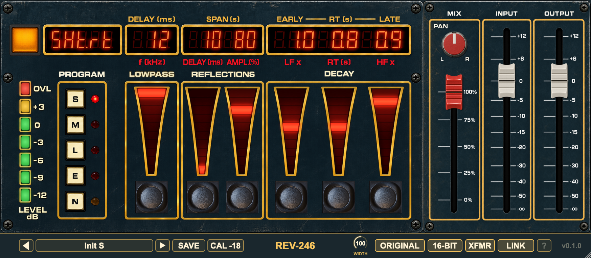

# REV-246


[](https://opensource.org/license/agpl-v3)
[](https://somsubhra.github.io/github-release-stats/?username=tehguitarist&repository=REV-246&page=1&per_page=30)



REV-246 is a free, open-source reverb plugin (AU, VST3 and standalone) inspired by the classic and relatively rare
EMT 246 digital reverb, with the EMT 250 algorithm included as a programme of its own. It is just the reverb half of
the hardware: there is no delay or echo section.

It was built by comparing impulse responses from three separate units, and it has two switches that move it between a
clean, modern reading and a period one: **16-bit** processing, which reproduces the original's quantisation, and an
optional **transformer** stage, the factory option the real unit could be ordered with. Switch both off for a cleaner
sound, or on for the more period-accurate one.

The original's remote joysticks are kept, made a little friendlier for a mouse, and the mix, input and output levels
borrow the look of the unit's optional fader pack.

> REV-246 is an independent project. It is not affiliated with or endorsed by EMT or any other manufacturer.

**Status:** pre-release. The panel, presets, installers and plugin plumbing are in place; the reverb engine is still
being finalised, so there is no download yet. When there is, the latest one will be here:
**[Download the latest release](https://github.com/tehguitarist/REV-246/releases/latest)**.

## Features

- **Five programmes:** **S** (short, 0.2–2.5 s), **M** (medium, 0.5–5 s), **L** (long, 2–20 s), **E** (the EMT 250
  algorithm) and **N** (the non-linear programme).
- **Six joysticks** for the reverb's parameters: low-pass, reflections delay and amplitude, and the decay's low-
  frequency multiplier, reverberation time and high-frequency multiplier. They step through the same kinds of values as
  the hardware, and the readouts above them show the value for the programme you are in.
- **Mix, input and output faders** with a PAN control for the dry signal, and an optional LINK to move input and output
  together.
- **Level meter** with an overload light and a calibration button for the reference level.
- **16-bit mode:** quantises the reverb's internal storage to 16 bits, as the original did, for its faint, signal-
  dependent noise floor and grit in the decays, and clips the input where the original's A/D converter did. Set it to
  FLOAT for full precision.
- **XFMR:** adds the weight in the low end and the gentle low-frequency harmonic distortion of a unit
  fitted with the optional input and output transformers. Off, the sound is that of the standard unit.
- **Factory and user presets**, with a bypass (power) button.
- **Mono in / mono out, mono in / stereo out and stereo in / stereo out.** Like the hardware, the reverb has one mono
  input and two outputs. With a stereo input it can sum to mono first (**ORIGINAL**, the default) or run a reverb per
  channel (**TRUE ST**).

## Install

Download the installer for your system from the [latest release](https://github.com/tehguitarist/REV-246/releases/latest):

| System | Installer | Formats |
|---|---|---|
| macOS | `.pkg` | AU, VST3 |
| Windows | `.exe` | VST3 |
| Linux | `.deb` | VST3 |

Then rescan plugins in your DAW. Logic caches Audio Units, so if REV-246 does not show up, restart Logic or run
`auval -v aufx Rv24 Lprc`.

## Using it

**Pick a programme** (S, M, L, E or N) and set the six joysticks. Each joystick is the original's lever: press the
upper half of the round button to step the value up and the lower half to step it down. Hold it to repeat; after a
second it speeds up. For convenience you can also drag or click the wedge above it, use the mouse wheel for one step per
notch, and Cmd/Alt-click to return to the default.

| Control | What it does |
|---|---|
| **LOWPASS** (f, kHz) | Low-pass filter on the reverb, 2 to 12 kHz |
| **REFLECTIONS** (DELAY, AMPL.) | Delay before the early reflections, 0 to 999 ms, and their level, 0 to 100 % |
| **DECAY** (LF ×, RT, HF ×) | Reverberation time in seconds, with multipliers for how much faster or slower the low and high frequencies decay |
| **MIX** | Wet/dry balance. PAN places the dry signal |
| **INPUT / OUTPUT** | Levels, with LINK to move them together |

In the non-linear programme (N) the readouts change meaning to match the hardware's own labels (DELAY, SPAN, and early
and late RT). Hover over any control for a description.

The bottom bar holds the preset browser (previous, next, name, **SAVE**) and **CAL** for the meter reference on the
left, then the routing and accuracy buttons (**ORIGINAL / TRUE ST**, **FLOAT / 16-BIT**, **XFMR**), **LINK** and
**?** on the right. A changed preset's name turns italic with a `*`. Saving under an existing user-preset name asks
before replacing it; factory names are read-only. ORIGINAL / TRUE ST, XFMR and LINK are preferences, so presets
neither store nor change them.

## Accuracy options

<!-- TODO: the FLOAT / 16-BIT button and parameter exist, but the placeholder engine has no loops to quantise yet;
     the real algorithm applies the setting when it lands. -->

Both options are off or on independently, and both only change the reverb path.

**16-bit.** The original stored the intermediate results in its reverb loops as 16-bit words, and truncating them at
that depth costs a little noise and grit: its service data put the reverb around 15 dB noisier than the unit's own
straight-through path. With **16-BIT** selected, REV-246 will quantise its loops the same way (the placeholder engine
has no loops yet). Leave it on **FLOAT** for a cleaner tail.

In 16-bit mode the input also clips where the original's A/D converter did. That converter left only 6 dB of headroom
above the 0 mark on its meter, and it clipped hard: past full scale it simply holds the last code. Its input filter
lifts the treble by up to 5 dB first, so cymbals and sibilance clip sooner than the meter suggests. And because it
clipped at its own sample rate of 26.4 kHz, the clipping comes out as inharmonic grit rather than plain harmonics.
Where it clips follows **CAL**: CAL sets what 0 VU means in dBFS, and the converter clips 6 dB above that for a low
sine (at the default -18 dBFS, that's a sine peaking at -9 dBFS). **OVL** lights whenever the converter clips, and in
FLOAT mode it lights where it would have clipped.

**XFMR.** The original could be ordered with balanced input and output transformers, which the manual says raise the
harmonic distortion slightly. With this option on, the wet path gains the low-frequency colour and gentle odd-
harmonic distortion of that option. The low-frequency colour comes from measurement; the distortion is an informed
estimate, since measurements of a unit's response cannot show it.

## A/B comparison

<!-- TODO: add before the first release. Audio samples to be supplied by the author; the IR sources stay unnamed.
     One row per example, each with a plugin render and the matching reference. -->

*Audio examples comparing REV-246 with the reference impulse responses will go here.*

| Example | Settings | REV-246 | Reference |
|---|---|---|---|
| *to come* | | | |

## Build

You need CMake 3.15 or newer and a C++17 compiler (Xcode on macOS, Visual Studio 2022 on Windows, GCC or Clang on
Linux). JUCE is a git submodule.

```bash
git clone --recurse-submodules https://github.com/tehguitarist/REV-246.git
cd REV-246
cmake -S plugin -B plugin/build -DCMAKE_BUILD_TYPE=Release -DRV_STANDALONE=ON
cmake --build plugin/build --config Release --parallel 3
```

The plugins land in `plugin/build/REV246_artefacts/Release/{AU,VST3,Standalone}` (AU on macOS only). Add
`-DRV_BUILD_TESTS=ON` and run `ctest --test-dir plugin/build -C Release` to build and run the tests.

Development rules (cross-platform code, assets, CI) and the source layout are in
[docs/DEVELOPMENT.md](docs/DEVELOPMENT.md). The plugin is one half of this repository: the other half, in `docs/` and
`tools/` at the top level, is the research behind the reverb.

## Licence

REV-246 is free software under the [GNU AGPLv3](../LICENSE). It uses [JUCE](https://juce.com) under its AGPLv3 option,
and the notices for it and the other third-party code are in [THIRD_PARTY_NOTICES.md](THIRD_PARTY_NOTICES.md).

## Credits

Built by Leigh Pierce, using [JUCE](https://juce.com/) for the plugin framework and interface.
